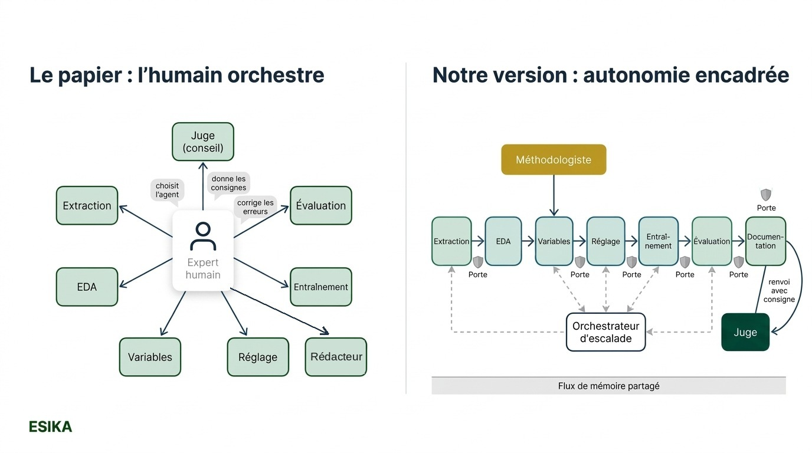
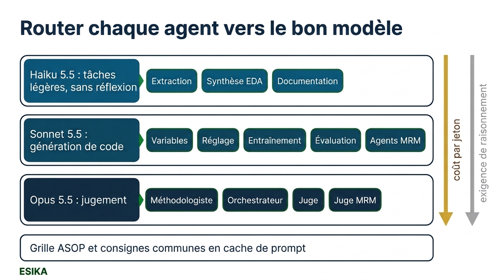
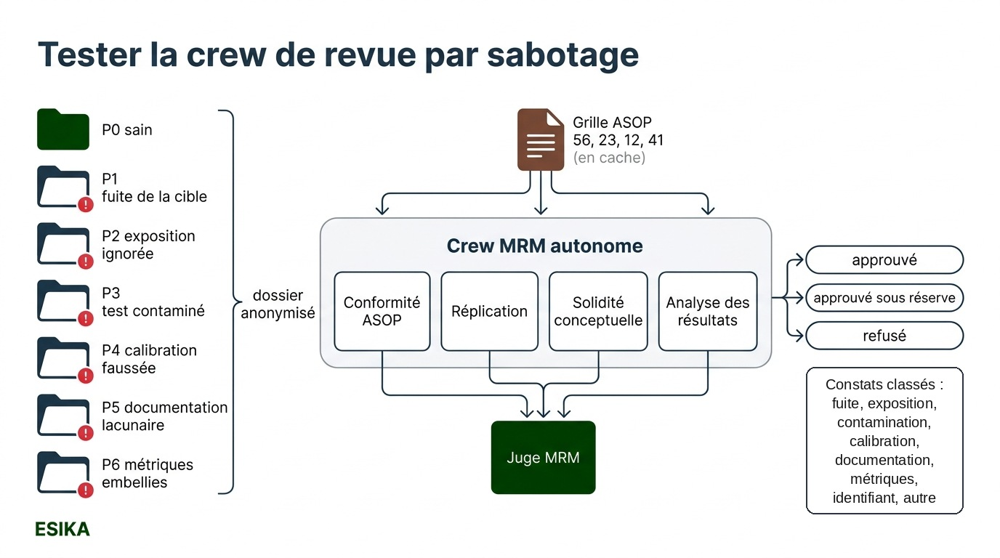
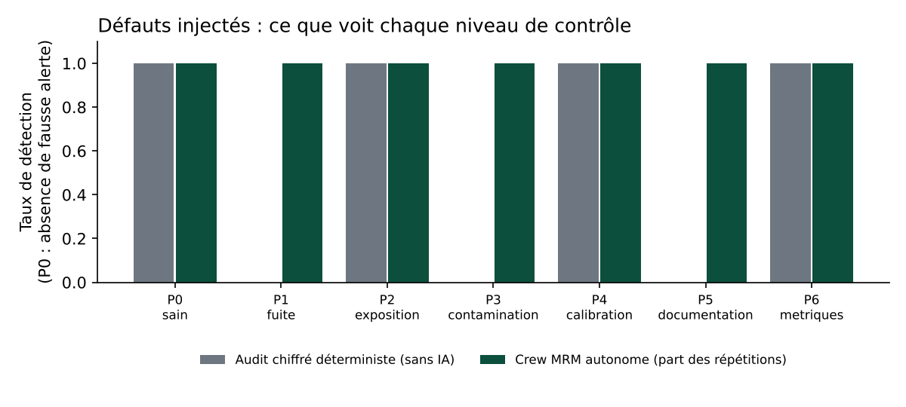
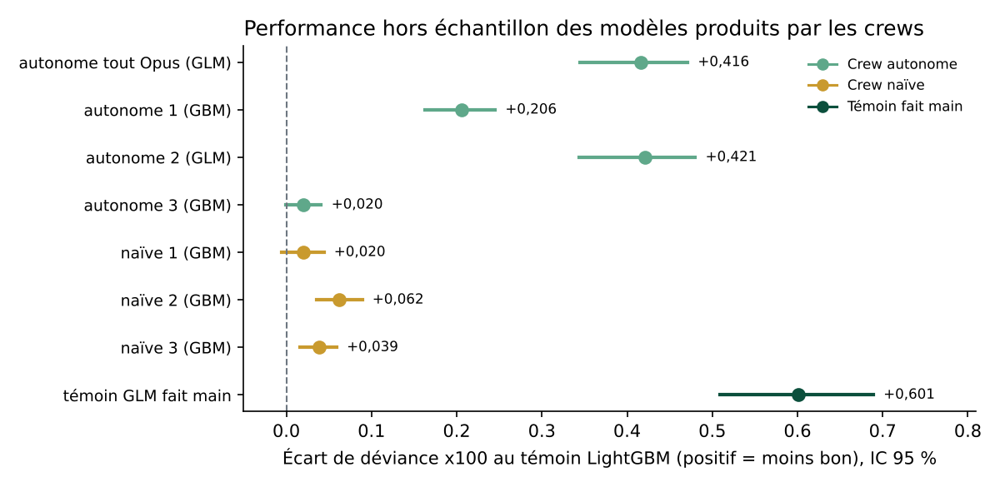
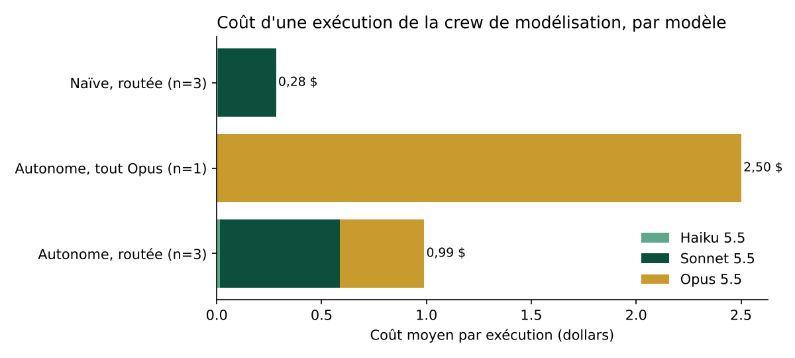

# Retirer l'humain de la boucle : des équipes d'agents IA pour construire et valider un tarif auto

*Un papier de Discover Financial Services montre des « crews » d'agents IA qui modélisent puis valident des modèles de crédit, sous la conduite d'un expert humain. Nous avons repris l'architecture, retiré l'humain, transposé le tout à la fréquence de sinistres en RC automobile et soumis la crew de validation à un test de sabotage fondé sur les normes actuarielles ASOP. Résultat : la crew de revue a refusé les dossiers piégés dans 12 revues sur 12 (6 dossiers, revus deux fois) sans refuser le dossier sain, pour environ 0,40 $ par revue. Elle a aussi refusé 2 revues sur 8 de modèles sans défaut injecté, sur une question de jugement à la frontière où sa sévérité varie d'une revue à l'autre. Quant à l'échafaudage d'autonomie, il n'a pas amélioré la performance des modèles : il a surtout produit de la traçabilité et un biais assumé vers les GLM, sans empêcher l'approbation d'une documentation tronquée.*



## 1. Le goulet de la validation des modèles

Dans une compagnie d'assurance ou une banque, construire un modèle n'est que la moitié du travail. L'autre moitié, souvent plus longue, est sa validation : vérifier les données, répliquer les résultats, juger la solidité conceptuelle, tester le comportement sous stress, contrôler la documentation. C'est le rôle de la fonction de gestion du risque de modèle (Model Risk Management, MRM), ou de la fonction actuarielle sous Solvabilité II.

Cette validation est un goulet d'étranglement : elle mobilise des profils rares, elle arrive tard dans le cycle, et elle repose sur des listes de contrôle que personne n'a le temps d'appliquer exhaustivement. D'où la question posée par le papier que nous étudions : une équipe d'agents IA peut-elle prendre en charge une partie de ce travail ? Et nous ajoutons la nôtre : peut-elle le faire **sans humain dans la boucle**, avec des garde-fous qui remplacent le jugement humain plutôt que de le supposer ?

## 2. Ce que propose le papier

Izunna Okpala, Ashkan Golgoon et Arjun Ravi Kannan (Emerging Capabilities Research Group, Discover Financial Services) ont publié en février 2025, révisé en avril 2025, « Agentic AI Systems Applied to Tasks in Financial Services: Modeling and Model Risk Management Crews » (arXiv 2502.05439). Leur idée : confier le cycle de vie d'un modèle à deux équipes d'agents IA, appelées « crews ».

- La **crew de modélisation** reproduit une équipe data classique : un analyste extrait et découpe les données, un data scientist fait l'analyse exploratoire, un data scientist senior construit la préparation des variables, des ingénieurs machine learning choisissent le modèle, l'entraînent et l'évaluent, un rédacteur documente, et un « juge » (un manager) examine le tout.
- La **crew de gestion du risque de modèle (MRM)** reproduit une équipe de validation : conformité de la documentation à un guide interne, réplication du modèle, solidité conceptuelle, analyse des résultats sous stress, rédaction, et un juge.

Le tout est implémenté avec le cadre CrewAI, sur trois jeux Kaggle (fraude à la carte, octroi de carte, risque de crédit), avec Llama 3, GPT-3.5 Turbo et DeepSeek-R1 (ce dernier notamment pour le juge, choisi pour ses capacités de raisonnement, pour le rédacteur et pour le contrôle de conformité documentaire). Sur le risque de crédit, le modèle choisi par les agents (XGBoost) atteint une accuracy de 93,4 %, proche de la meilleure solution Kaggle, et la crew MRM met en évidence la fragilité du modèle face à des données décalées.

Le point décisif est ailleurs : **un expert humain orchestre tout**. Dans les journaux d'exécution publiés en annexe, c'est l'humain qui choisit l'agent à chaque étape, qui dicte la préparation des variables (imputation KNN, standardisation, encodage ordinal, sélection SelectKBest), qui rappelle à l'agent de réplication d'importer joblib après une erreur, et qui signale à l'agent de stress test qu'il a oublié d'appeler la fonction predict. Les auteurs l'assument : ils estiment qu'il reste une chance de 1 à 10 % que la sortie ne soit pas conforme aux attentes, et recommandent pour cette raison que l'humain soit l'orchestrateur plutôt qu'un agent.

## 3. Anatomie d'un agent, anatomie d'une équipe

> **Encadré : qu'est-ce qu'un agent ?** Un agent est un modèle de langage (LLM) auquel on donne un rôle, un objectif, des outils et une mémoire, et qu'on fait travailler en boucle : il raisonne, agit avec un outil (par exemple exécuter du code), lit le résultat, corrige. Le papier décrit quatre composants : le **cœur** (le LLM, son rôle et ses objectifs), la **mémoire** (courte pour la tâche en cours, longue pour les échanges passés), les **outils** (exécution de code, recherche documentaire, API) et la **planification** (découper une tâche, critiquer son propre résultat).

Dans CrewAI, ces composants deviennent : le jeu de rôle (une identité et une histoire qui orientent le comportement), la focalisation (une tâche précise avec un résultat attendu), les outils, la coopération (partage d'informations, délégation), les garde-fous et la mémoire.

Les agents peuvent collaborer selon trois structures :
- **horizontale** : des pairs sans hiérarchie qui coopèrent ou débattent ;
- **hiérarchique** : un chef qui distribue le travail à des exécutants ;
- **imbriquée** : un mélange des deux, par exemple une équipe hiérarchique dont un membre est lui-même un petit collectif de pairs.

Les deux crews du papier sont hiérarchiques, avec l'humain au sommet et un juge LLM en conseiller. La mémoire y est un **flux partagé** : chaque agent y dépose ses entrées, son code et ses sorties horodatés, et l'agent suivant y puise son contexte. C'est l'équivalent numérique du dossier de travail qu'une équipe se passe de main en main.

> **Encadré : Cache-Augmented Generation (CAG).** Le CAG consiste à charger entièrement un document de référence dans le contexte du modèle et à le réutiliser, au lieu de le découper en morceaux à rechercher (le RAG classique). Le papier l'emploie pour vérifier une documentation contre un guide de modélisation. Avec le cache de prompt des API récentes, un préfixe commun est écrit une fois dans le cache (à 1,25 fois le prix d'entrée), puis relu à un prix très réduit (un vingtième du prix d'entrée pour Sonnet et Opus 5.5). Le cache est propre à chaque modèle et à chaque préfixe : en pratique, chaque agent l'écrit une fois par exécution et le relit lors de ses appels suivants.

## 4. Les deux crews, agent par agent (version Esika)

Nous avons réimplémenté les deux crews en Python, sans CrewAI : un mini-cadre d'environ 200 lignes (agent, tâche, flux de mémoire, exécuteur de code) suffit et permet de tout tracer. Chaque agent a un rôle, un objectif, un profil, et un **niveau** qui détermine le modèle Claude utilisé.

| Étape | Agent (persona) | Ce qu'il produit | Modèle |
|---|---|---|---|
| Extraction | analyste de données | découpage 80/20 imposé, échantillon de 40 % pour le réglage | Haiku 5.5 |
| EDA | data scientist | synthèse des anomalies à partir d'un outil EDA déterministe | Haiku 5.5 |
| Méthodologie | actuaire senior en tarification | spécification JSON : traitements, variables, exposition, candidats, critère | Opus 5.5 |
| Variables | data scientist senior | `features.py` : fonction `prepare(df)` sans état appris | Sonnet 5.5 |
| Réglage | ingénieur ML senior | sélection du modèle par validation croisée, `tuning.json` | Sonnet 5.5 |
| Entraînement | ingénieur ML senior | modèle final et `predict.py` (nombre attendu de sinistres) | Sonnet 5.5 |
| Évaluation | ingénieur ML senior | `eval.json` : déviance de Poisson, Gini, A/E par décile | Sonnet 5.5 |
| Documentation | rédacteur technique actuariel | documentation structurée selon la grille ASOP | Haiku 5.5 |
| Juge | responsable de la modélisation | verdict, renvoi de tâches avec consignes | Opus 5.5 |
| Escalade | orchestrateur | décision quand une tâche échoue après 3 tentatives | Opus 5.5 |

La crew MRM reprend la structure du papier : contrôle de conformité documentaire (grille ASOP chargée en cache), réplication indépendante, solidité conceptuelle, analyse des résultats et tests de résistance (quatre agents sous Sonnet 5.5), puis un juge MRM sous Opus 5.5 qui rend une décision (approuvé, approuvé sous réserve, refusé) et classe chaque constat dans une taxonomie fermée (fuite de la cible, exposition, contamination du test, calibration, documentation, métriques inexactes, identifiant, autre).

Le contrat imposé aux agents est le cœur du dispositif. Tout modèle livré est un dossier qui contient `features.py`, `predict.py`, le modèle sérialisé, la documentation et les métriques annoncées. `predict(df)` doit renvoyer le **nombre attendu de sinistres** de chaque police sur sa période d'exposition, sur un tableau qui ne contient pas la cible. Ce contrat rend tout livrable auditable par un programme, sans lire le code.

## 5. Ce que faisait vraiment l'humain, et comment le remplacer

Relire les journaux d'exécution du papier ligne à ligne est instructif. L'expert humain y joue quatre rôles distincts, et chacun appelle un mécanisme de remplacement différent.

| Rôle de l'humain dans le papier | Exemple tiré des journaux | Mécanisme de remplacement |
|---|---|---|
| Ordonnancer : choisir l'agent suivant | menu de sélection de l'agent à chaque itération | graphe de tâches fixe (extraction, EDA, méthodologie, variables, réglage, entraînement, évaluation, documentation) |
| Donner les consignes techniques | imputation KNN, standardisation, encodage ordinal, SelectKBest | **agent méthodologiste** (Opus) qui écrit une spécification JSON à partir de l'EDA et de la grille ASOP |
| Débloquer une erreur | rappel d'importer joblib après une erreur XGBoost | **boucle d'auto-correction** (la trace d'erreur est renvoyée à l'agent, 3 tentatives) puis **orchestrateur d'escalade** (Opus) |
| Contrôler le résultat | signalement d'un appel oublié à predict | **portes de qualité déterministes** puis **juge** (Opus) qui renvoie des tâches avec consignes |

> **Encadré : porte de qualité.** Une porte est un contrôle écrit en Python, sans IA, qui vérifie une propriété que tout livrable doit respecter. Si elle échoue, le message est renvoyé à l'agent fautif, qui corrige. Une porte ne dit jamais comment faire, seulement quelle propriété est violée. Nos portes vérifient notamment : le jeu de test correspond-il exactement au découpage imposé (empreinte SHA-256 des identifiants) ? `prepare(df)` fonctionne-t-il sans la colonne cible ? Les prédictions changent-elles si l'on permute l'identifiant de police ? Doubler l'exposition double-t-il le nombre attendu de sinistres ? Le modèle est-il équilibré sur l'apprentissage ? Les métriques annoncées correspondent-elles à un recalcul indépendant ? La documentation contient-elle les sections exigées et dépasse-t-elle 2 500 caractères ?

Voici, en simplifié, la porte la plus utile en assurance non vie : elle attrape l'oubli de l'exposition sans lire une ligne du code de l'agent.

```python
m = X["Exposure"] <= 0.5
Xe = X[m].copy()
Xe["Exposure"] *= 2
ratio = predict(Xe) / predict(X)[m]
assert abs(np.median(ratio) - 2) < 1e-3, "predict ne renvoie pas fréquence x exposition"
```

Le juge, lui, reçoit un dossier de preuves : la spécification, le code des agents, la documentation et le résultat d'un audit déterministe indépendant. Il rend un verdict structuré par un schéma JSON (approuvé ou à reprendre, avec pour chaque point la gravité, la tâche visée, le constat et la consigne). Une reprise relance la première tâche visée puis toutes les tâches suivantes du graphe, dans l'ordre ; nous avons limité le dispositif à **une seule reprise** pour borner le coût.

Le papier comptait sur une température basse (0,2) pour limiter les dérives. Ce levier n'était plus disponible dans notre configuration (SDK Python 2.6, modèles Claude 5.5) : l'API a refusé ce paramètre et propose à la place un niveau d'effort (de « low » à « max ») et des sorties JSON contraintes par un schéma. Ce changement va dans le sens de notre approche : la fiabilité ne se règle plus dans l'échantillonnage du modèle, elle se construit autour de lui, par des contrôles.

## 6. Routage multi-modèles et coût



Tous les agents n'ont pas besoin du même modèle. Extraire un fichier ou mettre en forme une documentation est une tâche légère : Haiku 5.5, sans réflexion interne, à 0,10 $ par million de jetons en entrée. Écrire et corriger du code de modélisation demande un bon modèle de code : Sonnet 5.5 (2 $ en entrée, 10 $ en sortie). Les décisions de jugement (spécification, escalade, verdicts) vont à Opus 5.5 (4 $ et 20 $). La grille ASOP et les consignes communes sont placées en tête de prompt, dans le cache.

Pour mesurer ce que rapporte le routage, nous avons fait tourner une exécution témoin où **tous** les agents passent par Opus 5.5. Le résultat est en section 9.3 ; il réserve une surprise qui dépasse la question du prix.

## 7. Transposition à la tarification non vie

Les cas d'usage du papier sont des classifications binaires évaluées notamment à l'accuracy, une métrique trompeuse quand 99,83 % des transactions sont légitimes. En assurance non vie, le problème canonique est la **fréquence de sinistres** : un nombre de sinistres observé sur une durée d'exposition variable, modélisé par une loi de Poisson.

> **Encadré : exposition et offset.** Une police observée 3 mois a, toutes choses égales, quatre fois moins de chances de sinistre qu'une police observée un an. Le modèle prédit une fréquence annuelle λ(x) et un nombre attendu λ(x) × exposition. Dans un GLM de Poisson, on ajoute log(exposition) au prédicteur linéaire avec un coefficient fixé à 1 : c'est l'« offset ». De façon équivalente, on modélise y / exposition avec un poids égal à l'exposition. Oublier l'exposition est l'erreur la plus classique, et elle est silencieuse.

> **Encadré : déviance de Poisson, Gini et A/E.** La déviance de Poisson mesure l'écart entre sinistres observés et attendus en respectant la nature de comptage des données (plus bas = meilleur ; nous la donnons multipliée par 100). Le Gini ordonné mesure la capacité du modèle à classer les risques : on trie les polices de la moins risquée à la plus risquée selon le modèle et on regarde comment les sinistres se concentrent dans l'exposition jugée la plus risquée. Le rapport A/E (observé / attendu) vérifie la calibration, globalement et par décile de risque prédit.

Le jeu de données est **freMTPL2freq** : 677 991 contrats de responsabilité civile automobile français, 358 000 années-exposition et 26 444 sinistres (fréquence de 7,4 %), dans la version de la bibliothèque R CASdatasets, aussi diffusée sur Kaggle. C'est le jeu de l'étude de cas de Noll, Salzmann et Wüthrich (2018) et de nombreux cours de tarification ; d'autres diffusions, dont celle de l'étude de cas, comptent 678 013 lignes. Il contient des pièges connus : 1 224 polices ont une exposition supérieure à un an, quelques polices déclarent jusqu'à 16 sinistres, et l'identifiant de police est corrélé à la fréquence (artefact de constitution du fichier : la fréquence observée passe de 8,9 % dans le premier décile d'identifiants à 6,4 % dans le dernier). Un modèle qui utiliserait l'identifiant pourrait en tirer un gain apparent, pour de mauvaises raisons (hypothèse que nous n'avons pas testée).

### La grille ASOP

Pour la crew MRM et pour la documentation, nous avons remplacé le guide interne du papier (généré par IA, de l'aveu des auteurs) par une grille de 26 points tirée des normes de pratique actuarielle (Actuarial Standards of Practice) de l'Actuarial Standards Board américain :

- **ASOP 56, Modélisation** : objet du modèle, adéquation de la structure, hypothèses, compréhension des limites, réduction du risque de modèle (tests, validation hors échantillon, revue par un pair, gouvernance), documentation ;
- **ASOP 23, Qualité des données** : choix, revue et usage des données, déclaration des limites ;
- **ASOP 12, Classification des risques** : lien des variables avec la sinistralité, objectivité, crédibilité des classes, caractère raisonnable des relativités, contraintes légales ;
- **ASOP 41, Communications actuarielles** : une documentation qui permet à un autre actuaire de juger du travail, chiffres exacts et reproductibles, limites d'usage.

Les ASOP sont publiées par l'ASB et s'appliquent aux membres des associations actuarielles américaines (dont la SOA et la CAS) lorsqu'ils exercent aux États-Unis. Notre grille paraphrase les exigences et cite les sections d'origine (le texte officiel n'est pas reproduit) ; elle est placée en tête du prompt de chaque agent qui en a besoin, et mise en cache. Nous y avons ajouté un point propre à la fréquence : le traitement correct de l'exposition.

## 8. Protocole expérimental

Toutes les métriques citées ci-dessous sont **recalculées par un programme indépendant** des agents, à partir de leur `predict.py`, sur le même jeu de test (20 % des polices, découpage imposé par une graine fixe). Aucun chiffre annoncé par un agent n'est repris sans vérification.

**Expérience 1 : la crew MRM face au sabotage.** Nous avons construit, sans IA, sept dossiers de modèle à partir d'un GLM de Poisson fait main. Le premier est sain ; chacun des six autres contient un seul défaut connu :



| Dossier | Défaut injecté | Ce que le défaut produit |
|---|---|---|
| P0 | aucun | déviance 24,29, A/E 1,016 |
| P1 | variable « indicateur de dossier client actif » construite à partir de la cible | déviance 16,56 : beaucoup trop belle |
| P2 | exposition ignorée (modèle ajusté sur le nombre brut de sinistres) | A/E global 1,015 mais écart de 75 % sur un décile |
| P3 | LightGBM entraîné sur apprentissage + test, documentation qui affirme le contraire | déviance de test 23,19 au lieu de 23,68 honnêtement |
| P4 | prédictions multipliées par 0,85 (« ajustement de tendance » non documenté) | A/E 1,195 |
| P5 | modèle correct, documentation de quatre lignes | aucun effet chiffré |
| P6 | modèle correct, métriques annoncées embellies | déviance annoncée 23,09 au lieu de 24,29, Gini 0,342 au lieu de 0,282 |

La crew MRM reçoit chaque dossier sous un nom neutre, sans savoir s'il est piégé. Chaque dossier est revu **deux fois** (14 revues ; pour P2, la première revue est le pilote, lancé avec le code final). Nous comparons à ce que détecte l'audit chiffré déterministe de nos portes (exposition, calibration, métriques annoncées, identifiant) ; la porte documentaire est discutée à part.

Nous comptons un défaut comme **détecté** quand sa catégorie figure parmi les constats bloquants et que le dossier est refusé. Sur le dossier sain, nous comptons une **fausse alerte** en cas de refus ou de constat bloquant. Ce second critère a été fixé après la première revue du dossier sain. Notre définition initiale comptait aussi les constats « importants » dans les catégories de fond ; mais tous ceux émis sur P0 se sont révélés exacts à la vérification (section 9.1). Avec la définition initiale, les deux revues du dossier sain compteraient comme des fausses alertes.

**Expérience 2 : la crew de modélisation sans humain.** Trois variantes :
- **autonome, routée** (méthodologiste, portes, escalade, juge ; Haiku, Sonnet et Opus selon les tâches) : 3 exécutions ;
- **naïve, routée** (les mêmes agents, sans méthodologiste, sans portes ni juge, mais avec le contrat de livrable, le graphe de tâches, l'outil EDA et la boucle d'auto-correction) : 3 exécutions ;
- **autonome, tout Opus** (témoin de coût) : 1 exécution.

Chaque modèle livré est comparé à deux **témoins forts faits main** : un GLM de Poisson actuariel à la Noll, Salzmann et Wüthrich (classes d'âge, plafonds, logarithme de la densité, offset) et un LightGBM Poisson avec arrêt anticipé (un modèle de gradient boosting, ou GBM : une somme d'arbres de décision, chacun ajusté sur les erreurs des précédents). Les écarts de déviance sont estimés par bootstrap apparié.

> **Encadré : bootstrap apparié.** On tire au hasard, avec remise, 300 jeux de test de même taille. Pour chacun, on calcule la déviance des deux modèles sur les mêmes polices et on retient l'écart. La dispersion de ces 300 écarts donne l'intervalle de confiance. Apparier les tirages neutralise la part de l'aléa commune aux deux modèles. Ce bootstrap ne couvre que l'aléa du jeu de test, pas celui de l'entraînement.

**Expérience 3 : la chaîne complète.** La crew MRM revoit quatre modèles produits par les crews de modélisation ; les deux livrables refusés à la première revue sont revus une seconde fois pour mesurer la stabilité du verdict.

Le budget d'API était plafonné à 20 $, avec une garde dans le code qui arrête tout avant dépassement. L'ensemble des expériences a coûté 16,27 $ pour 206 appels, dont 0,86 $ de pilotes de la crew de modélisation et d'une exécution interrompue par un incident technique, exclus des analyses. C'est la principale contrainte du protocole : quelques répétitions seulement, là où nos articles reposent d'ordinaire sur des centaines de simulations. Nous en tirons les conséquences dans les conclusions.

## 9. Résultats

### 9.1 La crew MRM détecte tous les défauts injectés

| Dossier | Revue A | Revue B | Audit chiffré déterministe |
|---|---|---|---|
| P0 sain | approuvé sous réserve | approuvé sous réserve | aucune alerte |
| P1 fuite de la cible | **refusé**, fuite bloquante | **refusé**, fuite bloquante | non détecté |
| P2 exposition ignorée | **refusé**, exposition bloquante | **refusé**, exposition bloquante | détecté |
| P3 test contaminé | **refusé**, contamination bloquante | **refusé**, contamination bloquante | non détecté |
| P4 calibration faussée | **refusé**, calibration bloquante | **refusé**, calibration bloquante | détecté |
| P5 documentation lacunaire | **refusé**, documentation bloquante | **refusé**, documentation bloquante | non détecté (voir texte) |
| P6 métriques embellies | **refusé**, métriques bloquantes | **refusé**, métriques bloquantes | détecté |

Sur les 12 revues de dossiers piégés (6 dossiers revus deux fois), la crew MRM a **12 fois** classé le défaut injecté comme bloquant et refusé le dossier ; l'intervalle de confiance de Clopper-Pearson à 95 % va de 73,5 % à 100 %. Sur les deux revues du dossier sain, elle n'a ni refusé ni émis de constat bloquant : 0 sur 2, avec un intervalle de 0 à 84 % qui rappelle que deux revues ne prouvent pas grand-chose. Dans certains dossiers piégés, d'autres catégories sont aussi classées bloquantes (la calibration pour la fuite et pour l'exposition ignorée, les métriques inexactes pour le test contaminé) : ce sont des conséquences directes du défaut injecté.

L'audit chiffré déterministe attrape 3 types de défauts sur 6 : ceux qui se voient dans les nombres (exposition, calibration, métriques). Ajouter la porte documentaire de nos crews ne suffit pas à trancher : avec son seuil de 2 500 caractères, elle refuse les sept dossiers, y compris le sain (2 090 caractères) ; réduite à la seule présence des sections, elle attraperait P5 sans fausse alerte. Le test contaminé serait lui aussi détectable sans IA, en comparant l'empreinte de la base d'entraînement à celle de l'apprentissage. L'écart entre la crew et les contrôles automatiques dépend donc en partie du choix de ces contrôles. Ce qui reste propre à la crew, c'est de repérer une variable suspecte, de la tester et de remonter au script fautif.



Les preuves avancées par le juge MRM sont chiffrées. Sur le dossier à fuite, la crew observe que la modalité suspecte concentre 60 % des sinistres pour 5,7 % de l'exposition, avec une fréquence environ 25 fois plus élevée, puis réentraîne le modèle sans elle : la déviance remonte de 16,56 à 24,29. Sur le dossier contaminé, l'agent de réplication réentraîne le même LightGBM sur la seule base d'apprentissage, obtient une déviance de test de 23,68 au lieu des 23,19 annoncés, et remonte au script d'entraînement : la base de modélisation compte 677 991 lignes, soit exactement l'apprentissage (542 392) plus le test (135 599).

**Le résultat le plus instructif concerne le dossier sain.** La crew ne l'a pas approuvé sans réserve : dans les deux revues, elle a émis des constats « importants ». Nous les avons tous vérifiés, et ils sont exacts. Notre GLM fait main sous-estime les conducteurs de 18 à 20 ans (A/E de 1,268 sur 132 sinistres), sous-prédit les déciles 7 et 8 (A/E de 1,12), et l'hypothèse de proportionnalité à l'exposition est contredite par les données (A/E de 1,56 pour les polices de moins de 3 mois contre 0,88 pour celles de plus de 9 mois, un phénomène connu sur ce jeu). Notre « témoin sain » n'était pas parfait, et la crew l'a vu. Dans l'expérience de sabotage, le refus et le classement « bloquant » n'ont été utilisés que sur les dossiers piégés ; la section 9.4 montre que ce n'est plus vrai sur les modèles produits par les crews.

Une revue complète coûte en moyenne **0,40 $** et prend de 3,3 à 4,7 minutes. Le juge MRM (Opus) représente 44 % de ce coût.

### 9.2 La crew de modélisation : autonome, mais pas meilleure

Les sept exécutions ont toutes livré un modèle **valide** au sens de notre audit indépendant : aucun n'utilise l'identifiant de police, tous traitent correctement l'exposition, tous sont équilibrés sur l'apprentissage (A/E entre 0,994 et 1,006), et toutes les métriques annoncées par les agents sont exactes.



| Exécution | Modèle retenu | Déviance x100 | Gini | Écart au témoin LightGBM, positif = moins bon (IC 95 %) | Verdict final du juge | Coût |
|---|---|---|---|---|---|---|
| naïve 1 | LightGBM | 23,70 | 0,332 | +0,020 [-0,005 ; 0,044] | sans juge | 0,26 $ |
| naïve 2 | LightGBM | 23,75 | 0,327 | +0,062 [0,036 ; 0,089] | sans juge | 0,32 $ |
| naïve 3 | LightGBM | 23,72 | 0,329 | +0,039 [0,016 ; 0,059] | sans juge | 0,28 $ |
| autonome 1 | LightGBM | 23,89 | 0,320 | +0,206 [0,163 ; 0,245] | à reprendre | 1,19 $ |
| autonome 2 | GLM | 24,11 | 0,299 | +0,421 [0,344 ; 0,480] | à reprendre | 0,82 $ |
| autonome 3 | LightGBM | 23,70 | 0,331 | +0,020 [-0,001 ; 0,041] | approuvé | 0,96 $ |
| autonome tout Opus | GLM | 24,10 | 0,301 | +0,416 [0,345 ; 0,471] | approuvé, sur une documentation tronquée | 2,50 $ |
| témoin LightGBM | LightGBM | 23,68 | 0,333 | référence | | |
| témoin GLM | GLM | 24,29 | 0,282 | +0,601 [0,509 ; 0,689] | | |
| modèle nul | fréquence moyenne | 25,40 | 0,000 | | | |

Trois constats, dont deux contredisent notre intuition de départ.

**Premier constat : la variante « naïve » fonctionne.** Sans méthodologiste, sans portes ni juge, des agents (Sonnet 5.5 pour le code, Haiku 5.5 pour l'intendance) livrent en 5 minutes et pour environ 0,28 $ en moyenne (de 0,26 à 0,32 $) un LightGBM Poisson à 0,02 à 0,06 point de déviance du témoin fait main par un actuaire, soit moins de 0,3 % en relatif. Ils respectent le contrat d'exposition, plafonnent les valeurs aberrantes, écartent l'identifiant. Ce n'est pas pour autant « le papier sans l'humain » : ces agents disposent du contrat de livrable, du graphe de tâches, de consignes qui donnent les formules des métriques et de la boucle d'auto-correction, soit une bonne part de ce que l'humain apportait implicitement. Sans porte, rien n'a vérifié leur documentation : celle de la première exécution naïve ne passerait pas notre porte documentaire (pas de section de méthodologie).

Les difficultés que l'humain corrigeait dans le papier (import oublié, appel oublié à `predict`) sont absorbées par la boucle d'auto-correction : tous les échecs d'exécution ont été corrigés par l'agent lui-même, **sans aucune escalade**. Dans les exécutions autonomes, les portes de code n'ont jamais refusé de livrable. Seule la porte documentaire a servi : elle a renvoyé **six fois** la documentation au rédacteur (deux fois dans trois des quatre exécutions). Ce refus n'était pas inscrit dans l'historique des tâches ; nous l'avons reconstitué à partir du journal des appels, après que la relecture de l'article l'a signalé.

**Deuxième constat : le méthodologiste a introduit un biais assumé vers le GLM.** Dans les quatre exécutions autonomes, la spécification écrite par l'actuaire virtuel contient une règle de parcimonie, par exemple « le GBM n'est retenu que si son gain relatif dépasse 1 % ». Deux fois sur quatre, le GLM l'a emporté, au prix d'environ 1,8 % de déviance par rapport au témoin LightGBM (tout en battant largement le GLM fait main). C'est un choix qu'un actuaire tarificateur peut défendre : un GLM se lit, ses relativités se vérifient et se communiquent. Mais c'est un choix, pas une optimisation, et il serait passé inaperçu sans la spécification écrite. Les écarts entre variantes ne sont pas testables avec trois exécutions par bras ; nous les décrivons, sans prétendre à la significativité.

**Troisième constat : le juge apporte de la gouvernance, pas de la performance.** Les quatre exécutions autonomes ont reçu un premier verdict « à reprendre ». Les points relevés sont réels et utiles : un modèle entraîné avec des paramètres différents de ceux validés en validation croisée (nous l'avons vérifié dans le code : un paramètre de lissage des catégories fixé par une valeur de repli que le réglage n'avait pas utilisée), des regroupements de modalités annoncés dans la documentation mais absents du code, une calibration non contrôlée par segment, une documentation laissée avec des renvois « à reporter ». Après une reprise, deux exécutions sur quatre sont approuvées ; les deux autres restent « à reprendre » avec des points de documentation et de cohérence. Le juge montre ainsi que la question « le modèle est-il bon ? » et la question « le dossier est-il propre ? » sont deux questions différentes.

Mais il n'est pas infaillible. Il a approuvé l'exécution tout Opus alors que sa documentation finale n'est qu'un fragment de 1 182 caractères, qui s'arrête au milieu du tableau de synthèse et ne passerait pas notre propre porte documentaire (section 9.3). Son verdict porte sur « la partie visible de la documentation ». Dans notre code, la version réécrite après un refus de la porte n'était pas recontrôlée, et le juge ne lit que les 6 000 premiers caractères de la documentation. Le juge est un bon relecteur de fond ; il ne remplace pas un contrôle mécanique appliqué à chaque version.

### 9.3 Le routage divise le coût, et pas seulement pour une question de prix



Une exécution autonome routée coûte en moyenne **0,99 $** (de 0,82 à 1,19 $) et prend 12,6 minutes. Opus y pèse 41 % du coût alors qu'il ne réalise que les jugements ; Haiku, qui fait l'extraction, la synthèse EDA et la documentation, pèse 1,4 %. L'unique exécution tout Opus (n = 1) a coûté **2,50 $**, soit 2,5 fois plus. L'extraction du fichier y a coûté 0,10 $, contre 0,0006 $ en moyenne en mode routé : environ 160 fois plus cher pour le même résultat.

La surprise est ailleurs. En mode tout Opus, l'agent rédacteur tourne avec un effort « high », une réflexion interne adaptative et le même plafond de 8 000 jetons de sortie par appel que dans le mode routé (où Haiku n'a pas de réflexion). Ses quatre appels (deux par passe, à cause des refus de la porte documentaire) ont tous atteint ce plafond, presque entièrement consommé par la réflexion : 30 770 jetons de réflexion au total, pour des textes de 1 568, 0, 0 puis 1 182 caractères. La documentation finale reste un fragment, que le juge a pourtant approuvé (section 9.2). L'épisode coûte à lui seul 0,89 $.

C'est un effet de configuration (réflexion activée, plafond de sortie inchangé), pas une propriété d'Opus : avec un plafond plus haut ou sans réflexion, le même modèle aurait très probablement rédigé le document. Hors rédacteur, le mode tout Opus reste environ 1,65 fois plus cher que le mode routé, sur une seule exécution et avec des chemins de reprise différents (le mode tout Opus n'a repris que la documentation). La leçon tient néanmoins : le bon modèle pour la bonne tâche, c'est aussi le bon niveau d'effort et le bon plafond de sortie.

### 9.4 La chaîne complète : la crew MRM revoit les modèles des crews

Dernière étape : soumettre à la crew MRM quatre modèles produits par les crews de modélisation, deux autonomes (dont un approuvé par le juge interne) et deux naïfs. C'est la chaîne complète, de la donnée brute à la décision de validation, sans aucun humain.

| Livrable | Verdict du juge de modélisation | Revue MRM A | Revue MRM B |
|---|---|---|---|
| autonome 3 (LightGBM) | approuvé | **refusé** (exposition bloquante) | approuvé sous réserve |
| autonome tout Opus (GLM) | approuvé | approuvé sous réserve | |
| naïve 1 (LightGBM) | sans juge | approuvé sous réserve | |
| naïve 2 (LightGBM) | sans juge | **refusé** (exposition bloquante) | approuvé sous réserve |

Deux livrables ont d'abord été refusés, pour le même motif : la non-proportionnalité empirique à l'exposition. La crew MRM a trié les polices par nombre attendu de sinistres et trouvé un A/E de 3,27 sur le premier décile, puis montré que les polices courtes sont fortement sous-estimées. Attention : ce décile n'est pas celui du tableau de la section 8, qui trie sur la fréquence prédite. Trier sur le nombre attendu revient en grande partie à trier sur l'exposition. Le premier décile ne contient que des polices de moins de 3 mois (médiane : environ deux semaines), alors que ces polices font 32,8 % du jeu de test ; d'où un A/E très élevé dès que la fréquence n'est pas proportionnelle à la durée. Le constat est exact. Mais nous avons vérifié qu'il est **structurel au jeu de données**, et non propre à ces modèles :

| Modèle | A/E, 1er décile du nombre attendu | A/E, exposition < 3 mois | A/E, exposition > 9 mois |
|---|---|---|---|
| témoin GLM fait main | 3,41 | 1,56 | 0,88 |
| témoin LightGBM fait main | 3,11 | 1,53 | 0,89 |
| les 7 modèles des crews | de 3,05 à 3,30 | de 1,52 à 1,54 | de 0,88 à 0,89 |

Tous les modèles, y compris nos témoins, partagent ce comportement : il vient des données (les contrats de courte durée ont une fréquence annualisée plus élevée dans freMTPL2freq), pas d'une erreur de modélisation. La plupart des études de référence sur ce jeu conservent pourtant l'offset, par convention.

Pour mesurer la stabilité du jugement, nous avons soumis une seconde fois les deux livrables refusés : les deux ont été « approuvés sous réserve », avec l'exposition classée « importante » ou « mineure ». Au total, sur les huit revues de modèles sans défaut injecté (le dossier sain et les livrables), l'exposition a été classée deux fois bloquante, quatre fois importante, deux fois mineure. La crew a donc refusé deux fois sur huit un modèle sans défaut injecté (intervalle de confiance à 95 % : 3 % à 65 %).

C'est le second résultat important de cet article, symétrique du premier. Sur des défauts nets, injectés, la crew MRM a classé **la même catégorie comme bloquante et pris la même décision** dans les deux répétitions de chaque dossier (les autres constats bloquants, eux, varient parfois). Sur une question de jugement à la frontière (une convention actuarielle discutable mais répandue), sa **gravité fluctue d'une revue à l'autre**, comme celle de deux validateurs humains qui n'auraient pas reçu de règle commune. Une autre cause possible tient à notre implémentation : le juge MRM ne reçoit que les 5 000 premiers caractères de la documentation (celles des crews en font de 10 100 à 12 400) et des extraits tronqués des travaux des autres agents, ce que plusieurs juges ont eux-mêmes signalé.

Dans le premier refus du livrable autonome, le juge MRM a aussi rejeté l'explication de l'équipe de modélisation, qui présentait l'écart comme un « artefact de tri ». L'explication était à moitié juste : le tri place bien les polices courtes en tête, mais l'écart traduit une vraie non-proportionnalité. Le livrable naïf 2 a d'ailleurs été refusé pour le même motif sans que cet argument ait été avancé.

Les deux niveaux de jugement n'ont pas non plus toujours concordé : le livrable « autonome 3 », approuvé par le juge interne de la crew de modélisation, a été refusé à la première revue MRM. Une revue indépendante n'est pas une formalité, même entre agents de la même famille.

Ces revues de livrables ont coûté entre 0,51 et 0,70 $ chacune et duré de 4 à 6 minutes.

## 10. Limites

- **Peu de répétitions.** Le budget plafonné à 20 $ limite chaque bras à quelques exécutions, et à une seule pour le mode tout Opus. Les comparaisons de performance au témoin reposent sur un bootstrap apparié, qui ne couvre que l'aléa du jeu de test ; les comparaisons entre variantes de crews sont descriptives, et les taux de la crew MRM ont des intervalles de confiance larges.
- **Un seul jeu de données, une seule famille de modèles.** freMTPL2freq est propre et célèbre : les modèles l'ont très probablement rencontré pendant leur entraînement (l'agent d'extraction, sous Opus, a d'ailleurs annoncé spontanément 678 013 lignes attendues, le nombre d'une autre diffusion du fichier, puis l'agent EDA a relevé l'écart de 22 lignes). Sur des données de portefeuille réelles, les agents disposeront de moins de repères.
- **Des défauts injectés un par un, et une taxonomie fournie au juge.** La liste fermée de catégories de constats aide le juge MRM à nommer ce qu'il voit. Des défauts combinés, plus subtils (une fuite temporelle partielle, une dérive de définition de l'exposition), ou une taxonomie ouverte donneraient sans doute des taux de détection plus faibles. Certains défauts sont en outre assez visibles : le code de P4 porte le commentaire « ajustement de tendance ».
- **Claude revoit Claude.** Les crews de modélisation et de revue utilisent la même famille de modèles. Leurs angles morts peuvent être corrélés ; une revue par une autre famille de modèles, ou par un humain sur échantillon, reste une bonne pratique au sens de l'ASOP 56 (§3.6.3).
- **Des rapports écrits avant l'exécution.** Dans notre implémentation, chaque agent rédige son rapport dans le même message que son script, donc avant d'en voir le résultat. Le juge MRM l'a relevé lui-même. Les fichiers JSON et la sortie console font foi, mais une étape de synthèse après exécution serait plus propre.
- **Une gravité instable sur les cas limites.** Sans règle commune sur les conventions admises (ici, l'offset d'exposition), le juge MRM classe un même constat de « mineur » à « bloquant » selon la revue. Une politique de validation écrite, avec ses tolérances, doit faire partie de la grille.
- **Des preuves tronquées et un défaut de journalisation.** Les juges lisent des extraits limités (5 000 ou 6 000 caractères de documentation), et un refus de la porte documentaire n'était pas inscrit dans l'historique des tâches ni recontrôlé après réécriture. Ces deux points expliquent en partie l'approbation d'une documentation tronquée.
- **Pas de bac à sable.** Les agents exécutent leur code dans le même environnement que l'expérience : les dossiers de travail de la revue portaient le nom du défaut, et le fichier de vérité des sabotages était accessible par un chemin relatif. Nous avons vérifié qu'aucun agent ne les a consultés, mais une mise en production doit isoler les agents.
- **Une seule reprise autorisée.** Deux exécutions autonomes se terminent avec un verdict « à reprendre ». Plus de tours amélioreraient sans doute le dossier, pour un coût supplémentaire.

## 11. Mise en pratique

Pour un assureur, une mutuelle ou une caisse qui voudrait s'inspirer de ce travail, l'ordre de priorité qui ressort de nos résultats est clair.

1. **Commencer par la revue, pas par la modélisation.** La crew MRM apporte un gain mesuré : elle a refusé chaque dossier piégé, y compris ceux que notre audit chiffré ne voyait pas, pour moins d'un dollar par revue. Mais elle a aussi refusé 2 revues sur 8 de modèles sans défaut injecté. Elle peut servir de premier filtre avant la revue humaine, pas de décideur final, avec une grille de normes connue de tous (ASOP, ou les exigences de la fonction actuarielle sous Solvabilité II).
2. **Écrire la politique de validation, pas seulement la grille.** Les normes disent quoi vérifier ; elles ne disent pas quelle tolérance accepter. Fixer à l'avance ce qui est bloquant (fuite, contamination, calibration hors d'une bande) et ce qui relève de la réserve stabilise le jugement des agents comme celui des humains.
3. **Écrire les portes avant les agents, et les appliquer à chaque version.** Un contrat de livrable clair (`predict(df)` renvoie un nombre attendu de sinistres, sans la cible) et une dizaine de contrôles déterministes coûtent quelques heures et rendent tout livrable auditable, qu'il vienne d'un agent ou d'un humain. Ne confiez pas à un juge ce qu'une porte peut vérifier : notre juge a laissé passer une documentation tronquée que la porte aurait refusée.
4. **Rendre explicites les choix de méthode.** Le méthodologiste n'a pas amélioré la performance, mais il a écrit noir sur blanc une règle de parcimonie qui aurait été implicite chez un humain. C'est précisément ce que demande l'ASOP 56 : documenter les choix qui comptent.
5. **Router par tâche et par niveau d'effort.** Haiku sans réflexion pour l'intendance, Sonnet pour le code, Opus pour les jugements : 2,5 fois moins cher que tout sous Opus sur notre unique exécution témoin. Et régler pour chaque tâche l'effort et le plafond de sortie : c'est ce réglage, plus que le choix du modèle, qui a fait échouer la documentation en mode tout Opus.

## 12. Conclusion

Retirer l'humain de la boucle n'a pas cassé la chaîne : avec les modèles de 2026, des agents bien outillés corrigent seuls les erreurs qu'un expert devait signaler en 2025. Mais l'autonomie ne crée pas de performance ; elle crée de la traçabilité. La vraie valeur mesurée de ce travail est du côté de la validation : une crew de revue, adossée à des normes actuarielles explicites, a refusé chaque dossier piégé et n'a pas refusé le dossier sain. Sa limite est celle de tout validateur sans politique écrite : sur les cas limites, son verdict varie, au point de refuser deux fois sur huit un modèle sans défaut injecté. Et aucun juge, humain ou agent, ne dispense des contrôles mécaniques. **La première tâche à confier à une équipe d'agents n'est pas de construire les modèles, c'est de les relire, avec des règles de décision écrites à l'avance.**

## Références

- Okpala, I., Golgoon, A., Ravi Kannan, A. (2025). *Agentic AI Systems Applied to Tasks in Financial Services: Modeling and Model Risk Management Crews*. arXiv:2502.05439 [cs.AI ; aussi cs.CE, cs.CL, cs.LG] (v1 du 8 février 2025, v2 du 29 avril 2025).
- Actuarial Standards Board. ASOP No. 56, *Modeling* (doc. 195, en vigueur au 1er octobre 2020).
- Actuarial Standards Board. ASOP No. 23, *Data Quality* (doc. 185, en vigueur au 30 avril 2017).
- Actuarial Standards Board. ASOP No. 12, *Risk Classification (for All Practice Areas)* (doc. 132, en vigueur au 1er mai 2006).
- Actuarial Standards Board. ASOP No. 41, *Actuarial Communications*.
- Noll, A., Salzmann, R., Wüthrich, M. V. (2018). *Case Study: French Motor Third-Party Liability Claims*. SSRN.
- Dutang, C., Charpentier, A. *CASdatasets* : Insurance datasets (jeu freMTPL2freq).
- Code, journaux d'exécution et résultats : dépôt GitHub esika-articles-techniques, dossier 2026-11_crews-agentiques-tarification.

---

*Esika : Financial Engineering & Process Optimization*
