# Comprendre l'erreur de modèle en provisionnement : faire voter des centaines de modèles

*Un actuaire choisit un modèle, en tire une provision, puis chiffre l'incertitude autour de cette provision. Mais l'incertitude sur le choix du modèle lui-même est presque toujours oubliée. Greg Taylor et Gráinne McGuire (Risks, 2023) proposent de la mesurer à partir des données : on laisse le LASSO fabriquer une famille de modèles plausibles, on les fait voter avec des poids bayésiens, et l'écart entre leurs provisions devient une mesure de l'erreur de modèle. Nous expliquons la méthode pas à pas, nous la reproduisons en Python et R sur des triangles fictifs, et nous regardons ce qu'elle apporte vraiment à un assureur non vie. À la fin de l'article, vous saurez refaire le calcul, l'implémenter et en connaître les limites.*

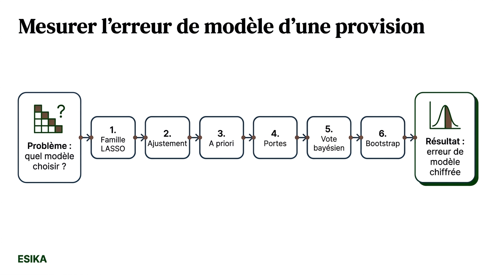

> **En bref.** Quand un actuaire calcule une provision, il choisit un modèle ; or d'autres modèles, presque aussi bons sur le passé, donneraient d'autres provisions. Taylor et McGuire (2023) proposent de chiffrer cette incertitude : un algorithme (le LASSO) fabrique automatiquement des centaines de modèles, on les fait voter avec des poids bayésiens, et l'écart entre leurs provisions mesure l'erreur de modèle. Nous avons reproduit la méthode sur deux des jeux de données fictifs du papier. Trois résultats : (1) l'erreur de modèle pèse 1,3 % à 1,8 % de la provision et l'erreur totale 7 % à 9 %, un peu en dessous du papier (8,1 % à 11,7 %) ; (2) appliquée à la lettre, la méthode n'a pas fonctionné chez nous sur ces données et a dû être adaptée sur deux réglages ; (3) sur 20 triangles simulés par jeu, la provision issue du vote dépasse les paiements réels de 24 % à 35 % en moyenne, bien au-delà de l'erreur qu'elle annonce, alors que l'écart moyen de la méthode classique de Mack n'est pas distinguable de zéro. Usage visé : la marge de risque IFRS 17 d'un assureur non vie, avec la méthode utilisée à côté d'une méthode de référence, jamais seule.

## 1. Le problème, simplement

Prenez un triangle de paiements de sinistres. Vous ajustez un modèle, vous le prolongez dans le futur, vous obtenez une provision : disons 100. Votre collègue ajuste un autre modèle, presque aussi bon sur le passé, et obtient 108. Lequel a raison ?

La pratique habituelle consiste à garder un modèle, puis à mesurer deux incertitudes autour de lui :

- **l'erreur de processus** : même avec le bon modèle, les sinistres futurs sont aléatoires ;
- **l'erreur de paramètre** : les coefficients du modèle sont estimés sur un historique limité.

La méthode de Mack ou le bootstrap d'England et Verrall font exactement cela. Mais ils supposent tous les deux que **la forme du modèle est la bonne**. Si le vrai processus a une inflation qui s'accélère, une rupture de cadence de règlement ou un effet de calendrier que votre modèle ignore, aucune de ces deux mesures ne le verra. C'est l'**erreur de modèle**.

Elle compte pour la marge de risque. Le *risk adjustment* d'IFRS 17 et les marges de type VaR (75 % en Australie, cité par les auteurs) reposent sur la distribution de l'erreur de prévision. Si une composante manque, la marge est sous-estimée, ou bien elle est gonflée par un forfait que personne ne sait justifier.

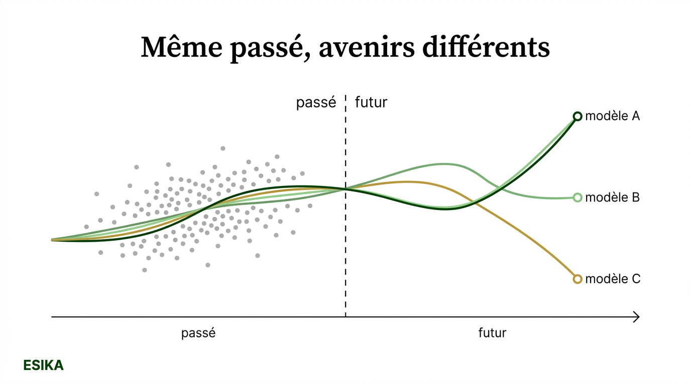

**Notre fil rouge.** Pour suivre la méthode à la main, nous utilisons un petit triangle annuel fictif de 10 années de survenance sur 10 années de développement (55 cellules observées). Les paiements montent de 5 % par an à partir de la quatrième survenance, culminent la troisième année de développement, et subissent une inflation de 3 % par année calendaire jusqu'à l'année 10 (la dernière diagonale observée) ; dans le futur, cette inflation ne continue pas. Les lignes S1 à S10 sont les années de survenance (indice i), les colonnes D1 à D10 les années de développement (indice j). Le bruit a un coefficient de variation d'environ 10 %. La provision vraie (l'espérance des paiements futurs, connue puisque nous avons fabriqué les données) vaut **39 928**.

| Survenance | D1 | D2 | D3 | D4 | D5 | D6 | D7 | D8 | D9 | D10 |
|---|---|---|---|---|---|---|---|---|---|---|
| S1 | 454 | 1 146 | 1 120 | 1 491 | 1 166 | 810 | 586 | 452 | 274 | 180 |
| S2 | 595 | 1 217 | 1 386 | 1 322 | 1 139 | 802 | 596 | 486 | 291 | |
| S3 | 508 | 1 272 | 1 405 | 1 354 | 1 237 | 1 116 | 588 | 573 | | |
| S4 | 498 | 1 476 | 1 683 | 1 659 | 1 141 | 1 048 | 658 | | | |
| S5 | 663 | 1 310 | 1 567 | 1 841 | 1 438 | 1 137 | | | | |
| S6 | 873 | 1 632 | 1 727 | 1 908 | 1 408 | | | | | |
| S7 | 664 | 1 493 | 1 829 | 1 679 | | | | | | |
| S8 | 657 | 1 668 | 2 567 | | | | | | | |
| S9 | 1 072 | 1 808 | | | | | | | | |
| S10 | 1 033 | | | | | | | | | |

*Triangle du fil rouge : paiements incrémentaux fictifs (fichier `results/fil_rouge_triangle.csv`).*

## 2. Les prérequis

### 2.1 Les composantes de l'erreur

Les auteurs partent d'une décomposition de l'erreur de prévision (section 4 du papier, équations 3 à 8). L'erreur quadratique moyenne de la provision se découpe en un biais de modèle et trois variances : processus, paramètre et modèle. L'erreur de modèle se divise ensuite en deux :

- l'**erreur de distribution** : la loi choisie pour le bruit (Gamma, Poisson...) est fausse ;
- l'**erreur de structure** : la forme des espérances (quels effets, quelles tendances) est fausse.

L'erreur de structure se divise encore en deux, et c'est la distinction la plus importante du papier :

- l'**erreur interne** porte sur la façon de décrire le passé. Elle est estimable sur les données ;
- l'**erreur externe** porte sur les hypothèses faites pour le futur (l'inflation continue-t-elle ?). Par définition, aucune donnée passée ne la renseigne.

Le papier ne traite que l'erreur interne, qu'il appelle IMSE (*internal model structure error*). Le biais de modèle, terme à part de la décomposition, ne figure pas sur le schéma ci-dessous ; il comptera beaucoup en section 5.7.

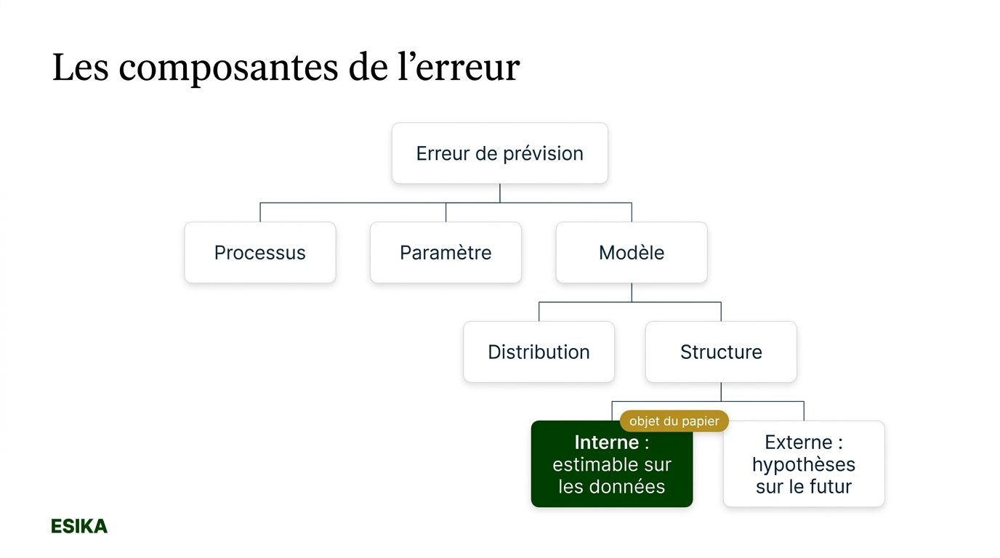

### 2.2 Quatre notions à connaître

> **Encadré : le LASSO.** Une régression qui ajoute à l'objectif d'ajustement une pénalité proportionnelle à la somme des valeurs absolues des coefficients, multipliée par un paramètre λ. Quand λ est grand, la pénalité pousse beaucoup de coefficients exactement à zéro : le modèle est simple. Quand λ diminue, des variables entrent une à une : le modèle se complexifie. En faisant varier λ, on obtient donc **une famille de modèles**, du plus simple au plus complexe, d'un seul coup. Analogie : un recruteur exigeant (λ grand) ne garde que deux ou trois candidats ; s'il devient indulgent, il en garde des dizaines.

> **Encadré : les fonctions de base.** Une **rampe** R_K(x) = max(0, x − K) vaut 0 jusqu'à K puis monte d'une unité par période : elle décrit une tendance qui démarre à la période K. Une **fonction de Heaviside** H_k(x) vaut 0 avant k et 1 à partir de k : c'est une marche d'escalier. Le produit de deux marches, par exemple H_k(i) H_l(j), décrit un changement qui ne touche que les survenances à partir de k et les développements à partir de l.

> **Encadré : minCV et 1se.** Pour choisir un λ, on découpe les données en 8 blocs, on ajuste sur 7 et on mesure l'erreur sur le huitième (validation croisée). Le modèle **minCV** est celui qui minimise cette erreur. Le modèle **1se** est le plus simple dont l'erreur reste à moins d'un écart type du minimum : un peu moins bon sur le papier, mais plus sobre. Les auteurs prennent le 1se comme modèle principal.

> **Encadré : a priori, vraisemblance, a posteriori.** Le théorème de Bayes combine deux avis. L'**a priori** dit ce qu'on croit avant de voir les données (ici : « les modèles simples sont plus plausibles »). La **vraisemblance** dit à quel point un modèle explique les données observées. L'**a posteriori** est leur produit, normalisé pour que la somme fasse 1. Sur l'échelle logarithmique, c'est une simple addition : log a posteriori = log a priori + log vraisemblance, à une constante près.

> **Encadré : le bootstrap.** Pour savoir à quel point un résultat dépend du hasard des données, on fabrique des jeux de données simulés (des « pseudo-triangles ») en rééchantillonnant les résidus du modèle (les écarts entre observé et ajusté), puis on refait tout le calcul sur chacun. La dispersion des résultats mesure l'incertitude d'estimation.

### 2.3 Notations

| Symbole | Sens |
|---|---|
| i, j, t = i + j − 1 | période de survenance, de développement, de paiement |
| Y_ij, y_ij | paiement incrémental (aléatoire, observé) |
| µ_ij | espérance du paiement de la cellule (i, j) |
| R̂ | provision estimée : somme des paiements futurs prévus |
| M_q | modèle obtenu avec la q-ième valeur de pénalité λ₀^(q) |
| φ | dispersion de la loi Gamma (variance = φ µ²) |
| s | échelle de la loi de Laplace a priori ; le papier note λ₀[G] son inverse (la pénalité équivalente une fois la loi Gamma substituée à Poisson) |
| X, β, β₀, β_r | matrice des fonctions de base, coefficients, intercept, r-ième coefficient |
| ℓ, L | log-vraisemblance, vraisemblance |
| π_pr, π_po | lois a priori et a posteriori sur les modèles |
| B | nombre de réplications bootstrap |
| CoV | coefficient de variation : écart type divisé par la moyenne |

## 3. L'idée centrale

Au lieu de choisir un modèle, **faire voter tous les modèles plausibles**. En statistique, ce vote s'appelle une moyenne bayésienne de modèles (BMA, pour *Bayesian Model Averaging*) ; nous emploierons indifféremment « vote » et « BMA ».

1. Le LASSO fabrique une famille de modèles, du plus simple au plus complexe.
2. Chaque modèle reçoit un poids : bon ajustement aux données, mais pénalisé s'il est trop compliqué.
3. La provision retenue est la moyenne pondérée des provisions des modèles.
4. **La dispersion pondérée de ces provisions mesure l'erreur de modèle interne.**

Si tous les modèles plausibles donnent à peu près la même provision, l'erreur de modèle est faible. S'ils divergent, elle est forte. L'originalité du papier tient au point 2 : en statistique bayésienne, la difficulté habituelle est de choisir l'a priori sur les modèles. Ici, sa **forme** sort du LASSO lui-même, qui est mathématiquement un estimateur bayésien avec un a priori de Laplace. Son **échelle**, elle, reste un réglage : on la cale pour que le vote retombe sur le modèle que l'actuaire aurait choisi (brique 3).

> **À retenir.** L'erreur de modèle interne est l'écart entre les provisions de modèles qui expliquent tous raisonnablement le passé. Le LASSO fournit les modèles et la forme de leur a priori.

## 4. La méthode pas à pas

*Où en sommes-nous ? Nous avons le problème (le choix du modèle) et l'idée (faire voter). Voici les six briques, dans l'ordre où le code les exécute, chacune appliquée au fil rouge.*


### Brique 1 : fabriquer la famille de modèles

**Pourquoi.** Pour faire voter des modèles, il faut des candidats. Les écrire à la main serait arbitraire et limité. Le LASSO les fabrique automatiquement.

**Intuition.** On donne au LASSO un très grand catalogue de « briques de forme » : des rampes qui démarrent à une période donnée (une tendance qui commence à la survenance 4, une cadence qui change au développement 3, une inflation qui démarre au paiement 6...) et des interactions entre deux de ces dimensions (un changement de cadence qui ne touche que les survenances récentes). Le LASSO choisit lui-même lesquelles garder, et en garde d'autant plus que la pénalité λ est faible.

**Formule** (papier, éq. 2 et 16). Les rampes sont R_K(x) = max(0, x − K). Le modèle est log-linéaire : µ_ij = exp(X β). Pour chaque valeur λ₀^(q) de la pénalité, le LASSO résout

$$\hat\beta^{(q)} = \arg\min_\beta \Big\{ -\ell(Y \mid \beta) + \lambda_0^{(q)} \sum_r |\beta_r| \Big\}$$

**En mots.** On cherche les coefficients qui expliquent au mieux les paiements observés (premier terme), en payant un prix pour chaque coefficient non nul (second terme). Chaque valeur du prix donne un modèle M_q.

**Fil rouge.** Le catalogue compte 228 fonctions (rampes en survenance, développement et paiement, et interactions de Heaviside). En faisant varier λ sur une grille fine (439 valeurs, avec 5 valeurs intercalées entre deux points du chemin initial, comme dans le code des auteurs), on obtient 439 modèles, de 1 à 153 variables. Leurs provisions vont de 43 972 à 51 669. Au-delà du modèle 140, plus rien ne bouge : les provisions restent entre 44 171 et 44 385 et leur poids a posteriori est nul ; les figures s'arrêtent donc avant. La validation croisée désigne le modèle 52 (24 variables) comme 1se, et le modèle 70 (37 variables) comme minCV.

```r
# src/lasso_glmnet.R (extrait) : chemin LASSO Poisson, comme les auteurs
f0 <- glmnet(Xp, y, family = "poisson", nlambda = 50, lambda.min.ratio = 0,
             thresh = thresh, maxit = 1e6, standardize = FALSE)
lv <- sort(unique(c(f0$lambda, min(f0$lambda) * 0.85^(1:50))), decreasing = TRUE)
lv <- ...  # 5 valeurs intercalées géométriquement entre deux lambda successifs
set.seed(87)
cv <- cv.glmnet(Xp, y, family = "poisson", lambda = lv, nfolds = 8,
                thresh = thresh, maxit = 1e6, standardize = FALSE)
i1 <- which(lv == cv$lambda.1se); im <- which(lv == cv$lambda.min)
```

> **Simplification.** Les auteurs ajustent un LASSO Poisson (glmnet ne converge pas avec une loi Gamma) et passent ensuite à la loi Gamma pour le vote. Nous faisons de même. La mise à l'échelle exacte des fonctions de base n'est pas publiée : nous centrons et réduisons chaque colonne sur les cellules observées.

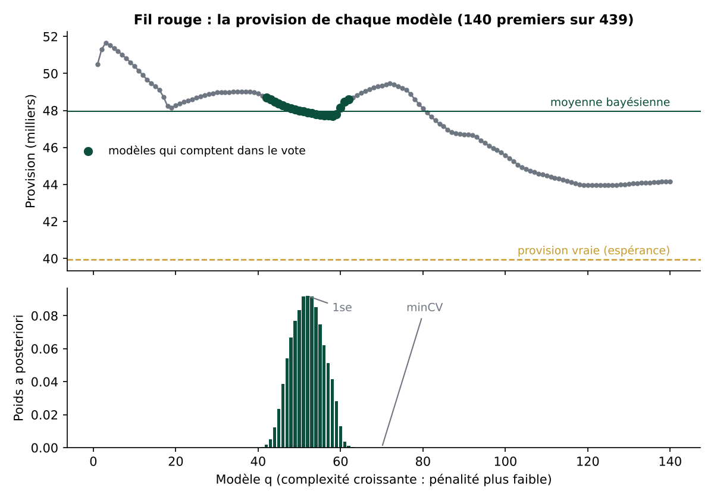

*Ce qu'il faut y lire : la provision bouge beaucoup le long de la famille (de 44 000 à 51 700 environ), mais le vote (barres du bas) se concentre sur une vingtaine de modèles voisins du 1se. Notez aussi que toutes les provisions dépassent la provision vraie (39 928). Une partie de l'écart est voulue : nous avons arrêté l'inflation après l'année 10, ce qu'aucun modèle ne peut deviner à partir du passé ; si elle continuait, la provision vraie serait de 43 715. C'est de l'erreur externe, hors du champ du papier. Le reste (le 1se est encore 9,5 % au-dessus de 43 715) annonce le biais étudié en section 5.7.*

> **À retenir.** Une seule commande LASSO produit des centaines de modèles candidats, du plus simple au plus complexe. Pas besoin de les imaginer un par un.

### Brique 2 : mesurer l'ajustement de chaque modèle

**Pourquoi.** Un bon candidat doit expliquer les paiements observés. La vraisemblance mesure cela.

**Intuition.** On suppose que chaque paiement fluctue autour de sa moyenne selon une loi Gamma : l'écart type est proportionnel à la moyenne, ce qui convient aux montants de sinistres. Plus les moyennes d'un modèle collent aux observations, plus sa vraisemblance est élevée.

**Formule** (papier, éq. 21), avec γ = 1/φ et c_ij = 1/(φ µ_ij) :

$$\ell(Y \mid \beta) = \sum_{(i,j) \text{ observées}} \big[\gamma \ln c_{ij} - \ln\Gamma(\gamma) + (\gamma - 1)\ln y_{ij} - c_{ij} y_{ij}\big]$$

**En mots.** On additionne, cellule par cellule, la « surprise » de voir le paiement observé si le modèle disait vrai. La dispersion φ est la même pour tous les modèles : on l'estime une fois, par un GLM Gamma ajusté sur les variables du modèle 1se (fonction `gamma.dispersion` du package R MASS, comme les auteurs).

**Fil rouge.** φ = 0,0092, soit un coefficient de variation d'environ 9,6 % par cellule, cohérent avec les 10 % du générateur. Le modèle 52 (1se) a une log-vraisemblance de −362,5 ; le modèle 70 (minCV), plus complexe, monte à −331,8 ; les plus complexes plafonnent vers −300,8.

```python
# src/bma.py : éq. (21) du papier
def gamma_loglik(y, mu, phi):
    g = 1.0 / phi
    c = 1.0 / (phi * mu)
    return np.sum(g * np.log(c) - gammaln(g) + (g - 1) * np.log(y) - c * y, axis=-1)
```

> **À retenir.** La vraisemblance récompense l'ajustement. Seule, elle choisirait toujours le modèle le plus complexe : il faut un contrepoids.

### Brique 3 : l'a priori, ou le prix de la complexité

**Pourquoi.** Sans contrepoids, le vote irait au modèle le plus compliqué, qui épouse le bruit du passé. Il faut pénaliser la complexité, de façon objective.

**Intuition.** Le LASSO a une lecture bayésienne : minimiser « ajustement + λ × somme des |β| », c'est exactement trouver le mode a posteriori quand chaque coefficient suit a priori une loi de Laplace (une loi en pic, centrée sur zéro). Autrement dit, le LASSO croit déjà que la plupart des coefficients sont nuls. Les auteurs réutilisent cette croyance comme a priori sur les modèles : un modèle dont les coefficients sont grands et nombreux est jugé a priori moins plausible.

**Formule** (papier, éq. 17 et 22). Pour une échelle s, à une constante commune près :

$$\ln \pi_{pr}(M_q) = -\frac{|\beta_0^{(q)} - m_0|}{2} - \frac{\sum_{r \ge 1} |\beta_r^{(q)}|}{s}$$

**En mots.** Chaque unité de « taille » des coefficients (leur somme en valeur absolue, la norme L1) coûte 1/s points de log a priori. L'intercept a son propre a priori, centré sur le log du paiement moyen, d'échelle 2 (valeurs reprises du code des auteurs).

**Comment choisir s ?** C'est le seul réglage de l'a priori, et les auteurs le calent sur les données, de façon un peu circulaire : le vote est réglé pour retomber sur le modèle que la validation croisée aurait choisi. Le bénéfice n'est donc pas de trouver un meilleur modèle, mais de mesurer la dispersion des modèles voisins de celui-ci. On choisit s pour que le modèle le plus probable a posteriori soit le 1se (a priori « 1se »), ou le minCV (a priori « minCV »). Deux variantes extrêmes encadrent le résultat (éq. 23 et 24) : l'a priori « simple » rend tous les modèles au moins aussi complexes que le 1se presque impossibles (masse totale de 0,05 %), l'a priori « complexe » fait de même pour les modèles au plus aussi complexes que le minCV.

**Fil rouge.** Avec s = 0,00324, le mode a posteriori tombe sur le modèle 52. Le modèle 52 a une norme L1 de 0,813, donc un log a priori de −251,3 (−0,813 / 0,00324 ≈ −251 ; l'écart vient de l'arrondi des valeurs affichées). Le modèle 70 a une norme de 0,959 et un log a priori de −296,1 : il gagne 30,7 points de vraisemblance mais en perd 44,9 d'a priori. Il perd le vote.

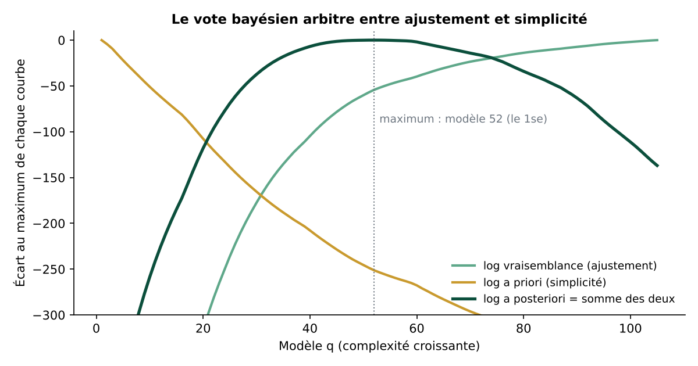

> **À retenir.** L'a priori n'est pas inventé : c'est celui que le LASSO suppose déjà. Son échelle est calée pour que le vote retombe sur le modèle que l'actuaire aurait retenu.

### Brique 4 : les portes d'inclusion

**Pourquoi.** C'est la découverte la plus pratique du papier. Certains modèles collent parfaitement au passé mais extrapolent de façon absurde. Chez les auteurs, l'un d'eux portait 67 % du poids a posteriori et pesait donc lourd dans le vote. Sur nos données, l'a priori leur donne déjà un poids quasi nul sur le triangle observé ; les portes y servent surtout pendant le bootstrap (brique 6), où les triangles simulés produisent beaucoup de modèles délirants.

**Intuition.** Il est très peu probable qu'un actuaire accepte un modèle qui prévoit 50 % de plus que les autres sur les dernières survenances. Les auteurs automatisent ce réflexe : chaque modèle doit rester dans des « portes », exprimées en pourcentage de la prévision du modèle principal (1se).

**Règle** (papier, section 6.2.5, Table 2). Un modèle est éliminé si l'un de ses six rapports sort de sa porte :

| Prévision comparée au 1se | Borne basse | Borne haute |
|---|---|---|
| 2 dernières survenances | 75 % | 133 % |
| 5 dernières survenances | 80 % | 125 % |
| 10 dernières survenances | 83 % | 120 % |
| 2 prochaines périodes de paiement | 91 % | 110 % |
| 5 prochaines périodes de paiement | 87 % | 115 % |
| 10 prochaines périodes de paiement | 83 % | 120 % |


**Fil rouge.** Sur le petit triangle, les portes n'éliminent que les 3 modèles les plus simples (1 à 2 variables), qui n'avaient de toute façon aucun poids. C'est sur les grands triangles que les portes changent tout, comme on le verra en section 5.

> **Attention.** Les auteurs le disent eux-mêmes : les portes réintroduisent une part de jugement dans une méthode sinon pilotée par les données, et le résultat y est sensible (section 8.4 du papier). Nous mesurons cette sensibilité en section 5.

> **À retenir.** Avant de voter, on retire les candidats qui extrapolent de façon déraisonnable. Les portes sont un garde-fou d'actuaire, pas un calcul statistique.

### Brique 5 : le vote bayésien

**Pourquoi.** C'est le cœur : transformer la famille de modèles en une provision et une erreur de modèle.

**Formule** (papier, éq. 11, 12 et 10). Sur les modèles admis :

$$\pi_{po}(M_q) = \frac{\pi_{pr}(M_q)\, L(y \mid M_q)}{\sum_k \pi_{pr}(M_k)\, L(y \mid M_k)}, \qquad \hat R_{BMA} = \sum_q \pi_{po}(M_q)\, \hat R(M_q)$$

$$\mathrm{IMSE} = \frac{\sqrt{\sum_q \pi_{po}(M_q)\,\big(\hat R(M_q) - \hat R_{BMA}\big)^2}}{\hat R_{BMA}}$$

**En mots.** Le poids d'un modèle est « a priori × vraisemblance », renormalisé. La provision est la moyenne pondérée des provisions. L'erreur de modèle interne est l'écart type des provisions entre modèles, rapporté à la provision. **Dans tout l'article, « IMSE » désigne ce coefficient de variation (CoV), exprimé en %.**

**Fil rouge, à la main, sur 5 modèles.** Prenons 5 modèles autour du 1se, espacés de 4 en 4 sur la grille. Toutes les valeurs viennent de `results/fil_rouge_5_modeles.csv`. Les poids sont renormalisés sur ces 5 modèles seulement (sur la famille complète, le 1se pèse environ 9 %). Les trois modèles à 24 variables donnent des provisions différentes parce que la pénalité change aussi la taille de leurs coefficients.

| Modèle | Variables | log a priori | log vraisemblance | Somme | Écart au max | exp(écart) | Poids | Provision |
|---|---|---|---|---|---|---|---|---|
| M44 | 23 | −224,60 | −391,18 | −615,77 | −2,0246 | 0,1320 | 4,9 % | 48 485 |
| M48 | 24 | −239,38 | −374,69 | −614,07 | −0,3181 | 0,7275 | 27,2 % | 48 106 |
| M52 (1se) | 24 | −251,26 | −362,49 | −613,75 | 0 | 1,0000 | 37,3 % | 47 881 |
| M56 | 24 | −259,71 | −354,43 | −614,14 | −0,3922 | 0,6755 | 25,2 % | 47 741 |
| M60 | 29 | −267,74 | −347,96 | −615,69 | −1,9441 | 0,1431 | 5,3 % | 48 145 |

Le calcul se fait en quatre gestes :

1. **Additionner** log a priori et log vraisemblance (colonne « Somme »).
2. **Retrancher le maximum** (celui de M52) pour éviter des exponentielles minuscules ; les écarts sont calculés sur les valeurs non arrondies, d'où 4 décimales.
3. **Prendre l'exponentielle** : 0,1320 + 0,7275 + 1 + 0,6755 + 0,1431 = 2,6781.
4. **Normaliser** : chaque exponentielle divisée par 2,6781 donne le poids (0,7275 / 2,6781 = 27,2 % pour M48).

La provision moyenne vaut (0,1320 × 48 485 + 0,7275 × 48 106 + 1 × 47 881 + 0,6755 × 47 741 + 0,1431 × 48 145) / 2,6781 = 128 417 / 2,6781 = **47 951**. L'écart type pondéré vaut 188, soit un CoV de **0,39 %**. Le vote complet sur les 436 modèles admis donne quasiment la même chose : 47 944 et 0,40 %, avec 23 modèles de poids supérieur à 0,0001.

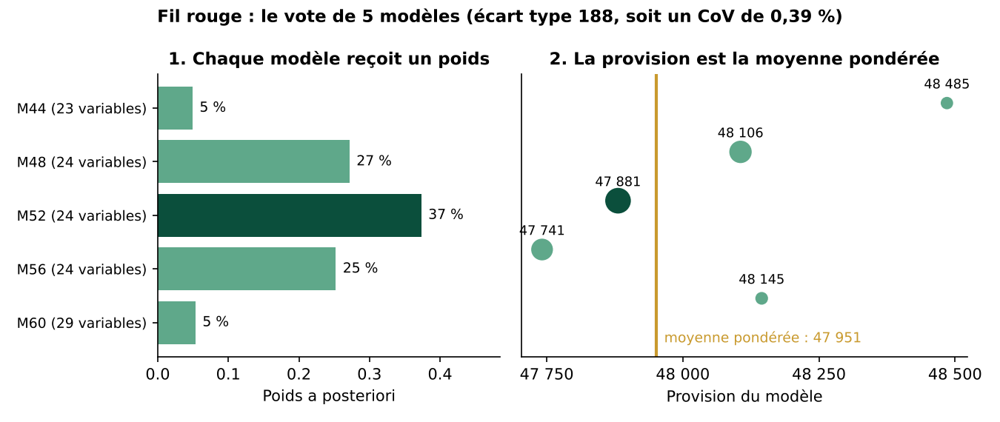

```python
# src/bma.py : éq. (11), (12) et (10)
def posterior(logw, admissible):
    lw = np.where(admissible, logw, -np.inf)
    lw = lw - np.nanmax(lw[admissible])
    w = np.nan_to_num(np.where(admissible, np.exp(lw), 0.0))
    return w / w.sum()

def bma(w, reserves):
    ok = w > 0
    m = np.sum(w[ok] * reserves[ok])
    v = np.sum(w[ok] * (reserves[ok] - m) ** 2)
    return m, v, np.sqrt(v) / m
```

> **À retenir.** Erreur de modèle interne = écart type pondéré des provisions des modèles plausibles, divisé par la provision. Sur le fil rouge : 0,4 %. C'est peu, et c'est le premier constat du papier : le modèle principal seul donne une estimation « mince ».

### Brique 6 : le bootstrap, pour épaissir le vote

**Pourquoi.** Les auteurs notent que l'ensemble des modèles qui comptent est souvent « mince » : 10 à 30 modèles de poids non négligeable, tous voisins. L'IMSE est alors probablement sous-estimée.

**Intuition.** On fabrique des **pseudo-triangles** (des triangles simulés) en rééchantillonnant les résidus du modèle 1se ; chaque pseudo-triangle est une **réplication** du bootstrap. Sur chacun, on refait tout : famille LASSO, portes, vote. Chacun donne sa propre provision moyenne et sa propre dispersion entre modèles. On empile tout dans une « matrice bootstrap » : une ligne par pseudo-triangle, une colonne par modèle.

**Formules** (papier, éq. 28 à 33). Avec m^[b] et v^[b] la moyenne et la variance du vote du pseudo-triangle b :

$$m = \overline{m^{[b]}}, \qquad s^2_{IMSE} = \overline{v^{[b]}}, \qquad s^2_{Pa} = \mathrm{Var}\big(m^{[b]}\big), \qquad \mathrm{Var\ totale} = s^2_{Pa} + s^2_{IMSE}$$

**En mots.** La dispersion *à l'intérieur* de chaque vote mesure l'erreur de modèle. La dispersion *entre* les votes des différents pseudo-triangles mesure l'erreur de paramètre. Leur somme est la variance totale de la matrice (loi de la variance totale). L'erreur de processus s'ajoute à part. On exprime chaque composante en CoV (IMSE = √s²_IMSE / m, de même pour le paramètre et le processus) et, comme ce sont les variances qui s'additionnent, **le total vaut la racine de la somme des carrés des CoV** : par exemple √(1,5² + 7,1² + 0,6²) = 7,3 %.

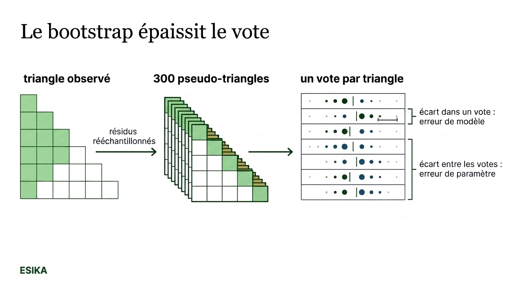

**Détails d'implémentation** (section 7.2 du papier), tous dans `src/bootstrap.py` :

- résidus standardisés du 1se, ρ = (y − µ̂)/(√φ µ̂), **centrés** car le LASSO est biaisé ;
- premier passage avec des portes provisoires élargies d'un facteur 1,4, pour ne pas éliminer avant recentrage des modèles qui seraient admis après ;
- recentrage : toutes les provisions bootstrap sont multipliées par un même facteur, pour que la moyenne des votes retombe sur la moyenne du triangle observé ;
- portes définitives, puis vote ;
- rejet des pseudo-triangles dont le vote repose sur moins de 5 modèles de poids supérieur à 0,0001.

> **Attention : paramètre et modèle sont emmêlés.** Dans un GLM classique, tous les pseudo-triangles gardent la même structure : la dispersion entre eux est de la pure erreur de paramètre. Avec le LASSO, chaque pseudo-triangle fabrique d'autres modèles. Les auteurs concluent que la séparation entre erreur de paramètre et erreur de modèle devient floue, peut-être même dénuée de sens, et que **seule leur somme a un sens sans ambiguïté**. Bonne nouvelle : c'est la somme qui sert pour une marge de risque.

> **À retenir.** Le bootstrap donne trois choses : une erreur de modèle moins sous-estimée, une erreur de paramètre, et la distribution complète de la provision.

## 5. L'expérience complète : les jeux 1 et 2 du papier

*Où en sommes-nous ? Les six briques sont en place. Nous les faisons maintenant tourner à l'échelle du papier, sur deux de ses quatre jeux de données, puis nous comparons nos chiffres aux siens.*

### 5.1 Protocole

- **Données.** Triangles trimestriels 40 x 40 (820 cellules observées), générés avec le code publié par les auteurs (blog MLR de l'Institute and Faculty of Actuaries). **Jeu 1** : effets de survenance et de développement seulement, compatible avec un chain ladder. **Jeu 2** : le même, plus une inflation superposée (effet calendaire) qui s'accélère deux fois au cours des 40 trimestres, puis **s'arrête** après le trimestre 40. Notre tirage aléatoire diffère de celui des auteurs (graine numpy et non R), mais les espérances sont identiques : provisions vraies de 188,7 et 238,1 (en milliards d'unités fictives), contre 190 et 238 dans le papier.
- **Famille de modèles.** 3 903 fonctions de base, 523 valeurs de pénalité, donc 523 modèles par triangle.
- **Bootstrap.** 300 réplications par jeu (500 dans le papier), mêmes graines pour toutes les variantes d'a priori et de portes.
- **Témoins.** (1) La méthode de Mack sur le triangle cumulé, standard du marché. (2) Un GLM Gamma dont la structure est **connue** (les vraies variables du générateur, y compris l'arrêt futur de l'inflation du jeu 2, une information que le LASSO ne peut pas avoir), bootstrappé de la même façon, comme le contrôle de la section 8.5 du papier.
- **Critères de vérification** : six propriétés annoncées par le papier, traduites en critères chiffrés avant tout calcul (annexe A, avec leur verdict).

### 5.2 Le modèle principal seul : une erreur de modèle « mince »

| Jeu | A priori | Provision vraie | 1se seul | Moyenne bayésienne | IMSE | Modèles qui comptent |
|---|---|---|---|---|---|---|
| 1 | 1se | 188,7 | 194,7 | 194,8 | 0,26 % | 17 |
| 1 | minCV | 188,7 | 194,7 | 190,5 | 0,71 % | 14 |
| 2 | 1se | 238,1 | 311,0 | 310,6 | 0,47 % | 21 |
| 2 | minCV | 238,1 | 311,0 | 310,3 | 0,32 % | 14 |

*Source : `results/modele_principal.csv`. « 1se seul » : provision du seul modèle 1se, sans vote. « Modèles qui comptent » : poids a posteriori supérieur à 0,0001. Provisions en milliards d'unités fictives.*

**Ce qu'il faut y lire.** Comme dans le papier (Table 3 : 0,1 % à 3,4 % sur les jeux 1 et 2), l'erreur de modèle du seul modèle principal est faible : moins de 1 %. Le vote repose sur 14 à 21 modèles voisins, tous très proches. Sur le jeu 2, le calage de l'échelle s n'atteint pas exactement le 1se : aucune valeur de la grille ne place le mode sur le modèle 110, et le mode tombe sur son voisin 109 (le 1se pèse 11 % du vote) ; nous gardons le point de grille le plus proche. La moyenne bayésienne reste collée au 1se seul (écart de 0,1 % pour l'a priori 1se), sauf pour le jeu 1 avec l'a priori minCV (2,2 %). Notez enfin que, sur le jeu 2, la provision estimée (311) dépasse nettement la provision vraie (238) : la section 5.7 y revient.

### 5.3 Les portes : des modèles qui collent au passé et s'envolent dans le futur

Sur nos deux triangles, les portes n'admettent que 42 modèles sur 523 (jeu 1) et 73 sur 523 (jeu 2). Parmi les éliminés, la plupart s'ajustent **mieux** au passé que le 1se : 389 sur 481 (jeu 1) et 367 sur 450 (jeu 2). Sur le jeu 2, le premier modèle plus complexe éliminé (le modèle 157, avec 373 variables contre 142 pour le 1se) gagne 320 points de log-vraisemblance et prévoit une provision supérieure de 32 %.

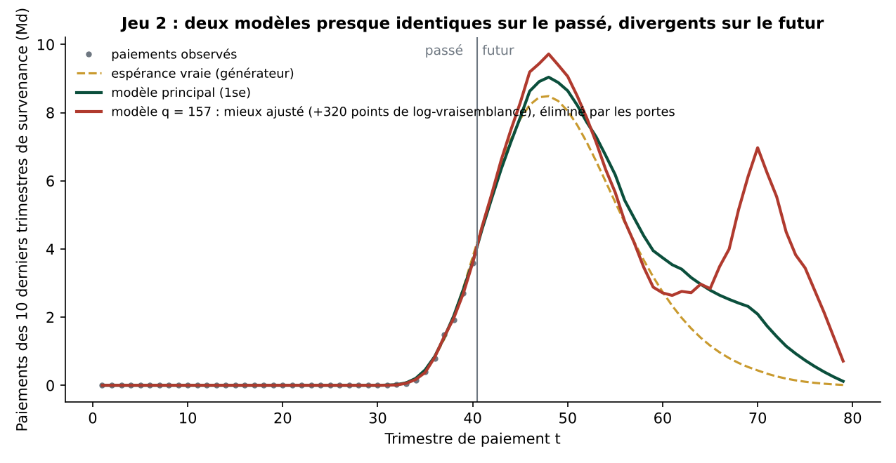

**Ce qu'il faut y lire.** La figure ne montre que les 10 dernières survenances, d'où des paiements nuls avant le trimestre 32 environ. Sur les trimestres observés de ces survenances (de 10 pour la survenance 31 à 1 seul pour la 40), les deux modèles passent par les mêmes points. Dans le futur, le modèle éliminé (rouge) fabrique une seconde bosse de paiements vers le trimestre 70, que rien dans les données ne justifie : c'est exactement le phénomène de la Figure 3 du papier. On voit aussi que le modèle principal (vert) reste au-dessus de l'espérance vraie (pointillés) : c'est le biais étudié en section 5.7.

**Une nuance par rapport au papier.** Chez les auteurs, un modèle de ce type portait 67 % du poids a posteriori avant élagage. Chez nous, l'a priori calé sur le 1se leur donne déjà un poids nul : la masse a posteriori de tous les modèles éliminés est inférieure à 0,0001 sur les deux jeux. Le critère correspondant (C2 : un modèle éliminé portait au moins 0,05 du poids avant élagage) n'est donc pas vérifié. Les portes jouent en revanche un rôle décisif dans le bootstrap.

### 5.4 Le bootstrap : deux adaptations nécessaires

Appliqué à la lettre, le bootstrap n'a pas fonctionné chez nous, alors que les auteurs gardent 432 et 452 réplications sur 500 (Table 4 du papier, jeux 1 et 2, a priori 1se) sur des données de même spécification. L'écart peut venir du protocole comme de notre implémentation (mise à l'échelle de la base non publiée, tirage différent, plancher appliqué aux valeurs simulées négatives). Nous avons adapté deux points, détaillés en annexe A. Signalons aussi que 1,1 % (jeu 1) et 0,85 % (jeu 2) des valeurs simulées, négatives, ont été ramenées à un plancher de 0,1 % de la moyenne.

1. **Les résidus.** Le papier réduit les résidus par la variance de la loi Gamma et demande de vérifier qu'ils ont tous la même dispersion avant de les rééchantillonner. Ce n'est pas le cas ici : les petites cellules sont bien plus bruitées, en relatif, que les grosses (écart type des résidus réduits de 1,5 sur les deux premiers développements contre 0,5 au milieu du triangle). Rééchantillonnés tels quels, ils produisent des provisions de 82 à 1 052 (médiane 234), pour une provision d'origine de 195. Avec des résidus réduits par la racine de la moyenne, la convention du bootstrap ODP (*over-dispersed Poisson*, le bootstrap classique d'England et Verrall), la dispersion devient homogène (0,76 à 1,08) : c'est ce que nous utilisons.
2. **Les portes.** Les pseudo-triangles surestiment surtout les dernières survenances. Le papier recentre toutes leurs prévisions par un facteur unique ; chez nous, il vaut 0,83 pour le jeu 1 et 0,90 pour le jeu 2 (a priori 1se), et il pousse les paiements à court terme sous la porte de 91 %. Avec les portes de la Table 2, 3 réplications sur 300 passent sur le jeu 1 (282 sur le jeu 2). Avec des portes élargies d'un facteur 1,1, une variante que le papier étudie lui-même, 294 à 299 passent sur les deux jeux. Nous avons fixé ce choix après le test du jeu 1 et avant de voir le jeu 2.

### 5.5 La décomposition de l'erreur

| Jeu | Méthode | IMSE | Paramètre | Processus | Total | Papier (total) |
|---|---|---|---|---|---|---|
| 1 | LASSO, a priori 1se | 1,5 % | 7,1 % | 0,6 % | **7,3 %** | 8,1 % |
| 1 | LASSO, a priori minCV | 1,4 % | 7,8 % | 0,6 % | **8,0 %** | 11,7 % |
| 1 | GLM de structure connue | | 8,9 % | 0,6 % | 8,9 % | |
| 1 | Mack | | | | 26,9 % | |
| 2 | LASSO, a priori 1se | 1,8 % | 6,7 % | 0,5 % | **7,0 %** | 9,9 % |
| 2 | LASSO, a priori minCV | 1,3 % | 8,9 % | 0,5 % | **9,0 %** | 10,1 % |
| 2 | GLM de structure connue | | 5,7 % | 0,6 % | 5,7 % | |
| 2 | Mack | | | | 5,5 % | |

*Coefficients de variation de la provision ; bootstrap B = 300, portes x 1,1 ; total = racine de la somme des carrés. Sources : `results/bootstrap.csv`, `results/temoins.csv`, Table 5 du papier.*

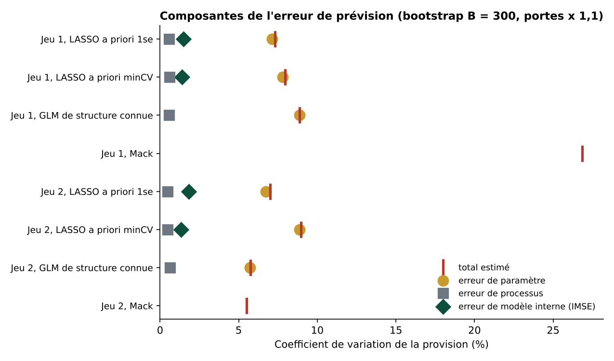

**Ce qu'il faut y lire.**

- **Le bootstrap épaissit bien l'erreur de modèle** (vérifié sur les 4 cas) : de 0,26 % à 1,5 % sur le jeu 1, de 0,47 % à 1,8 % sur le jeu 2 (a priori 1se). Les ordres de grandeur rejoignent le papier (1,2 % à 2,7 %).
- **L'erreur de paramètre domine** (6,7 % à 8,9 %), comme dans le papier (8,0 % à 12,7 %), et le total reste entre 7 % et 9 %. L'erreur de processus est plus basse que dans le papier (0,5 % à 0,6 % contre 0,9 % à 2,1 %), parce que nous la calculons avec la même fonction de variance que le bootstrap (proportionnelle à la moyenne). Rappel : la séparation paramètre / modèle est floue ; seul le total est solide.
- **Le papier prévoit que l'erreur de paramètre du LASSO dépasse celle d'un GLM de structure connue : c'est vrai sur un jeu sur deux.** Sur le jeu 2, l'erreur de paramètre du LASSO (6,7 %) dépasse celle du GLM de structure connue (5,7 %), comme le prédit le papier : un peu d'erreur de modèle « fuit » dans l'erreur de paramètre. Sur le jeu 1, c'est l'inverse (7,1 % contre 8,9 %) ; le GLM n'y garde d'ailleurs que 156 réplications sur 300 sous les portes.
- **Mack** donne 26,9 % sur le jeu 1 : le chain ladder sur triangle cumulé est très sensible aux premiers développements, extrêmement bruités dans ce générateur. Sur le jeu 2, il donne 5,5 %, autour d'une provision de 214 (10 % sous la provision vraie, un écart de tirage : sur 20 triangles, Mack n'est pas biaisé, section 5.7).

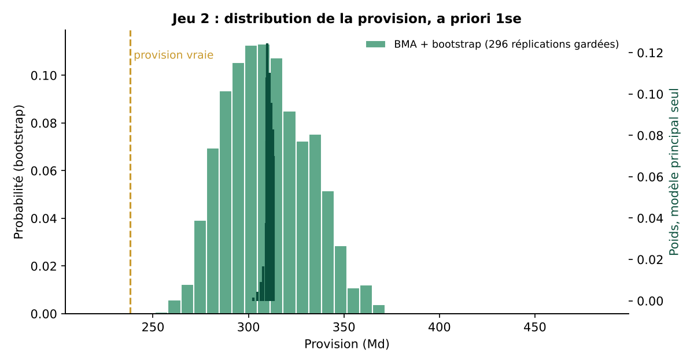

### 5.6 Sensibilité aux portes

| Jeu, a priori | Table 2 | x 1,1 | x 1,2 | x 1,3 |
|---|---|---|---|---|
| Jeu 1, 1se | 2,4 % (3 réplications) | 7,3 % | 7,6 % | 7,6 % |
| Jeu 1, minCV | 2,3 % (7 réplications) | 8,0 % | 8,4 % | 8,4 % |
| Jeu 2, 1se | 5,0 % (282) | 7,0 % | 7,5 % | 7,5 % |
| Jeu 2, minCV | 8,0 % (278) | 9,0 % | 9,5 % | 9,7 % |

*Erreur totale (CoV) ; entre parenthèses, réplications gardées sur 300 quand elles sont moins de 290. Source : `results/sensibilite_portes.csv`.*

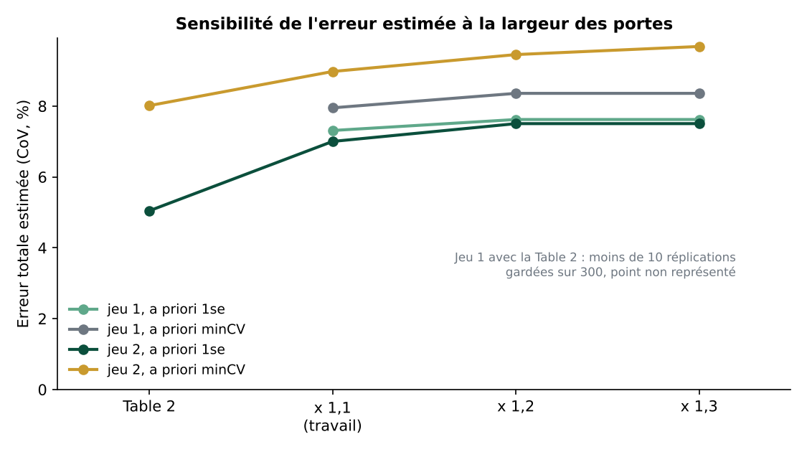

**Ce qu'il faut y lire.** Sur le jeu 2 avec l'a priori 1se, passer de la Table 2 aux portes x 1,1 multiplie l'erreur par 1,39 ; le papier annonce environ 1,5. Avec l'a priori minCV, le rapport n'est que de 1,12. Au-delà de x 1,1, l'effet s'atténue vite (rapports de 1,04 à 1,07 entre x 1,1 et x 1,2). L'effet ne passe pas seulement par le nombre de réplications gardées (le jeu 2 en garde déjà 282 sur 300 avec la Table 2) : le nombre médian de modèles admis dans chaque vote passe aussi de 35 à 96 puis 128. **Sur nos données, la sensibilité aux portes est forte quand elles sont serrées, et faible ensuite.** Ces rapports reposent sur un seul triangle par jeu et n'ont pas d'intervalle de confiance. Sur le jeu 1, les portes de la Table 2 rendent même le résultat inutilisable (3 réplications sur 300).

### 5.7 Contrôle de réalisme : l'erreur réellement commise

*Ce que le papier ne fait pas, mais que nous ajoutons.* Une erreur annoncée n'a de valeur que si elle correspond à l'erreur réellement commise. Puisque nos données sont fictives, nous pouvons le vérifier : nous avons généré **20 triangles indépendants par jeu** (graines 100 à 119, avec les mêmes espérances), appliqué à chacun le modèle principal et le vote (a priori 1se), ainsi que Mack, puis comparé chaque provision aux paiements futurs **réellement simulés**. Pour des raisons de temps de calcul, le bootstrap n'est pas refait sur chaque triangle : l'erreur annoncée de référence est celle du triangle principal (7,3 % pour le jeu 1, 7,0 % pour le jeu 2).

| Jeu | Méthode | Écart moyen aux paiements réalisés (IC à 95 %) | Écart type | Min ; max | Hors de ± 1,96 x 7 % |
|---|---|---|---|---|---|
| 1 | Vote bayésien (1se) | **+23,9 %** (+16,8 % ; +31,0 %) | 15,2 % | −0,3 % ; +58,0 % | 15 sur 20 |
| 1 | Mack | −0,4 % (−5,9 % ; +5,1 %) | 11,8 % | −11,8 % ; +35,2 % | 2 sur 20 |
| 1 | GLM de structure connue | +1,6 % (−5,6 % ; +8,7 %) | 15,3 % | | |
| 2 | Vote bayésien (1se) | **+34,7 %** (+28,0 % ; +41,3 %) | 14,3 % | +10,3 % ; +61,4 % | 19 sur 20 |
| 2 | Mack | +2,6 % (−3,2 % ; +8,4 %) | 12,4 % | −9,2 % ; +39,6 % | 3 sur 20 |
| 2 | GLM de structure connue | +1,1 % (−6,2 % ; +8,3 %) | 15,5 % | | |

*n = 20 triangles par jeu. Sources : `results/realisme.csv`, `results/realisme_glm.csv`, `results/complements.json`. La bande commune est ± 1,96 fois l'erreur annoncée sur le triangle principal (7,3 % et 7,0 %). L'écart entre espérance vraie et paiements réalisés (erreur de processus pure) n'a qu'un écart type de 0,7 %.*

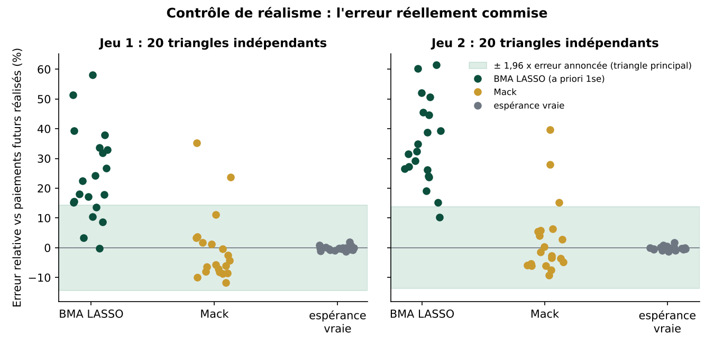

**Ce qu'il faut y lire.** Le vote bayésien surestime la provision sur 19 triangles sur 20 dans le jeu 1 et sur 20 sur 20 dans le jeu 2, de 24 % et 35 % en moyenne ; un test t sur les 20 écarts rejette nettement l'hypothèse d'un écart moyen nul (t = 7,0 et 10,9). L'erreur annoncée (7 %) ne couvre presque jamais l'écart réel. Sur les mêmes triangles, l'écart moyen de Mack n'est pas distinguable de zéro, mais Mack est peu précis (écart type de 12 %) et l'erreur qu'il annonce lui-même varie beaucoup d'un triangle à l'autre (de 6,9 % à 92 %, 11 % en médiane).

Un GLM Gamma de **structure connue** (les vraies variables du générateur, sans bootstrap) est lui aussi sans biais distinguable (+1,6 % et +1,1 %). Le biais ne vient donc ni de la loi Gamma ni du lien log : il est propre aux modèles 1se de la famille LASSO. Ce témoin a toutefois un avantage que le LASSO n'a pas : il connaît la vraie forme des effets, y compris l'arrêt futur de l'inflation du jeu 2. Et attention à ne pas conclure sur un seul triangle : sur le triangle principal du jeu 1, ce même GLM donne 213,5 contre 188,7 (+13 %), comme la Table 8 du papier (214 contre 190) ; c'est la répétition sur 20 triangles qui montre qu'il n'est pas biaisé. Le problème n'est donc ni le hasard, ni la difficulté des données : c'est un **biais systématique** des modèles 1se de la famille LASSO sur ce générateur.

**Où se loge ce biais ?** Nous avons testé une première hypothèse : des tendances de calendrier prolongées à tort. En figeant les rampes de période de paiement au dernier trimestre observé, la provision du 1se ne change pas du tout sur 12 triangles testés (`results/diagnostic_extrapolation.csv`) : le 1se ne retient aucune rampe explicite en t. Comme t = i + j − 1, une tendance de calendrier absorbée par les effets de survenance et de développement n'est pas exclue pour autant. Le découpage par survenance est plus parlant (`results/diagnostic_biais_survenance.csv`, 2 triangles par jeu) :

| Survenances | Part de la provision vraie | Écart de la prévision 1se, jeu 1 | Écart, jeu 2 |
|---|---|---|---|
| 1 à 20 (fin de queue) | 5 % | +23 % à +24 % | +25 % à +34 % |
| 21 à 30 | 37 % | −1 % à +11 % | +12 % à +18 % |
| 31 à 35 | 31 % | +10 % à +18 % | +24 % à +28 % |
| 36 à 38 | 17 % | +27 % à +35 % | +39 % à +47 % |
| 39 et 40 | 10 % | +44 % à +52 % | +58 % à +66 % |

Le biais est maximal là où les données sont les plus rares : les dernières survenances, connues par une ou deux cellules très bruitées, et la fin de la queue de développement. C'est cohérent avec le **biais de rétrécissement du LASSO**, que les auteurs signalent eux-mêmes (section 6.1.3 : la pénalité biaise les estimations), mais que leur décomposition range dans le « biais de modèle » sans l'estimer. Nous n'avons pas démontré ce mécanisme (rétrécissement plutôt que choix de la structure) ; nous constatons que le biais est systématique, important, et invisible dans l'erreur mesurée.

> **À retenir.** Sur nos données, l'erreur que la méthode mesure (7 %) est réelle mais incomplète : le biais du modèle 1se, de l'ordre de 25 % à 35 %, n'apparaît dans aucune de ses composantes. Le recentrage du bootstrap le retire de l'erreur mesurée ; le facteur de recentrage en garde une trace partielle (1/0,83 = 1,21 sur le jeu 1, 1/0,90 = 1,12 sur le jeu 2, sur un seul triangle par jeu).

## 6. Guide d'implémentation : le refaire chez soi

*Où en sommes-nous ? La méthode est comprise et testée. Voici comment la mettre en œuvre sur un portefeuille réel, avec les pièges que notre implémentation a rencontrés.*

### 6.1 Ce qu'il faut en entrée

| Besoin | Dans nos expériences | Équivalent réel chez un assureur non vie |
|---|---|---|
| Un triangle de paiements incrémentaux | 40 x 40 trimestriel, fictif | triangle par ligne d'activité (RC auto corporel, RC générale...), trimestriel si l'historique le permet |
| Assez de cellules | 820 cellules observées | au moins quelques centaines ; sur un 10 x 10 annuel (55 cellules), la méthode tourne (c'est notre fil rouge) mais chaque modèle repose sur peu d'observations |
| Une base de fonctions | rampes et interactions de Heaviside (3 903 colonnes) | la même, générée automatiquement à partir de la taille du triangle |
| Un modèle principal | le 1se de la validation croisée | celui que l'actuaire retient déjà, s'il est issu du LASSO |
| Des portes d'inclusion | Table 2 du papier, élargie x 1,1 | à fixer par l'actuaire selon la branche et la longueur de la queue |

### 6.2 Les étapes, dans l'ordre du code

1. **Construire la base** de fonctions et la standardiser sur les cellules observées (`src/basis.py`).
2. **Ajuster le chemin LASSO** Poisson avec glmnet, prolonger la grille, intercaler 5 valeurs entre deux pénalités, valider par 8 blocs (`src/lasso_glmnet.R`).
3. **Estimer φ** par un GLM Gamma sur la structure du 1se (`MASS::gamma.dispersion`).
4. **Calculer** pour chaque modèle la vraisemblance Gamma, la norme L1, la provision et les six agrégats des portes (`src/bma.py`).
5. **Caler l'échelle s** de l'a priori pour que le mode a posteriori tombe sur le 1se (et sur le minCV pour la variante) ; vérifier que c'est atteint (sur notre jeu 2, le mode reste sur le modèle voisin).
6. **Appliquer les portes**, puis **voter** : provision moyenne et IMSE du modèle principal.
7. **Vérifier l'homogénéité des résidus** du 1se, par bande de développement et de paiement, avant de choisir la fonction de variance du bootstrap (`homogeneity` dans `src/bootstrap.py`).
8. **Bootstrapper** : 300 pseudo-triangles, LASSO sur la même grille, recentrage, portes, vote, règle de rejet, puis décomposition paramètre / modèle et ajout du processus.
9. **Contrôler** : taux de réplications gardées, facteur de recentrage, sensibilité aux portes, comparaison à un témoin (Mack, GLM).

### 6.3 Réglages et comment les choisir

- **Grille des pénalités.** Elle n'est pas un détail. Sans les valeurs intercalées, nos modèles voisins étaient trop différents : le vote se concentrait sur quelques modèles seulement et toutes les réplications bootstrap tombaient sous la règle des 5 modèles. Avec 5 valeurs intercalées (comme le code des auteurs), 14 à 21 modèles comptent dans le vote, dans la fourchette de 10 à 30 annoncée par le papier.
- **Échelle de l'a priori s.** Calée automatiquement par balayage d'une grille (mode a posteriori sur le 1se) ; ce n'est pas toujours exactement atteignable. Les variantes « simple » et « complexe » servent de bornes de sensibilité.
- **Fonction de variance des résidus bootstrap.** À choisir par le test d'homogénéité, pas par habitude. Sur nos données, la variance Gamma du papier donnait des résidus réduits d'écart type 1,52 sur les deux premiers développements et 0,50 au milieu du triangle ; la variance proportionnelle à la moyenne (ODP) les ramenait entre 0,76 et 1,08.
- **Portes d'inclusion.** Le réglage le plus délicat (voir sections 5 et 7). Commencer par la Table 2, regarder le taux de réplications gardées, et documenter tout élargissement.
- **Nombre de réplications B.** 300 dans nos tests (500 dans le papier).

### 6.4 Temps de calcul observé

Sur une machine à 2 cœurs, pour un triangle 40 x 40 : environ 2 minutes pour la famille de modèles et la validation croisée, environ 13 minutes pour les 300 réplications bootstrap, quelques secondes pour le reste, soit **environ 15 minutes par triangle**. Toute notre étude (2 jeux, plus le contrôle de réalisme sur 40 triangles) prend environ 1 h 30. Le bootstrap se parallélise sans limite.

### 6.5 Les pièges que nous avons rencontrés

Les trois premiers sont détaillés plus haut (sections 5.4 et 6.3) : résidus Gamma non homogènes, grille trop grossière, recentrage qui vide les portes. Trois autres sont purement techniques :

1. **La mémoire.** Nous lancions 2 processus R de 150 réplications chacun ; garder en mémoire les 150 chemins glmnet de 523 modèles saturait la machine. Il faut écrire les prévisions de chaque pseudo-triangle dès qu'il est ajusté.
2. **Le GLM Gamma qui diverge.** Sur 2 des 40 triangles du contrôle de réalisme, le GLM Gamma servant à estimer φ n'a pas convergé ; nous utilisons alors l'estimateur de Pearson sur les valeurs ajustées du LASSO.
3. **La loi Gamma dans glmnet.** Comme les auteurs, nous ajustons le LASSO en Poisson et ne passons à la loi Gamma qu'au moment du vote.

### 6.6 Liste de vérifications avant mise en production

- [ ] Le modèle principal est-il celui qu'utilise réellement le service de provisionnement ?
- [ ] La grille des pénalités est-elle assez fine (au moins 10 modèles de poids supérieur à 0,0001) ?
- [ ] Les résidus réduits sont-ils homogènes par développement et par période de paiement ?
- [ ] Combien de réplications bootstrap passent les portes ? Moins de 80 % doit déclencher une analyse.
- [ ] Le facteur de recentrage est-il proche de 1 ? S'il s'en éloigne de plus de 10 %, regarder où le bootstrap dévie (dernières survenances ?).
- [ ] La sensibilité aux portes est-elle publiée avec le résultat ?
- [ ] L'erreur externe (inflation future, changements de gestion) est-elle chiffrée à part ?
- [ ] Les résultats sont-ils comparés à une méthode de référence (Mack, bootstrap ODP) ?

## 7. Regard critique

*Où en sommes-nous ? Nous avons compris, implémenté et testé. Voici ce qu'il faut en penser. Nous distinguons ce que disent les auteurs, ce que montrent nos expériences sur données fictives, et notre avis.*

### 7.1 Les forces du papier

- **Un a priori fondé.** La difficulté classique de la moyenne bayésienne de modèles est de choisir l'a priori sur les modèles, souvent à la main. Ici, sa forme découle du LASSO lui-même ; seule son échelle est calée (sur le modèle 1se). C'est élégant et reproductible, même si ce calage rend le vote un peu circulaire.
- **Une famille de modèles automatique et riche** : variations de structure (variables présentes ou non) et de paramètres, d'un seul chemin de régularisation.
- **Une distribution complète** de la provision, pas seulement un écart type : utile pour des quantiles élevés.
- **Une grande honnêteté sur les limites** : les auteurs reconnaissent eux-mêmes la subjectivité des portes, la sensibilité du résultat à leur largeur, l'enchevêtrement de l'erreur de paramètre et de l'erreur de modèle, et le fait que l'erreur externe n'est pas traitée.
- **Du code et des données publiés** (générateur et exemple commenté), ce qui nous a permis de retrouver la provision vraie du jeu 2 (238,1 contre 238 dans le papier ; 188,7 contre 190 pour le jeu 1).

### 7.2 Les hypothèses fortes, et ce qu'elles coûtent

**1. Des résidus de même dispersion.** Le bootstrap suppose que les résidus réduits sont interchangeables. Le papier demande de le vérifier « à l'œil », mais ne montre pas ce contrôle. Dans notre reproduction sur le générateur des auteurs, il échoue avec la variance Gamma : écart type réduit de 1,5 sur les premiers développements contre 0,5 au milieu du triangle (section 5.4). Appliqué tel quel, le bootstrap produit des provisions de 82 à 1 052 (médiane 234), pour une provision d'origine de 195. Les auteurs, eux, gardent 86 % à 90 % des réplications : nous ne savons pas si l'écart tient à leur protocole ou à notre implémentation. Dans tous les cas, **le choix de la fonction de variance n'est pas un détail : il conditionne tout le résultat**.

**2. Un recentrage uniforme face à des portes serrées.** Le recentrage multiplie toutes les prévisions bootstrap par un même facteur (0,81 à 0,95 chez nous selon l'a priori). Or le biais du bootstrap n'est pas uniforme : il porte sur les dernières survenances. Le facteur corrige la moyenne mais pousse les paiements à court terme hors des portes. Avec les portes de la Table 2, le jeu 1 devient inutilisable (3 réplications sur 300). Cette interaction n'est pas discutée dans le papier.

**3. Des portes qui pèsent lourd, mais pas partout.** Nos résultats confirment la mise en garde des auteurs, en la nuançant : sur le jeu 2, passer de la Table 2 aux portes x 1,1 multiplie l'erreur par 1,39 avec l'a priori 1se, mais par 1,12 seulement avec l'a priori minCV ; ensuite, élargir encore ne change presque plus rien (rapport 1,04 à 1,07). Sur un seul triangle par jeu, sans intervalle de confiance. Un actuaire qui publie ce chiffre doit publier avec lui le taux de réplications gardées et la sensibilité aux portes.

**4. Une grille de pénalités qui gouverne la règle de rejet.** La règle « au moins 5 modèles de poids supérieur à 0,0001 » dépend de la finesse de la grille. Sans les 5 valeurs intercalées du code des auteurs (détail absent du papier, présent dans l'exemple en ligne), nos votes reposaient sur 3 ou 4 modèles et toutes les réplications étaient rejetées.

**5. Le point aveugle : le biais de modèle.** C'est, selon nous, l'enseignement principal (section 5.7) : la provision du vote surestime de 24 % à 35 % en moyenne, quand l'erreur annoncée est de 7 %. Le papier range ce biais dans un terme à part de sa décomposition (éq. 4), qu'il n'estime pas, et l'attribue aux modèles 1se qui « surestiment simplement ». Deux choix de la méthode le masquent : le recentrage du bootstrap ramène toutes les réplications sur la moyenne biaisée d'origine (le facteur de recentrage en garde seulement une trace), et les portes sont définies par rapport au modèle principal, lui-même biaisé. La méthode mesure donc la dispersion autour d'un point qui peut être faux.

**6. L'erreur externe, hors champ.** S'ajoute l'erreur de structure externe (inflation future, changements de gestion), que le papier exclut explicitement. Sur données réelles, elle s'ajouterait au biais ci-dessus.

**7. La loi Gamma.** Le générateur produit des paiements lognormaux de variance proportionnelle à la moyenne ; le vote les évalue avec une loi Gamma (variance proportionnelle au carré de la moyenne). Cette erreur de distribution est assumée par les auteurs, mais elle explique en partie l'échec du point 1.

### 7.3 Reproductibilité

Le générateur et un exemple de code sont publiés, ce qui nous a permis de retrouver la provision vraie du jeu 2 (238,1 contre 238) ; pour le jeu 1, nous obtenons 188,7 contre 190. Deux points restent ambigus : la mise à l'échelle des fonctions de base, et le recentrage du bootstrap (la vraisemblance est-elle recalculée avec les prévisions recentrées ? nous avons choisi que non). Les quatre jeux viennent du même générateur et aucune validation sur données réelles n'est présentée ; nous n'avons reproduit que les jeux 1 et 2, avec 300 réplications au lieu de 500.

### 7.4 Ce que nos expériences confirment, nuancent ou contredisent

| Affirmation du papier | Notre résultat |
|---|---|
| L'IMSE du modèle principal seul est « mince » | **Confirmé** : 0,3 % à 0,7 % |
| Le bootstrap l'épaissit | **Confirmé** : 1,3 % à 1,8 % (papier : 1,2 % à 2,7 %) |
| L'erreur de paramètre domine, total de l'ordre de 8 à 13 % | **Confirmé, un peu plus bas** : total de 7 % à 9 % |
| Des modèles bien ajustés extrapolent mal | **Confirmé**, mais sans poids a posteriori notable chez nous (C2 non vérifié) |
| Portes x 1,1 : erreur x 1,5 environ | **Nuancé** : x 1,39 (jeu 2, 1se), x 1,12 (minCV), puis quasi rien au-delà ; un seul triangle |
| Erreur de paramètre LASSO > GLM de structure connue | **Nuancé** : oui sur le jeu 2, non sur le jeu 1 |
| Le bootstrap des résidus Gamma garde 86 % à 90 % des réplications | **Non reproduit chez nous** : la vérification d'homogénéité échoue, 19 réplications sur 300 ; résidus ODP nécessaires |
| Les moyennes a posteriori dépassent « habituellement » les provisions vraies | **Confirmé et quantifié** : +24 % et +35 % en moyenne sur 20 triangles par jeu, bien au-delà de l'erreur annoncée |

## 8. Exploitation business : la marge de risque d'un assureur non vie

*Où en sommes-nous ? Il reste à répondre à la question d'un dirigeant : qu'est-ce que j'en fais ?*

### 8.1 Pourquoi l'assurance non vie

Nous avons retenu l'assurance non vie (IARD) plutôt que l'asset management ou les fonds de pension. La méthode a été conçue et testée pour les triangles de sinistres, et le besoin y est réglementaire : la norme IFRS 17 impose un ajustement pour risque non financier sur les passifs de sinistres, et son paragraphe 119 oblige à **publier le niveau de confiance** auquel il est mesuré ; beaucoup d'entités devraient viser 75 % (source : HM Treasury, FRAB, note IFRS 17 de novembre 2021). Les fonds de pension pourraient transposer l'idée aux projections de mortalité, mais il faudrait la revalider entièrement.

### 8.2 Le cas d'usage

**Problème métier.** Le *risk adjustment* (RA) dépend de la distribution de l'erreur sur la provision. Aujourd'hui, la plupart des services calculent l'erreur de paramètre et de processus sur un modèle unique (Mack, bootstrap ODP), puis ajoutent souvent une marge forfaitaire pour « incertitude de modèle », difficile à justifier devant l'auditeur.

**Ce que la méthode apporte.**

1. Un **chiffrage documenté** de l'erreur de modèle interne, au lieu d'un forfait.
2. La **distribution complète** de la provision, d'où le quantile à 75 % (ou plus) en lecture directe.
3. Une **famille de modèles automatique**, qui sert aussi de revue de robustesse : si les modèles plausibles divergent, l'actuaire le voit.
4. Un **signal d'alerte**, à condition de le lire : un facteur de recentrage loin de 1 ou un fort taux de rejet indiquent un risque d'extrapolation. Ce signal ne remplace pas la comparaison avec une méthode de référence peu biaisée.

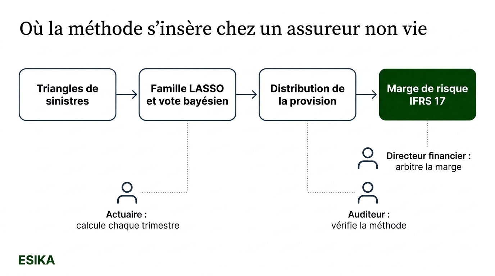

### 8.3 L'utilisation au quotidien

| Qui | Quand | Avec quoi | Pour quelle décision |
|---|---|---|---|
| Actuaire provisionnement | à chaque clôture trimestrielle | triangles par ligne d'activité, chaîne LASSO + vote + bootstrap automatisée | provision et distribution par ligne |
| Directeur financier, comité des risques | à chaque clôture | distribution agrégée, sensibilité aux portes, scénarios d'erreur externe | niveau du RA et niveau de confiance publié |
| Fonction actuarielle, auditeur | annuellement | code versionné, journal des portes et des réplications rejetées | validation de la méthode |

L'intégration la plus simple : une brique R/Python appelée par l'outil de provisionnement existant, qui lit les triangles et renvoie la distribution, le quantile et un rapport de contrôle (taux de réplications gardées, facteur de recentrage, sensibilité).

### 8.4 Les gains potentiels, chiffrés sur un exemple fictif

Toutes les hypothèses sont explicites et fictives. Prenons un assureur dont les provisions pour sinistres d'une ligne valent **500 millions d'euros**, avec une erreur totale de **7 %** (l'ordre de grandeur de nos résultats, a priori 1se). Avec l'approximation normale que les auteurs jugent raisonnable pour un quantile modéré (le quantile à 75 % est à 0,674 écart type au-dessus de la moyenne), le RA à 75 % vaut environ 0,674 × 7 % × 500 = **23,6 millions**.

- **Part de l'erreur de modèle interne.** Sur le jeu 2 (a priori 1se), retirer l'IMSE (1,8 %) du total le ramène de 7,0 % à 6,8 % (les variances s'additionnent). Le RA passe alors à environ 22,8 millions : **l'erreur de modèle interne pèse environ 0,8 million, soit 3,5 % du RA**.
- **Ce que cela ne permet pas.** Si le service ajoutait jusqu'ici un forfait de 20 % du RA pour incertitude de modèle (hypothèse fictive), soit 4,7 millions, la méthode ne justifie pas de le ramener à 0,8 million : ce forfait couvre aussi, en pratique, le biais et l'erreur externe, que l'IMSE exclut par construction et que nos tests montrent bien plus grands (section 5.7). L'IMSE documente une composante, environ 3,5 % du RA ; elle ne remplace pas le reste.
- **Gain de temps et de gouvernance.** La famille de modèles et la revue de robustesse sont automatiques ; le temps de calcul (environ 15 minutes par triangle sur 2 cœurs) se parallélise.

> **Attention : le risque le plus important n'est pas celui que la méthode mesure.** Sur nos données, le biais moyen du modèle 1se (+24 % à +35 %) est trois à cinq fois plus grand que l'erreur totale mesurée (7 %). Sur l'exemple, un biais de 24 % représenterait 120 millions, contre un RA de 23,6 millions. La méthode ne doit donc **jamais** être utilisée seule pour fixer la provision ni vendue comme une mesure complète de l'incertitude. Elle doit tourner **à côté** d'une méthode de référence peu biaisée (Mack, bootstrap ODP), avec un contrôle a posteriori sur les clôtures passées, et l'erreur externe doit être traitée à part, par scénarios (inflation future, gestion des sinistres, jurisprudence).

### 8.5 Prérequis et risques

- **Données** : triangles assez profonds (quelques centaines de cellules), stables dans leur définition.
- **Gouvernance des modèles** : la méthode remplace un modèle par des centaines ; il faut documenter la base de fonctions, la grille, les portes, la fonction de variance et l'a priori.
- **Validation** : contrôle d'homogénéité des résidus, taux de rejet, facteur de recentrage, comparaison à Mack ou au bootstrap ODP, contrôle a posteriori sur les clôtures passées.
- **Explicabilité** : un comité doit comprendre que la provision est un vote. La figure du vote et la sensibilité aux portes sont les deux supports clés.
- **Réglementaire** : IFRS 17 (RA et niveau de confiance publié), Solvabilité II (meilleure estimation et risque de provisionnement), ou les règles de provisionnement du Code CIMA selon le régime applicable ; la méthode complète ces cadres, elle ne remplace pas les exigences de suffisance des provisions.

### 8.6 Feuille de route

1. **Preuve de concept (4 à 6 semaines)** : une ligne d'activité, triangles historiques ; reproduire la chaîne, comparer au RA actuel et à Mack, tester l'homogénéité des résidus et la sensibilité aux portes ; contrôle a posteriori sur les 8 dernières clôtures, **en premier** : si la provision du vote est biaisée comme sur nos données, on s'arrête là ou on corrige avant d'aller plus loin.
2. **Pilote (2 clôtures)** : 3 à 4 lignes en parallèle de la méthode actuelle ; calibrer les portes par ligne ; écrire la note méthodologique pour la fonction actuarielle et l'auditeur ; ajouter les scénarios d'erreur externe.
3. **Industrialisation** : chaîne automatisée et versionnée, rapport de contrôle à chaque clôture, validation indépendante annuelle.

**Indicateurs de succès** : écart moyen à la méthode de référence et aux paiements réalisés des clôtures passées inférieur à l'erreur annoncée ; taux de réplications gardées supérieur à 80 % ; facteur de recentrage entre 0,9 et 1,1 ; quantiles a posteriori cohérents avec les écarts réellement observés sur les clôtures passées ; zéro remarque d'audit sur la justification du RA ; temps de calcul compatible avec le calendrier de clôture.

## 9. Conclusion

Trois idées à retenir :

1. **L'erreur de modèle interne se mesure** : en faisant voter, avec des poids bayésiens, les modèles qu'un LASSO fabrique automatiquement. Elle est faible sur le seul modèle principal et pèse 1 à 2 % une fois le bootstrap appliqué.
2. **Le résultat dépend de réglages qu'il faut publier** : fonction de variance des résidus, finesse de la grille, largeur des portes. Dans notre reproduction, le protocole littéral n'a pas fonctionné et les portes de la Table 2 ont rejeté presque toutes les réplications du jeu 1.
3. **Le vrai danger est ailleurs** : sur 20 triangles par jeu, la provision du vote surestime les paiements réalisés de 24 % à 35 % en moyenne, un biais que rien dans l'erreur mesurée ne signale. À utiliser à côté d'une méthode de référence, jamais seule.

La question ouverte la plus intéressante : peut-on corriger le biais de la famille LASSO (par exemple en réajustant sans pénalité la structure de chaque modèle, piste que McGuire et al. 2021 jugeaient décevante) sans perdre la richesse de la famille, et peut-on rendre les portes objectives ? Les auteurs posent eux-mêmes la seconde question.

## Annexe A : critères de vérification et écarts au protocole

### A.1 Les critères, fixés avant exécution

Avant le premier calcul, nous avons traduit six affirmations du papier en critères chiffrés (fichier de travail `retro.md`). Le tableau est produit par `src/criteria.py` (`results/criteres.csv`). Quatre changements sont intervenus après le début des calculs, dans cet ordre :

1. **Fonction de variance des résidus** (après avoir vu le bootstrap du jeu 1 en protocole littéral, 300 réplications) : passage des résidus Gamma aux résidus ODP.
2. **Largeur des portes** (après un pilote de 20 réplications sur le jeu 1, avant de voir le jeu 2) : les portes x 1,1 deviennent la configuration de travail. C1 et C5 sont donc évalués à x 1,1 ; avec les portes de la Table 2, C5 échouerait sur le jeu 1 (2,4 % et 2,3 %, calculés sur 3 et 7 réplications).
3. **Seuil d'interprétabilité** (après exécution) : un rapport C3 calculé sur moins de 30 réplications gardées (10 %) est déclaré non évaluable ; ce seuil ne figurait pas dans les critères initiaux.
4. **Ajout de C3 bis** (après exécution), signalé comme tel.

| Critère | Formulation | Jeu, a priori | Valeur | Vérifié |
|---|---|---|---|---|
| C1 | Le bootstrap épaissit l'IMSE du modèle principal | jeu 1, 1se | 0,26 % → 1,49 % | oui |
| C1 | Le bootstrap épaissit l'IMSE du modèle principal | jeu 1, minCV | 0,71 % → 1,40 % | oui |
| C1 | Le bootstrap épaissit l'IMSE du modèle principal | jeu 2, 1se | 0,47 % → 1,83 % | oui |
| C1 | Le bootstrap épaissit l'IMSE du modèle principal | jeu 2, minCV | 0,32 % → 1,34 % | oui |
| C2 | Un modèle éliminé par les portes portait au moins 0,05 du poids avant élagage | jeu 1, 1se | 0 modèle(s) ; 481 éliminés, poids total avant élagage inférieur à 0,0001 | non |
| C2 | Un modèle éliminé par les portes portait au moins 0,05 du poids avant élagage | jeu 2, 1se | 0 modèle(s) ; 450 éliminés, poids total avant élagage inférieur à 0,0001 | non |
| C3 | Portes x 1,1 / Table 2 : rapport des erreurs totales entre 1,2 et 1,8 | jeu 1, 1se | non évaluable : 3,07 calculé sur 3 réplications gardées avec la Table 2 | non évaluable |
| C3 | Portes x 1,1 / Table 2 : rapport des erreurs totales entre 1,2 et 1,8 | jeu 1, minCV | non évaluable : 3,39 calculé sur 7 réplications gardées avec la Table 2 | non évaluable |
| C3 | Portes x 1,1 / Table 2 : rapport des erreurs totales entre 1,2 et 1,8 | jeu 2, 1se | 1,39 | oui |
| C3 | Portes x 1,1 / Table 2 : rapport des erreurs totales entre 1,2 et 1,8 | jeu 2, minCV | 1,12 | non |
| C3 bis | (ajouté après exécution) Portes x 1,2 / x 1,1 : rapport entre 1,2 et 1,8 | jeu 1, 1se | 1,04 | non |
| C3 bis | (ajouté après exécution) Portes x 1,2 / x 1,1 : rapport entre 1,2 et 1,8 | jeu 1, minCV | 1,05 | non |
| C3 bis | (ajouté après exécution) Portes x 1,2 / x 1,1 : rapport entre 1,2 et 1,8 | jeu 2, 1se | 1,07 | non |
| C3 bis | (ajouté après exécution) Portes x 1,2 / x 1,1 : rapport entre 1,2 et 1,8 | jeu 2, minCV | 1,05 | non |
| C4 | Erreur de paramètre du LASSO supérieure à celle du GLM de structure connue | jeu 1, 1se | 7,1 % contre 8,9 % | non |
| C4 | Erreur de paramètre du LASSO supérieure à celle du GLM de structure connue | jeu 2, 1se | 6,7 % contre 5,7 % | oui |
| C5 | Erreur totale entre 5 % et 20 % | jeu 1, 1se | 7,3 % | oui |
| C5 | Erreur totale entre 5 % et 20 % | jeu 1, minCV | 8,0 % | oui |
| C5 | Erreur totale entre 5 % et 20 % | jeu 2, 1se | 7,0 % | oui |
| C5 | Erreur totale entre 5 % et 20 % | jeu 2, minCV | 9,0 % | oui |
| C6 | Moyenne bayésienne à moins de 3 % du 1se seul | jeu 1, 1se | 0,08 % | oui |
| C6 | Moyenne bayésienne à moins de 3 % du 1se seul | jeu 1, minCV | 2,17 % | oui |
| C6 | Moyenne bayésienne à moins de 3 % du 1se seul | jeu 2, 1se | 0,11 % | oui |
| C6 | Moyenne bayésienne à moins de 3 % du 1se seul | jeu 2, minCV | 0,21 % | oui |

### A.2 Le bootstrap : les deux écarts au protocole en détail

**Premier écart : la fonction de variance des résidus.** Le papier rééchantillonne les résidus réduits par la variance Gamma (φ µ²) et demande de vérifier qu'ils sont homogènes. Sur nos données, ils ne le sont pas :

| Écart type des résidus réduits | Développement 1-2 | 3-10 | 11-25 | 26-40 |
|---|---|---|---|---|
| Variance Gamma (papier), jeu 1 | 1,52 | 0,74 | 0,50 | 1,26 |
| Variance proportionnelle à µ (ODP), jeu 1 | 0,76 | 1,08 | 0,95 | 0,87 |
| Variance Gamma (papier), jeu 2 | 1,50 | 0,69 | 0,49 | 1,40 |
| Variance proportionnelle à µ (ODP), jeu 2 | 0,73 | 0,98 | 0,95 | 1,13 |

*Source : `results/homogeneite_residus.csv`.*

La raison tient au générateur : sa variance est proportionnelle à la moyenne, si bien que les petites cellules (premiers développements, fin de queue) sont bien plus bruitées, en relatif, que les grosses. En rééchantillonnant les résidus Gamma, on injecte le bruit des petites cellules dans les grosses. Résultat sur le jeu 1 avec le protocole littéral : au niveau de pénalité du 1se, les provisions des pseudo-triangles vont de 82 à 1 052 (5 % à 95 %) autour de 195, et seules 19 réplications sur 300 passent les portes (`results/bootstrap_protocole_litteral.csv`). **Nous avons donc rééchantillonné des résidus réduits par √µ** (le bootstrap ODP classique d'England et Verrall), homogènes ici, et calculé l'erreur de processus avec la même fonction de variance. Le vote garde la vraisemblance Gamma du papier.

**Second écart : la largeur des portes.** Même avec des résidus homogènes, les pseudo-triangles surestiment les prévisions, surtout sur les dernières survenances : le facteur de recentrage du papier vaut 0,83 (jeu 1) et 0,90 (jeu 2) pour l'a priori 1se. Ce facteur unique ramène bien la moyenne, mais il pousse les paiements des deux prochains trimestres sous la porte basse de 91 %. Avec les portes de la Table 2, 3 réplications sur 300 passent sur le jeu 1 (282 sur 300 sur le jeu 2). Avec les portes élargies d'un facteur 1,1, la variante de sensibilité du papier, 294 à 299 réplications passent sur les deux jeux, quel que soit l'a priori. Nous avons décidé, **après le test du jeu 1 et avant de voir le jeu 2**, de retenir cette largeur comme configuration de travail. Le critère C3 tel que formulé (rapport x 1,1 / Table 2) devient non évaluable pour le jeu 1 ; nous le donnons pour le jeu 2 et ajoutons, en le signalant comme ajouté après coup, le rapport x 1,2 / x 1,1.

## Références

- Taylor, G. et McGuire, G. (2023). *Model Error (or Ambiguity) and Its Estimation, with Particular Application to Loss Reserving*. Risks, 11(11), 185. doi : 10.3390/risks11110185.
- McGuire, G., Taylor, G. et Miller, H. (2021). *Self-assembling insurance claim models using regularized regression and machine learning*. Variance, 14.
- McGuire, G. (2023). Exemple commenté et code R : grainnemcguire.github.io, billet « model error example » du 4 mai 2023.
- Institute and Faculty of Actuaries, groupe MLR : billet « Foundations : LASSO » (code du générateur de données).
- Mack, T. (1993). *Distribution-free calculation of the standard error of chain ladder reserve estimates*. ASTIN Bulletin, 23(2).
- England, P. et Verrall, R. (2002). *Stochastic claims reserving in general insurance*. British Actuarial Journal, 8.
- HM Treasury, Financial Reporting Advisory Board (2021). *FRAB 145 (11) IFRS 17 Update* : niveau de confiance du risk adjustment (paragraphe 119 d'IFRS 17).
- Code et résultats de cet article : https://github.com/solo78/esika-articles-techniques/tree/main/2026-11_deep_erreur-modele-provisionnement

*Esika : Financial Engineering & Process Optimization*
