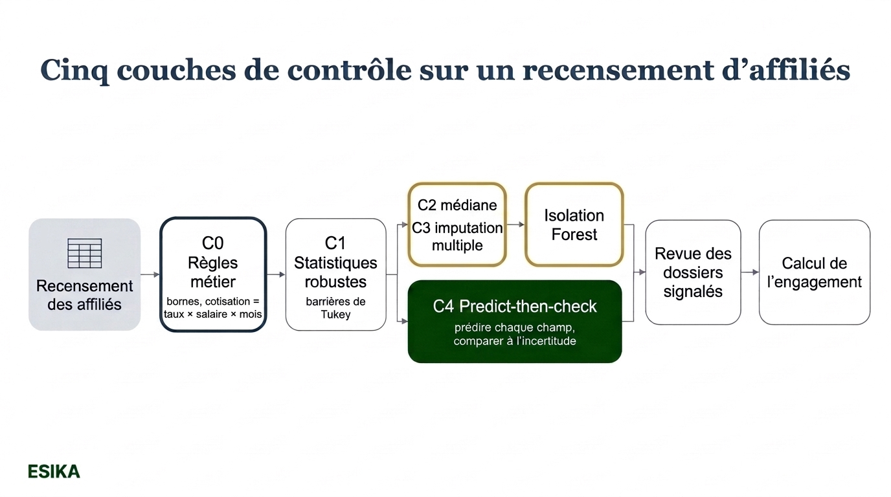
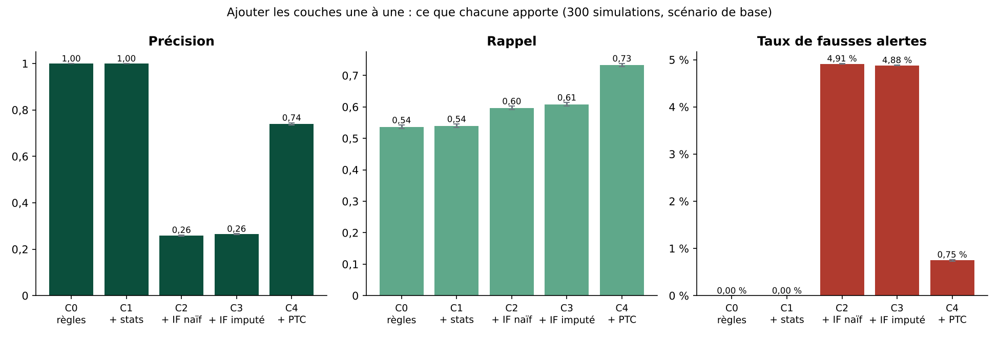
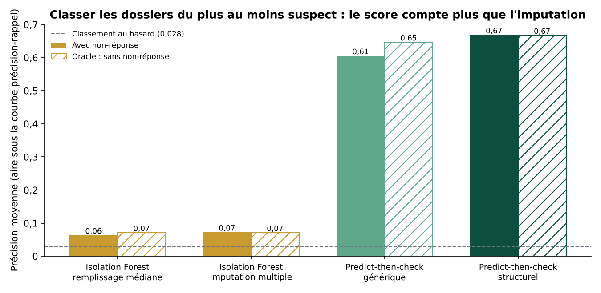
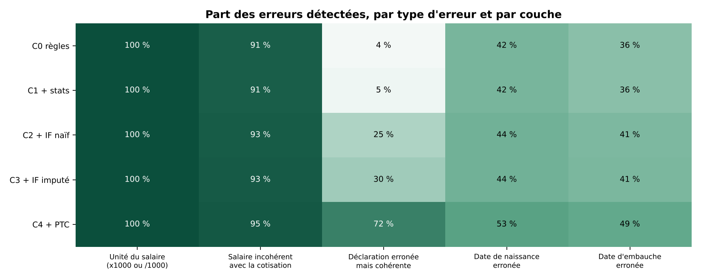
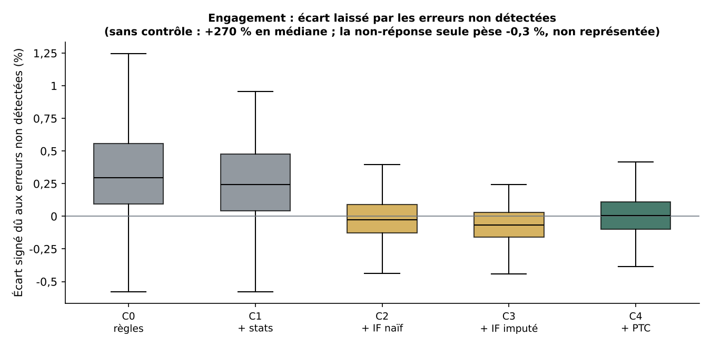
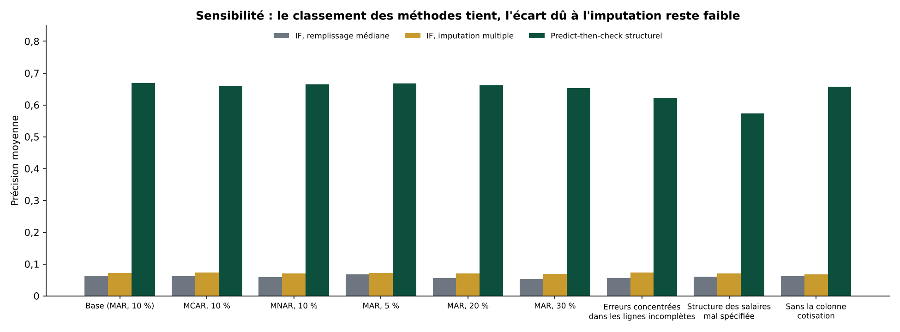
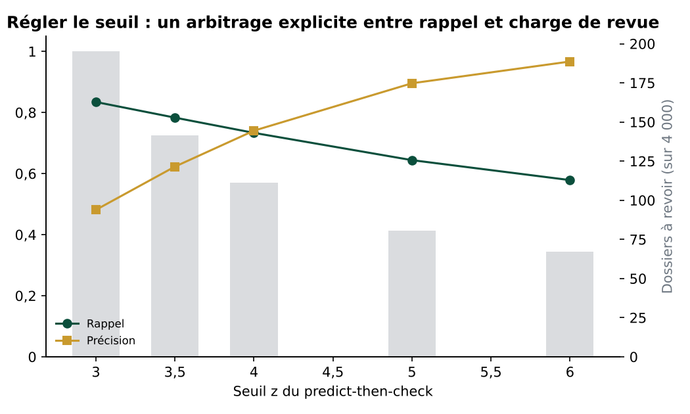

# Imputer pour mieux contrôler ? Ce qu'un recensement d'affiliés nous apprend sur le contrôle qualité « augmenté »

*Une équipe de BlackRock propose de faire du contrôle qualité des données un composant à part entière des chaînes de modélisation, avec une brique dédiée aux valeurs manquantes. Nous avons transposé l'idée au recensement d'une caisse de retraite et l'avons testée sur 300 simulations par scénario. Sur ce recensement, compléter les trous avant de chercher les anomalies change peu de chose. Ce qui fait la différence, c'est de confronter chaque valeur à ce que les autres champs laissent attendre, à condition que ce modèle de contrôle soit lui-même validé.*



---

## 1. Le problème : un fichier incomplet, des alertes qu'on finit par ignorer

Toute évaluation actuarielle d'un régime de retraite commence par le même fichier : le recensement des affiliés. Âge, catégorie, date d'embauche, salaire, cotisations de l'année. Ce fichier arrive rarement propre. Certaines lignes portent des erreurs (un salaire saisi en francs au lieu de milliers de francs, une date de naissance décalée), d'autres sont simplement incomplètes : l'employeur n'a pas transmis le salaire, la date d'embauche s'est perdue dans un changement de système.

Les deux problèmes se mêlent. Un contrôle automatique qui voit une ligne incomplète peut la prendre pour une anomalie ; un contrôle qui complète la ligne trop vite peut masquer une vraie erreur. Et un contrôle qui produit trop de fausses alertes finit toujours de la même façon : l'équipe cesse de les lire.

C'est précisément le terrain d'un article publié en décembre 2025 par six auteurs de BlackRock, qui propose de traiter l'imputation des valeurs manquantes comme une étape gouvernée du contrôle qualité, et non comme une correction faite en passant. Nous avons voulu savoir ce que cette idée apporte, concrètement, sur un recensement d'affiliés.

## 2. Ce que propose l'équipe de BlackRock

Saini et al. (2025) décrivent un système de contrôle qualité des données (« Data QC ») conçu pour les environnements réglementés, la finance servant d'exemple. Leur point de départ figure dès le résumé : traiter le contrôle qualité « as a system concern rather than an afterthought », comme une préoccupation du système plutôt que comme une réflexion après coup.

L'architecture repose sur trois idées.

**Plusieurs niveaux de contrôle.** Un contrôle centralisé, au niveau de la plateforme de données, vérifie le schéma, les formats, les doublons et les identifiants avant que les données n'atteignent les équipes. Un contrôle au niveau du modèle, propre à chaque usage, détecte ce que le premier ne peut pas voir : dérive des variables, incohérences entre entrées et sorties, violations de contraintes métier. Un contrôle aval vérifie les sorties avant qu'elles ne soient consommées.

**Trois familles de contrôles.** Des règles (bibliothèques TensorFlow Data Validation et Great Expectations), des tests statistiques (bornes historiques, centiles, Z-score modifié, barrières de Tukey) et des détecteurs d'anomalies appris (bibliothèque PyOD, dont Isolation Forest et XGBOD). Les auteurs publient aussi un catalogue concret de contrôles d'une livraison à l'autre : nombre de lignes dans une plage attendue, variation du taux de valeurs manquantes et de la moyenne d'une colonne, corrélation entre deux livraisons successives, colonnes figées, identifiants en double, fichier manquant.

**Une brique dédiée aux valeurs manquantes**, organisée en trois temps :
1. profiler la non-réponse (taux de manquants, mécanisme probable : MCAR, MAR ou MNAR, voir l'encadré) ;
2. imputer avec une méthode adaptée (MissForest, MICE, SoftImpute, modèles temporels) ;
3. contrôler les résidus : des modèles légers prédisent la valeur attendue de chaque champ avec un intervalle de confiance, et un enregistrement est signalé quand l'écart est grand et l'incertitude faible. Les auteurs écrivent : « This predict-then-check mechanism transforms imputation from a black-box correction into a transparent and auditable safeguard. »

Sur un jeu public de transactions frauduleuses, les auteurs rapportent qu'un détecteur non supervisé précédé d'une imputation des valeurs manquantes passe d'une précision d'environ 0,74 et d'un rappel d'environ 0,53 à environ 0,90 pour les deux, avec un taux de faux positifs ramené d'environ 48 % à moins de 10 %.

> **Encadré : MCAR, MAR, MNAR, trois façons de manquer**
> - **MCAR** (*missing completely at random*) : la valeur manque par pur hasard, comme un fichier tronqué au mauvais endroit. Les lignes complètes restent représentatives.
> - **MAR** (*missing at random*) : la probabilité de manquer dépend d'informations observées. Par exemple, les salaires des affiliés les plus âgés, entrés avant la numérisation, manquent plus souvent. Une imputation qui tient compte de l'âge peut corriger le biais.
> - **MNAR** (*missing not at random*) : la probabilité de manquer dépend de la valeur elle-même. Par exemple, les salaires élevés sont moins souvent déclarés. Aucune imputation fondée sur les seules données observées ne peut alors corriger complètement le biais.

> **Encadré : Isolation Forest**
> Un algorithme non supervisé qui construit des arbres en coupant les données au hasard. Un point isolé en peu de coupes est jugé atypique. Il ne demande aucun exemple d'erreur, mais il ne connaît pas non plus les relations métier : il cherche ce qui est rare, pas ce qui est incohérent.

## 3. La transposition : le recensement d'une caisse de retraite

Le recensement d'une caisse se prête bien à l'exercice, pour trois raisons.

- **La non-réponse y est structurelle**, et rarement due au hasard : elle touche davantage certains employeurs, certaines catégories, les carrières anciennes. C'est du MAR, parfois du MNAR.
- **Les champs sont liés par des relations fortes** : la cotisation est un pourcentage du salaire sur les mois cotisés ; le salaire dépend de la catégorie, de l'âge et de l'ancienneté ; l'ancienneté ne peut pas dépasser l'âge moins l'âge minimal d'embauche.
- **L'enjeu se mesure en engagement.** Chaque erreur laissée dans le fichier se retrouve dans la valeur actuelle des droits acquis, et donc dans les comptes et les décisions de pilotage.

Nous comparons donc, sur le même fichier, cinq couches de contrôle ajoutées une à une, et nous mesurons à la fois leur capacité à trouver les erreurs et leur effet sur l'engagement.

> **Encadré : la valeur actuelle des droits acquis**
> Pour chaque affilié actif, on calcule la rente déjà acquise (ici : 1,5 % du salaire annuel par année d'ancienneté), payable à 60 ans, puis on l'actualise et on la pondère par la probabilité d'atteindre 60 ans. La somme sur tous les affiliés donne l'engagement. Le salaire et l'ancienneté y entrent en produit : une erreur sur l'un ou l'autre se répercute directement.

## 4. Cinq couches de contrôle

**C0, règles métier.** Les bornes (âge entre 16 et 65 ans, salaire mensuel entre 60 000 et 15 millions de FCFA, ancienneté positive et compatible avec l'âge) et une identité comptable : la cotisation doit valoir 12 % du salaire multiplié par le nombre de mois cotisés, à 10 % près.

```python
ratio = cotisation / (taux * salaire * nb_mois)
alerte |= abs(ratio - 1.0) > tolerance      # ne joue que si les trois champs sont renseignés
```

**C1, statistiques robustes.** Barrières de Tukey larges (trois écarts interquartiles) sur le salaire, la cotisation mensuelle et l'ancienneté, par catégorie.

**C2, Isolation Forest après remplissage par la médiane.** C'est la pratique la plus répandue quand un algorithme n'accepte pas de valeurs manquantes.

**C3, Isolation Forest après imputation multiple.** Cinq imputations par équations chaînées (MICE), scores moyennés. C'est la traduction directe de « imputer avant de détecter ».

**C4, predict-then-check.** Après imputation multiple, chaque champ observé (salaire, cotisation mensuelle, ancienneté, âge) est prédit à partir des autres par une régression robuste. On signale la ligne si l'écart dépasse quatre fois l'incertitude totale, qui additionne l'erreur du modèle et la dispersion entre imputations.

```python
z = abs(x_observe - moyenne_predictions) / sqrt(sigma_modele**2 + sigma_imputations**2)
alerte = z > 4
```

Le second terme du dénominateur traduit la condition du papier (*the associated uncertainty is low*) : si une prédiction repose sur des champs eux-mêmes imputés, les cinq imputations divergent, l'incertitude grandit et l'alerte devient plus difficile à déclencher.

Un choix de conception pèse lourd. Dans la version **générique**, chaque champ est prédit par tous les autres. Dans la version **structurelle** que nous retenons pour C4, le salaire n'est pas prédit par la cotisation (ni l'inverse) : leur cohérence comptable est déjà vérifiée par C0, et chacun est confronté à la structure (âge, ancienneté, catégorie, mois cotisés). La section 8 montre l'effet de ce choix, et ses limites.

Dans les trois couches apprises (C2 à C4), les modèles ne sont entraînés que sur les lignes que C0 et C1 n'ont pas signalées : on n'apprend pas sur ce qu'on sait déjà suspect.

> **Encadré : imputer quand deux colonnes sont liées par une identité**
> Salaire et cotisation sont presque proportionnels. Si on les laisse tous deux dans la chaîne d'imputation, une ligne où les deux manquent ne peut être complétée qu'à partir de l'autre, lui aussi manquant : l'algorithme reste bloqué près de la moyenne du fichier. Nous imputons donc de façon « passive » : un salaire manquant est d'abord déduit de la cotisation quand elle est connue, seul le salaire entre dans la chaîne, et la cotisation manquante est déduite du salaire imputé. Notre première version, qui ne prenait pas cette précaution, sous-estimait l'engagement de l'ordre de deux fois et demie à trois fois plus que la version finale ; c'est la relecture indépendante du code qui l'a révélé. Un modèle d'imputation est un modèle : il se valide.


*Illustration conceptuelle sur un affilié fictif (écart mesuré sur le logarithme du salaire, incertitude d'environ 0,22).*

## 5. Protocole

**Données.** Chaque simulation produit un recensement synthétique de 4 000 affiliés : trois catégories (employés, agents de maîtrise, cadres), âges de 22 à 60 ans, salaires log-normaux croissant avec l'ancienneté, cotisation à 12 %. Aucune donnée réelle n'est utilisée.

**Erreurs.** 3 % des lignes reçoivent une erreur, de cinq types :

| Type d'erreur | Ce qui change | Qui peut le voir ? |
|---|---|---|
| Unité du salaire | salaire multiplié ou divisé par 1 000 | règles (bornes) |
| Salaire incohérent | salaire multiplié ou divisé par 1,5 à 3, cotisation inchangée | règle de cohérence, si la cotisation est renseignée |
| Déclaration erronée mais cohérente | salaire et cotisation multipliés ou divisés par le même facteur (2 à 4) | essentiellement la structure catégorie, âge, ancienneté |
| Date de naissance | âge décalé de 8 à 15 ans | règles parfois, structure sinon |
| Date d'embauche | ancienneté décalée de 8 à 15 ans | règles parfois, structure sinon |

**Non-réponse.** Dans le scénario de base, salaire, cotisation et ancienneté manquent chacun dans 10 % des cas en moyenne, plus souvent chez les affiliés âgés et les employés (MAR). Une erreur sur un champ devenu manquant disparaît : on ne compte comme dossier erroné que celui dont une valeur erronée reste visible. En moyenne, 112 dossiers sur 4 000 sont erronés (2,8 %) et 24 % des lignes sont incomplètes.

**Seuils.** Pour Isolation Forest, le seuil est fixé par un budget de revue décidé a priori : 5 % des dossiers que C0 et C1 n'ont pas déjà signalés (C2 et C3 revoient donc 258 dossiers au total, soit 6,4 %). Le predict-then-check utilise son seuil statistique (z > 4), étudié en sensibilité. Pour comparer les méthodes indépendamment de tout seuil, nous calculons aussi la précision moyenne de leurs scores.

**Répétitions et tests.** 300 simulations par scénario. Tous les traitements voient exactement les mêmes fichiers (mêmes graines) et, pour le calcul de l'engagement, exactement les mêmes tirages d'imputation : les comparaisons sont appariées. Pour chaque écart, nous donnons l'intervalle de confiance à 95 % de la différence moyenne et le test de Wilcoxon sur les différences.

**Oracle.** Pour mesurer le coût propre de la non-réponse, nous rejouons les contrôles sur le même fichier, avec les mêmes erreurs, mais sans aucune valeur manquante.

**Impact sur l'engagement.** Les dossiers signalés sont revus et corrigés (une valeur erronée retrouve sa vraie valeur, une valeur manquante reste manquante), puis les trous sont comblés par imputation multiple et l'engagement est recalculé. Nous le comparons à l'engagement exact.

Aucune grandeur vraie n'entre dans un score ou une décision : elle ne sert qu'à l'évaluation.

> **Encadré : précision, rappel, précision moyenne**
> - **Précision** : parmi les dossiers signalés, la part réellement erronée. C'est ce que vit l'équipe qui fait la revue.
> - **Rappel** : parmi les dossiers erronés, la part signalée. C'est ce que vit l'actuaire qui calcule l'engagement.
> - **Taux de fausses alertes** : parmi les dossiers sains, la part signalée à tort.
> - **Précision moyenne** : on classe tous les dossiers du plus au moins suspect et on mesure la qualité de ce classement, sans choisir de seuil. Un classement au hasard vaut la part de dossiers erronés (ici 0,028) ; un classement parfait vaut 1.

## 6. Résultat 1 : ajouter les couches une à une



| Couche | Dossiers signalés (sur 4 000) | Précision | Rappel | Taux de fausses alertes | F1 |
|---|---|---|---|---|---|
| C0 règles métier | 60 | 1,00 | 0,54 | 0,00 % | 0,70 |
| C1 + statistiques robustes | 61 | 1,00 | 0,54 | 0,00 % | 0,70 |
| C2 + Isolation Forest, médiane | 258 | 0,26 | 0,60 | 4,91 % | 0,36 |
| C3 + Isolation Forest, imputation multiple | 258 | 0,26 | 0,61 | 4,88 % | 0,37 |
| C4 + predict-then-check | 111 | 0,74 | 0,73 | 0,75 % | 0,74 |

*Moyennes sur 300 simulations, scénario de base.*

Trois constats.

**Les règles métier forment un témoin difficile à battre.** Elles signalent 60 dossiers, tous erronés, et trouvent plus de la moitié des erreurs. Elles attrapent 100 % des erreurs d'unité, celles qui pèsent le plus sur l'engagement. Les barrières de Tukey n'ajoutent presque rien : les erreurs grossières sont déjà prises par les bornes, les autres restent dans la plage normale de leur catégorie.

**Isolation Forest ajoute surtout du bruit.** Pour environ 6 à 7 points de rappel supplémentaires, il faut revoir environ 197 dossiers de plus, dont 96 % à 97 % sont sains.

**Le predict-then-check fait le travail attendu.** Par rapport à C1, il gagne 19 points de rappel (IC à 95 % : [18,9 ; 19,7] points, p < 0,001) pour un taux de fausses alertes de 0,75 %, et demande 2,3 fois moins de revues que C3. Son F1 dépasse celui de C1 de 0,036 (IC [0,032 ; 0,040]), et celui de C3 de 0,37.

## 7. Résultat 2 : imputer avant de détecter, un effet réel mais marginal ici

Comparons C2 et C3, qui ne diffèrent que par la façon de compléter les trous, et revoient exactement le même nombre de dossiers.

| Mesure | C2 (médiane) | C3 (imputation multiple) | Écart apparié (IC à 95 %) |
|---|---|---|---|
| Précision | 0,259 | 0,264 | +0,005 [+0,004 ; +0,006] |
| Rappel | 0,597 | 0,608 | +0,012 [+0,010 ; +0,013] |
| Taux de fausses alertes | 4,91 % | 4,88 % | −0,03 point [−0,04 ; −0,03] |
| Précision moyenne du score | 0,063 | 0,072 | +0,009 [+0,008 ; +0,010] |

L'effet va dans le sens attendu et il est statistiquement net (p < 0,001 sur chaque mesure). Mais il est petit. À budget de revue identique, l'imputation ne peut que changer *quels* dossiers sont revus : sur 258 dossiers, C3 en trouve en moyenne un peu plus d'un erroné de plus que C2.

Le mécanisme est pourtant bien là. Sur les seules lignes saines **incomplètes**, le taux de fausses alertes passe de 5,88 % avec la médiane à 5,14 % avec l'imputation multiple ; sur les lignes complètes, il augmente légèrement (4,61 % contre 4,80 %), le budget se reportant sur elles. Remplir un salaire manquant par la médiane fabrique bien des lignes atypiques que la forêt signale à tort, et l'imputation corrige une partie de ce défaut. Mais ces lignes ne sont qu'une minorité du fichier, et le défaut principal d'Isolation Forest est ailleurs.



La figure 2 le montre. Même sans aucune valeur manquante (barres hachurées), Isolation Forest classe à peine mieux que le hasard : 0,071, pour un niveau de hasard de 0,030 dans ce cas (sans manquants, les 120 erreurs injectées restent toutes visibles). Le predict-then-check atteint 0,668, et la non-réponse ne lui coûte presque rien (0,667 sans manquants). La raison tient à la nature des erreurs : une erreur de recensement est rarement une valeur rare, c'est une valeur **incohérente avec le reste de la ligne**. Un salaire de cadre attribué à un employé n'a rien d'extrême à l'échelle du fichier. Il n'est anormal qu'au regard de la catégorie, de l'âge et de l'ancienneté.

À budget égal (les 200 dossiers les plus suspects selon chaque score), le predict-then-check trouve 78 % des erreurs avec une précision de 44 %, contre 14 % et 8 % pour Isolation Forest après imputation.

## 8. Résultat 3 : ce que voit, et ne voit pas, le predict-then-check



La figure 3 détaille la part des erreurs trouvées par type.

- **Unité du salaire** : 100 % dès les règles. Aucune couche apprise n'est nécessaire.
- **Salaire incohérent avec la cotisation** : 91 % par les règles, près de 95 % avec C4. Par construction, les 9 % manqués par les règles sont des lignes où la cotisation manque : la règle de cohérence ne peut pas jouer.
- **Déclaration erronée mais cohérente** : 5 % avec C1, 30 % avec C3, **72 % avec C4**. C'est là que se joue la différence.
- **Dates de naissance et d'embauche** : de 42 % et 36 % avec les règles à 53 % et 49 % avec C4. Un décalage de 8 à 15 ans reste souvent plausible ; c'est la limite de ce que la structure peut révéler.

La version générique du predict-then-check, qui prédit le salaire par la cotisation, ne trouve que **8 %** des déclarations erronées mais cohérentes. Quand salaire et cotisation sont faux ensemble, chacun « explique » parfaitement l'autre : le modèle conclut que tout va bien. La redondance entre champs, si utile pour les règles, aveugle un modèle qui l'exploite sans discernement. Dans le scénario de base, la précision moyenne de la version générique est de 0,605, contre 0,668 pour la version structurelle (écart apparié +0,063, IC [0,058 ; 0,068]).

Ce résultat doit être lu avec deux précautions. D'abord, la version structurelle a été conçue en connaissant la typologie des erreurs injectées, dont l'une est justement construite pour échapper à la règle comptable. Ensuite, quand le modèle de contrôle est mal spécifié (section 10), c'est la version générique qui l'emporte légèrement (0,583 contre 0,573, IC de l'écart [−0,015 ; −0,005]). Le bon choix dépend donc des erreurs qu'on redoute et de la qualité du modèle.

## 9. Résultat 4 : l'engagement, et le coût propre de la non-réponse

Sans aucun contrôle, l'engagement calculé dépasse l'engagement exact de 334 % en moyenne (270 % en médiane), presque entièrement à cause des erreurs d'unité. Les règles suffisent à supprimer ce risque.



Pour isoler l'effet des seules erreurs non détectées, la figure 6 compare chaque traitement à la situation où toutes les erreurs seraient corrigées (écarts signés). En valeur absolue, l'écart moyen passe de 0,40 % de l'engagement avec les règles seules à 0,33 % avec C1, puis environ 0,13 % à 0,14 % avec C2, C3 et C4, sans différence significative entre ces trois couches (C3 contre C4 : p = 0,59). Isolation Forest, en revoyant 258 dossiers, finit sans doute par attraper une bonne part des salaires les plus gonflés, qui pèsent le plus dans l'engagement ; c'est une hypothèse compatible avec nos résultats, que nous n'avons pas testée isolément. Le predict-then-check obtient le même résultat avec 111 dossiers.

Reste la non-réponse elle-même. **Même quand toutes les erreurs sont corrigées, les salaires et anciennetés manquants doivent être imputés**, et l'imputation déplace l'engagement :

| Scénario de non-réponse | Écart moyen sur l'engagement, toutes erreurs corrigées |
|---|---|
| MCAR, 10 % par champ | −0,1 % |
| MAR, 5 % | −0,1 % |
| MAR, 10 % (base) | −0,3 % |
| MAR, 20 % | −0,9 % |
| MAR, 30 % (taux effectif d'environ 28 % par champ) | −1,7 % |
| **MNAR, 10 %** (salaires élevés et anciennetés longues plus souvent absents) | **−4,2 %** |

Sous MAR, le biais reste modéré mais croît avec le taux de non-réponse : le modèle d'imputation, linéaire, reproduit imparfaitement la structure âge, ancienneté, salaire, et l'engagement multiplie ces grandeurs. Sous MNAR, la détection n'est pas affectée (F1 de C4 : 0,736 en base, 0,735 sous MNAR), mais l'engagement est sous-estimé d'environ 4 % (entre −5,1 % et −3,3 % pour 90 % des simulations). L'imputation ne peut pas reconstruire des salaires élevés à partir de lignes dont, justement, les salaires élevés ont disparu. Sur un recensement, **le risque principal laissé par la non-réponse ne se situe pas dans la détection des anomalies, il se situe dans l'engagement**.

## 10. Sensibilités



| Scénario | Précision moyenne IF médiane | IF imputé | Predict-then-check | F1 C1 | F1 C4 |
|---|---|---|---|---|---|
| Base (MAR, 10 %) | 0,063 | 0,072 | 0,668 | 0,70 | 0,74 |
| MCAR, 10 % | 0,062 | 0,073 | 0,660 | 0,70 | 0,73 |
| MNAR, 10 % | 0,059 | 0,071 | 0,664 | 0,70 | 0,74 |
| MAR, 30 % | 0,052 | 0,069 | 0,653 | 0,67 | 0,73 |
| Erreurs concentrées dans les lignes incomplètes | 0,055 | 0,073 | 0,622 | 0,66 | 0,70 |
| Structure des salaires mal spécifiée | 0,060 | 0,071 | 0,573 | 0,70 | **0,64** |
| Sans la colonne cotisation | 0,062 | 0,067 | 0,657 | 0,54 | 0,66 |

Le classement des méthodes tient partout. Le gain de l'imputation pour Isolation Forest augmente avec le taux de non-réponse (+0,017 de précision moyenne à 30 %, contre +0,009 à 10 %) et quand les erreurs se concentrent dans les lignes incomplètes (+0,018), mais reste d'un ordre de grandeur inférieur à l'écart avec le predict-then-check.

Deux scénarios méritent l'attention.

**Structure des salaires mal spécifiée.** Nous avons rendu la vraie relation non linéaire (pentes de carrière différentes par catégorie, plafonnement après 25 ans, queues de distribution épaisses) alors que le modèle de contrôle reste additif et linéaire. Le predict-then-check signale alors 152 dossiers, sa précision tombe à 0,56 et son taux de fausses alertes monte à 1,7 %. Son F1 (0,64) passe **sous** celui de C1 (0,70 ; écart −0,059, IC [−0,062 ; −0,055]). Un contrôle par modèle n'est jamais meilleur que le modèle : il faut le valider avant de lui confier une revue.

**Sans la colonne cotisation.** La règle de cohérence disparaît et C1 ne trouve plus que 37 % des erreurs. Le predict-then-check en trouve encore 62 % : c'est le cas où il apporte le plus (F1 +0,12).



Le seuil, enfin, est un arbitrage explicite. À z > 3, on revoit 195 dossiers pour un rappel de 83 % et une précision de 48 %. À z > 6, on n'en revoit que 67, avec une précision de 97 % et un rappel de 58 %. Le bon réglage dépend de la capacité de revue de l'équipe, pas d'une valeur universelle.

## 11. En pratique : ce qu'une caisse peut mettre en place

Le cadre de l'équipe de BlackRock se transpose bien, à condition de garder l'ordre des priorités que montrent nos résultats.

1. **Écrire d'abord les règles métier**, versionnées dans un fichier de configuration : bornes, identité cotisation = taux × salaire × mois, cohérence âge / ancienneté, unicité des identifiants. Dans notre test, c'est la couche la plus précise.
2. **Ajouter les contrôles de livraison** inspirés du catalogue du papier, d'un recensement à l'autre : nombre de lignes, taux de manquants par champ et par employeur, moyenne des salaires par catégorie, part d'affiliés présents aux deux dates.
3. **Profiler la non-réponse avant d'imputer** : par employeur, par âge, par catégorie, et, quand c'est possible, en comparant aux salaires de l'année précédente. Un soupçon de MNAR appelle une collecte complémentaire, pas une imputation plus sophistiquée.
4. **Imputer en respectant les identités comptables** : une seule des deux variables liées dans la chaîne, l'autre déduite. Et vérifier le biais de l'imputation par configuration de manquants avant de l'expliquer.
5. **Confronter chaque valeur à la structure** plutôt que chercher ce qui est rare : un predict-then-check par champ, avec une incertitude qui tient compte des imputations, en choisissant consciemment quels prédicteurs exclure.
6. **Valider le modèle de contrôle** comme un modèle actuariel : spécification, résidus par catégorie, taux d'alerte sur une base saine.
7. **Fixer le seuil par la capacité de revue**, avec deux niveaux de sévérité comme le prévoit le papier (arrêt du traitement ou simple notification) ; nous suggérons de réserver l'arrêt aux violations de règles.
8. **Tracer chaque décision** : dossier signalé, motif, valeur prédite, correction retenue. C'est ce qui rend l'imputation auditable.

## 12. Limites

- **Données synthétiques.** Le générateur est volontairement simple ; un vrai recensement contient des doublons, des changements de catégorie, des carrières interrompues, des employeurs multiples.
- **Un modèle de contrôle bien spécifié par construction.** Dans le scénario de base, la régression du predict-then-check a exactement la forme du générateur des salaires. Le scénario mal spécifié montre ce que coûte l'écart ; sur données réelles, il faut s'attendre à des performances intermédiaires.
- **Erreurs choisies.** Nous avons choisi cinq types d'erreurs, et la version structurelle du predict-then-check a été conçue en les connaissant. Une autre typologie (par exemple des erreurs rares mais extrêmes dans des champs non liés) favoriserait davantage Isolation Forest.
- **Une seule famille de détecteurs non supervisés.** Nous n'avons testé ni XGBOD (qui demande des exemples étiquetés), ni d'autres algorithmes de PyOD, ni une forêt sur des variables normalisées par catégorie, qui serait un témoin un peu plus fort. Le constat porte sur Isolation Forest tel que paramétré ici.
- **Imputation linéaire.** MICE avec régressions linéaires et traitement passif de la cotisation ; une imputation non linéaire réduirait probablement le biais résiduel sous MAR, sans rien changer au fond du problème sous MNAR.
- **Revue parfaite.** Nous supposons qu'un dossier revu est corrigé. En réalité, la revue a un coût et un taux d'erreur.
- **Un modèle d'engagement simplifié** (rente proportionnelle au dernier salaire, table de survie paramétrique, pas de revalorisation).
- **Un contexte différent de celui du papier.** Les auteurs travaillent sur des flux financiers et des transactions ; nos conclusions valent pour des données à forte structure métier, comme un recensement.

## 13. Conclusion

L'architecture proposée par l'équipe de BlackRock pose la question de fond : la qualité des données est une affaire de système, pas de prétraitement. Sur un recensement d'affiliés, notre test en précise la réponse. Imputer avant de chercher les anomalies réduit un peu les fausses alertes sur les lignes incomplètes, mais l'essentiel du gain vient de la brique « résidus et incertitude » : prédire chaque valeur à partir de la structure métier et la confronter à l'incertitude, avec un modèle de contrôle validé comme n'importe quel modèle actuariel. Et le risque que la non-réponse fait peser sur l'engagement ne se règle pas dans le contrôle qualité : il se règle dans la collecte et dans la validation du modèle d'imputation.

**Une erreur de recensement est rarement une valeur rare, c'est une valeur incohérente : on la trouve en prédisant, plus qu'en isolant.**

---

### Références

- Saini, D., Jain, B., Ujjwal, N., Sommer, P., Mbanga, D. R., Mehta, D. (2025). *A Unified AI System For Data Quality Control and DataOps Management in Regulated Environments*. arXiv:2512.05559. Les opinions exprimées sont celles des auteurs et non de BlackRock, Inc.
- Liu, F. T., Ting, K. M., Zhou, Z.-H. (2008). *Isolation Forest*. IEEE International Conference on Data Mining.
- Van Buuren, S., Groothuis-Oudshoorn, K. (2011). *mice: Multivariate Imputation by Chained Equations in R*. Journal of Statistical Software, 45(3).
- Rubin, D. B. (1976). *Inference and missing data*. Biometrika, 63(3).
- Zhao, Y., Nasrullah, Z., Li, Z. (2019). *PyOD: A Python Toolbox for Scalable Outlier Detection*. Journal of Machine Learning Research, 20(96).

### Code et résultats

Le code complet (simulation, contrôles, évaluation, figures), les versions de bibliothèques utilisées et tous les fichiers de résultats sont publics : [github.com/solo78/esika-articles-techniques](https://github.com/solo78/esika-articles-techniques/tree/main/2026-11_imputation-controle-qualite). La commande `python run_all.py` reproduit l'ensemble des chiffres de cet article (environ 70 minutes sur deux cœurs) ; `python run_all.py --analyse` refait l'analyse et les figures en une minute à partir des simulations publiées.

---

*Esika : Financial Engineering & Process Optimization*
