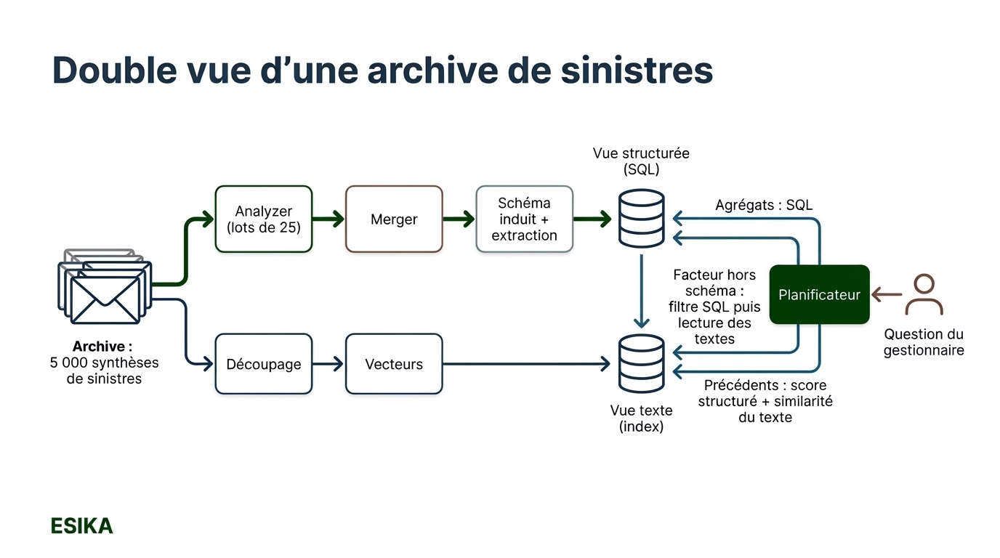
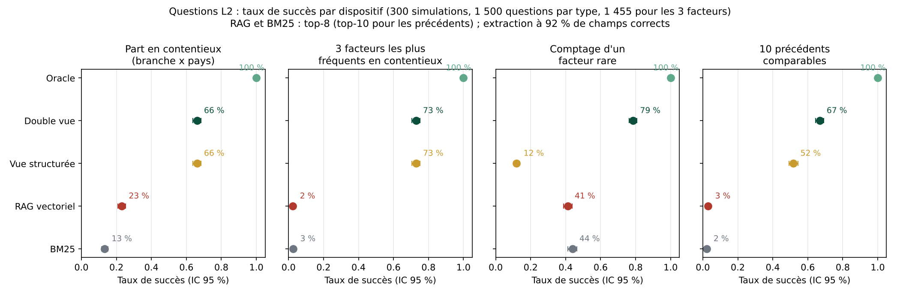
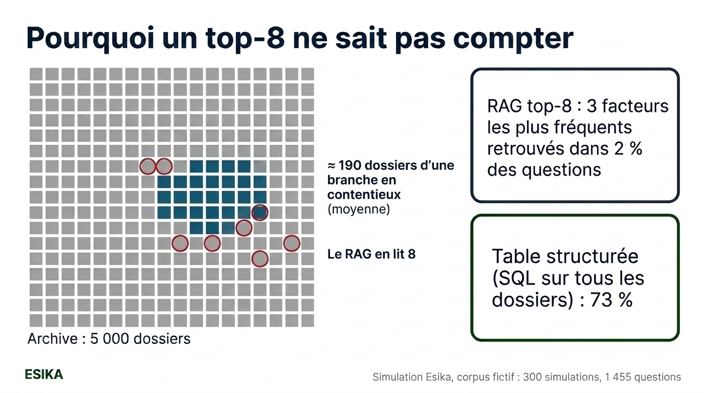
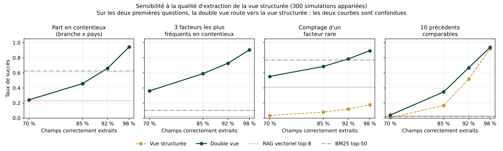
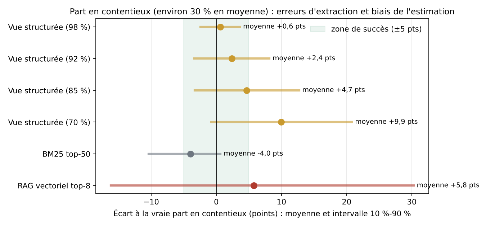

# Une archive de sinistres ne se lit pas, elle s'interroge

*Allianz décrit EKA, un assistant multi-agents qui donne aux gestionnaires de sinistres graves l'accès à plus de 5 000 dossiers passés. Le papier évalue l'outil avec des notes d'experts, sans mesurer l'exactitude des réponses. Nous avons reconstruit le principe sur une archive fictive dont la vérité est connue : 300 simulations, puis 111 appels réels à des LLM. Trois constats en sortent. Un RAG qui lit 8 extraits ne sait pas agréger : sur les parts et les facteurs dominants d'une population, il réussit 2 à 23 % des questions, contre 66 à 73 % pour une table extraite. Cette table hérite des biais de l'extraction. Et pour compter un événement rare, ce n'est pas la précision moyenne qui décide, mais le taux de faux positifs.*



## 1. Le savoir dormant des sinistres graves

Un sinistre grave ne se règle pas avec un barème. Incendie d'usine, pollution, rançongiciel, responsabilité produits aux États-Unis : chaque dossier mobilise des experts, des avocats, parfois plusieurs coassureurs, et des décisions de provisionnement qui engagent des millions. Le gestionnaire qui décide d'une stratégie aimerait savoir comment les cas comparables ont tourné : combien sont partis en contentieux, quels facteurs revenaient, quelles réserves ont dû être révisées.

Cette mémoire existe, mais elle dort dans des courriels, des notes de synthèse et des comptes rendus d'expertise. L'interroger demande de savoir écrire une requête, d'avoir accès aux bonnes bases ou de connaître le collègue qui « se souvient de ce dossier de 2017 ». Le savoir effectivement mobilisé dépend donc de l'ancienneté de la personne au bureau.

C'est exactement le problème que traite le papier d'Allianz. Il pose aussi une question plus générale, que l'on retrouve chez les caisses de retraite, les mutuelles ou les équipes actuarielles : **comment rendre interrogeable une archive textuelle sans perdre en rigueur ?**

## 2. Ce que propose EKA

Le papier « EKA, Enterprise Knowledge Assistant: Collaborative Multi-Agent AI for Large Claims Handling » (Loffredo, Liu, Chen, Fu, Ahrens, Lu et Chen, *Applied System Innovation*, 2026, 9, 62, publié le 17 mars 2026) décrit un système déployé chez Allianz Commercial. Les auteurs le positionnent comme un *sparring partner* du gestionnaire, pas comme un moteur de décision.

**L'architecture.** Quatre agents se succèdent :
- un *Planner* décompose la question en instructions ;
- un *DataSelector* va chercher les données utiles ;
- un *InfoExtractor* en tire les faits et les régularités ;
- un *Summarizer* rédige la réponse.

Un objet partagé, que les auteurs appellent *ledger*, transporte l'état de la conversation et les directives JSON renvoyées par le modèle d'un agent à l'autre.

**La double vue.** C'est le point le plus intéressant. La source unique est une archive de plus de 5 000 synthèses de sinistres au format courriel. Elle est préparée de deux façons :
- **Une vue structurée.** Un agent *Analyzer* lit des lots de synthèses et propose des champs. Un agent *Merger* consolide ces propositions en un schéma relationnel d'environ 30 champs, produit le DDL SQL et les consignes d'extraction. La table est ensuite remplie dossier par dossier.
- **Une vue texte.** Les synthèses sont découpées, transformées en vecteurs et indexées pour la recherche par similarité.

Le *Planner* choisit à chaque question la ou les vues à utiliser.

> **Encadré : RAG et embeddings.** Un RAG (*retrieval-augmented generation*) répond en deux temps. Il cherche d'abord les k passages les plus proches de la question, puis demande au modèle de rédiger une réponse à partir de ces seuls passages. La proximité se mesure entre *embeddings*, des vecteurs numériques qui résument le sens d'un texte. Le paramètre k fixe combien de passages le modèle lit : c'est sa fenêtre sur l'archive.

> **Encadré : induction de schéma.** Plutôt que de définir à la main les colonnes d'une base, on demande à un LLM de les déduire d'exemples : « voici 25 courriels, quelles informations reviennent et mériteraient une colonne ? ». Un second passage fusionne les propositions faites sur différents lots. On obtient une base de données sans modélisation préalable, mais aussi sans garantie que le schéma soit cohérent ou complet.

**L'évaluation publiée.** Les auteurs ont fait vérifier 50 enregistrements par des experts : environ 92 % des champs étaient corrects, 6 % présentaient des incohérences mineures et 2 % manquaient ou demandaient une clarification.

L'outil a ensuite été testé sur 150 cas nouveaux par 5 gestionnaires seniors. Les questions étaient classées en 30 questions « Level-1 » (récupérer une information) et 120 questions « Level-2 » (raisonner sur plusieurs dossiers, identifier des points communs et des corrélations). Les métriques sont l'utilité perçue sur une échelle de 1 à 4, le temps jusqu'au premier éclairage et le nombre d'échanges.

| | Utilité (médiane, écart interquartile) | Premier éclairage | Échanges |
|---|---|---|---|
| EKA, Level-1 (n = 30) | 4 [4-4] | moins de 30 s | 1 |
| EKA, Level-2 (n = 120) | 3 [3-4] | moins de 2 min | 1 à 2 |
| RAG simple, Level-2 | 1 [1-1] | non calculable | non calculable |

*Source : Loffredo et al. (2026), tableau 2 et section 3.3.*

Le témoin RAG du papier est décrit précisément : segments de 512 jetons, modèle d'embeddings multilingual-e5-large, **top-k = 8**, pas de reclassement, contexte de 12 000 jetons. Sur les questions Level-1, il donnait des réponses jugées satisfaisantes, mais au prix, en général, de 3 à 5 échanges et, le plus souvent, de plus de 3,5 minutes.

## 3. Ce que l'évaluation ne mesure pas

Le papier est honnête sur ses limites : métriques subjectives, une seule organisation, résultats donnés en fourchettes pour des raisons de confidentialité. Trois points méritent tout de même d'être posés factuellement, car ils conditionnent ce qu'on peut transposer.

- **Aucune mesure d'exactitude des réponses.** Les auteurs l'assument : pour un outil d'aide à la décision, l'utilité perçue compte davantage que la justesse, jugée difficile à définir. Or une part en contentieux fausse de 10 points peut être jugée « utile » par un expert pressé. Sans vérité de référence, impossible de savoir si une réponse Level-2 est juste.
- **Un témoin minimal, évalué sans protocole détaillé.** Le RAG compte au plus 8 extraits pour répondre à des questions qui portent sur des centaines de dossiers. Le papier ne précise ni le nombre de cas soumis au témoin, ni si les experts savaient quel système ils notaient. Dans la phrase qui donne l'utilité médiane du RAG sur les questions Level-1, la valeur elle-même manque : seul l'intervalle [3-4] figure.
- **La précision d'extraction mesurée sur 50 dossiers seulement**, sans résultat par type de champ. Or, comme on va le voir, une erreur d'extraction n'a pas le même effet selon qu'elle porte sur un montant ou sur un indicateur rare.

D'où notre démarche : reconstruire le principe sur une archive fictive dont on connaît toutes les réponses.

## 4. Transposition : une archive fictive dont on connaît la vérité

Nous avons écrit un générateur de synthèses de sinistres graves en français, au format courriel. Chaque dossier possède une vérité cachée :
- 8 branches (dommages industriels, RC générale, RC produits, environnement, aviation, cyber, construction, maritime) et 10 pays ;
- une cause propre à chaque branche ;
- un montant de dommage et une réserve ;
- 9 facteurs fréquents (retard de déclaration, coassurance, expertise contradictoire, sous-traitant impliqué, exclusion ambiguë, dommages corporels, perte d'exploitation, pluralité de victimes, sous-assurance) ;
- 3 facteurs rares, présents dans 1 à 2 % des dossiers (sanctions internationales, faute inexcusable, fraude suspectée) ;
- la survenue d'un contentieux, tirée par un modèle logistique qui dépend des facteurs. Environ 30 % des dossiers finissent en contentieux.

Chaque fait est écrit avec l'une de trois ou quatre paraphrases. Voici un dossier généré (extrait abrégé : formule d'appel et signature retirées) :

```
Objet : synthèse du dossier SIN-2019-00000 (Construction, Royaume-Uni)
Pour mémoire, sinistre survenu en 2019 (pays : Royaume-Uni), branche Construction.
Origine : dégât des eaux en chantier.
Dommage estimé à 8 002 000 EUR ; réserve actuelle 8,2 M EUR.
Points d'attention : réclamations de multiples tiers.
Le dossier est désormais en contentieux.
La réserve intègre désormais les frais de défense.
```

Ces textes sont **beaucoup plus propres** que de vrais courriels : un seul dossier par message, les faits énoncés clairement, sans fil de discussion ni pièce jointe. C'est la principale limite de l'exercice, et elle joue dans les deux sens (section 10).

## 5. Les dispositifs comparés

Nous comparons cinq façons de répondre à des questions Level-2 :

1. **BM25 top-8.** Recherche par mots-clés, le standard des moteurs de recherche classiques.
2. **RAG vectoriel top-8.** La configuration du témoin d'Allianz. Le modèle e5 n'étant pas téléchargeable dans notre environnement, les embeddings sont remplacés par une analyse sémantique latente (TF-IDF puis SVD à 150 dimensions).
3. **Vue structurée seule.** Une requête SQL sur une table extraite de toute l'archive.
4. **Double vue routée.** Le planificateur envoie les agrégats vers le SQL. Si le facteur demandé n'est pas dans le schéma, il filtre la sous-population par SQL puis fait relire ses textes. Pour les précédents, il combine le score structuré et la similarité des textes.
5. **Oracle.** La table parfaite, avec un schéma complet. Il mesure l'erreur irréductible : elle doit être nulle.

Pour donner sa meilleure chance au RAG, **son lecteur est parfait** : on suppose que le LLM lit sans erreur les 8 dossiers ramenés. Le lecteur de la double vue est, lui, imparfait (rappel de 95 %, faux positifs de 0,2 %). En sensibilité, nous ouvrons le RAG à **k = 50**.

```python
# Le RAG compte parfaitement... mais seulement ce qu'il a récupéré
got = retriever.search(question, k=8)
sel = got[(branche[got] == b) & (pays[got] == c)]
part_estimee = contentieux[sel].mean()

# La vue structurée compte sur toute la table, avec ses erreurs d'extraction
m = (table.branche == b) & (table.pays == c) & table.litige.notna()
part_estimee = table.loc[m, "litige"].mean()
```

## 6. Protocole

Les critères ont été fixés avant toute exécution et consignés dans le journal de travail.

**Les quatre questions Level-2**, chacune posée 5 fois par simulation :
- **Part en contentieux** d'une sous-population (une branche dans un pays, environ 60 dossiers) : succès si l'écart ne dépasse pas 5 points.
- **Trois facteurs les plus fréquents** parmi les dossiers d'une branche en contentieux (environ 190 dossiers) : succès si l'ensemble trouvé est exact. On ne garde que les questions bien posées, où le 3e et le 4e facteur diffèrent d'au moins 2 dossiers.
- **Comptage d'un facteur rare** dans une branche : succès si l'écart ne dépasse pas 2 dossiers ou 10 %.
- **Dix précédents comparables** à un dossier : on calcule la similarité réelle moyenne des 10 dossiers retenus, rapportée à celle des 10 meilleurs. Succès si ce ratio atteint 0,9.

**L'erreur d'extraction.** Par défaut, 92 % des champs sont corrects, comme dans le papier. Sensibilité à 98 %, 85 % et 70 %, avec les mêmes tirages aléatoires pour tous les niveaux.

**Le schéma induit.** Un facteur entre dans le schéma s'il apparaît au moins 5 fois dans un échantillon de 200 synthèses. Les facteurs rares en sont donc généralement absents. Le volet LLM montrera que cette hypothèse était fausse.

**L'ampleur.** 300 simulations de 5 000 dossiers, soit 1 500 questions par type (1 455 pour les 3 facteurs, certaines archives comptant moins de 5 branches où la question est bien posée). Les comparaisons utilisent des tests de Wilcoxon appariés sur le taux de succès par simulation, et les intervalles sont ceux de Clopper-Pearson.

> **Encadré : test apparié et Clopper-Pearson.** Tous les dispositifs répondent aux mêmes questions sur la même archive. On compare donc leurs résultats simulation par simulation, ce qui neutralise la difficulté propre à chaque archive tirée : c'est un test apparié. L'intervalle de Clopper-Pearson est l'intervalle de confiance exact d'une proportion. Il reste valable même pour de petits effectifs, ce qui servira pour le volet LLM.

## 7. Résultats : le top-k ne sait pas compter



| Question Level-2 (n questions) | BM25 top-8 | RAG top-8 | Vue structurée | Double vue | Oracle |
|---|---|---|---|---|---|
| Part en contentieux, ±5 pts (1 500) | 13 % | 23 % | 66 % | 66 % | 100 % |
| 3 facteurs les plus fréquents (1 455) | 3 % | 2 % | 73 % | 73 % | 100 % |
| Comptage d'un facteur rare (1 500) | 44 % | 41 % | 12 % | 79 % | 100 % |
| 10 précédents, ratio au moins 0,9 (1 500) ; BM25 et RAG en top-10 | 2 % | 3 % | 52 % | 67 % | 100 % |

*Extraction à 92 % de champs corrects. Intervalles de confiance à 95 % de largeur inférieure à ±3 points. Tous les écarts entre la meilleure approche et le RAG (top-8, top-10 pour les précédents) ont une p-valeur inférieure à 10⁻⁴¹ (300 simulations appariées).*



Le résultat central confirme l'intuition du papier, et en donne la raison mécanique. **Une question Level-2 porte sur une population, et un top-8 n'en voit qu'un échantillon, de surcroît biaisé.** Les 8 dossiers les plus proches de « sinistres cyber en contentieux » ne sont pas un échantillon représentatif des 190 dossiers concernés : ce sont ceux qui emploient les mots de la question. Même avec un lecteur parfait, le RAG retrouve les 3 bons facteurs dans 2 % des cas.

Le comptage d'un facteur rare semble faire exception : le RAG top-8 y réussit 41 % des questions, mieux que la table seule (12 %). Ce n'est pas une capacité de compter. Son erreur n'est jamais positive (médiane de -3 dossiers) : il ne voit qu'une partie des cas, et ne réussit que lorsque la vraie valeur est petite (une dizaine au plus, tolérance de 2) et que son lecteur parfait ne rate rien de ce qu'il a ramené.

Pour les précédents comparables, le RAG obtient un ratio moyen de 0,74, contre 0,83 pour la table et 0,86 pour la double vue. Cette comparaison n'est pas équitable et il faut le dire : la table classe les dossiers avec la fonction même qui sert à les noter, appliquée aux champs extraits. Son ratio ne mesure donc que l'effet des erreurs d'extraction, alors que le RAG doit retrouver une ressemblance métier qu'on ne lui a jamais définie. L'écart dit surtout qu'une définition explicite de « dossier comparable » vaut mieux qu'une similarité de texte générique, ce qui est un argument pour structurer, pas une preuve que la sémantique échoue.

La double vue apporte un gain dans deux cas précis :
- **Facteur absent du schéma** : 79 % contre 12 % pour la table seule. Le planificateur filtre la branche par SQL, puis fait relire environ 600 textes. C'est coûteux en appels, mais c'est la seule façon de répondre.
- **Précédents** : 67 % contre 52 %. Le texte rattrape une partie des erreurs d'extraction.

Pour les deux premières questions, la double vue route vers le SQL. Ses résultats sont donc identiques à ceux de la table seule par construction : nous ne lui attribuons aucun gain sur ces questions.

**Le résultat qui contredit notre hypothèse.** Il suffit d'ouvrir le top-k à 50 pour qu'un **simple BM25 ne soit plus distinguable de la table** sur la part en contentieux : 63 % contre 66 %, soit un écart apparié de 3,4 points, intervalle de confiance à 95 % de -0,1 à +6,9 points (p = 0,10). Même constat face à la double vue sur le facteur rare : 77 % contre 79 %, écart de 1,4 point, intervalle de -1,4 à +4,2 points (p = 0,36). Ces intervalles n'établissent pas une équivalence : un écart de quelques points reste possible. Avec un balayage moins fiable (rappel de 80 %), la double vue fait même moins bien que ce BM25 (71 % contre 77 %, p = 0,0003).

L'explication tient à nos textes : la branche, le pays et le facteur y figurent mot pour mot, et une sous-population d'une soixantaine de dossiers tient presque entière dans 50 résultats. Dans de vrais courriels, où « contentieux » s'écrit de vingt façons, l'avantage du mot-clé fondrait. La leçon reste utile : **l'échec du témoin d'Allianz tient d'abord à k = 8**, pas au principe de la recherche textuelle. Sur la question des 3 facteurs, en revanche, même le top-50 plafonne à 10 %.

## 8. La table sait compter, mais elle hérite des biais de l'extraction



La vue structurée dépend entièrement de la qualité de l'extraction. Quand la part de champs corrects passe de 98 % à 92 %, le succès sur la part en contentieux chute de 94 % à 66 % (p inférieure à 10⁻³⁷). À 70 %, il tombe à 24 %, soit le niveau du RAG. Les précédents fournis par la table deviennent alors moins bons que ceux du RAG : ratio de 0,53 contre 0,74.



Surtout, l'erreur n'est pas qu'un bruit qui se compense : elle **biaise**. À 92 % de précision, notre modèle d'erreur inverse l'indicateur de contentieux de 6 % des dossiers et le laisse vide pour 2 %. Les inversions créent davantage de faux contentieux qu'elles n'en effacent, car les dossiers sans contentieux sont plus nombreux (70 %). La part estimée dérive vers 50 % : +2,4 points en moyenne à 92 % de précision, +9,9 points à 70 %. Ce biais inclut aussi l'effet des dossiers mal rangés dans une autre branche ou un autre pays, qui mélangent les sous-populations.

> **Encadré : pourquoi une erreur symétrique crée un biais.** Prenons 100 dossiers, dont 30 en contentieux, et un taux d'inversion de 5 %. On perd 1,5 vrai contentieux (5 % de 30), mais on en invente 3,5 (5 % de 70). La part mesurée passe de 30 % à 32 %. L'effet est d'autant plus fort que l'événement est rare.

Cet encadré annonce la suite.

## 9. Le volet LLM : ce que font vraiment Haiku et Sonnet

Le Monte Carlo repose sur des hypothèses : ce qui entre dans le schéma, la forme des erreurs. Nous les avons confrontées à de vrais modèles sur une archive de 800 dossiers générés de la même façon : Claude Haiku 4.5 pour l'Analyzer et l'extraction, Claude Sonnet 4.6 pour le Merger. Cela représente 111 appels, pour un coût estimé au tarif public de 1,23 dollar, sans aucune réponse tronquée. La vérité n'a jamais figuré dans les consignes.

**Induction de schéma** (3 répétitions, n = 3 : à lire comme des observations, pas comme des fréquences). Chaque répétition fait lire 4 lots de 25 synthèses par l'Analyzer, puis le Merger consolide. Les trois schémas atteignent le plafond de 30 champs et couvrent tous les attributs de base et les 9 facteurs fréquents. Pour les facteurs rares, il suffit souvent d'une seule occurrence : dans 7 des 8 cas où un facteur rare figurait dans l'échantillon lu, il a obtenu son champ, même s'il n'apparaissait qu'une fois. Seules les sanctions internationales, vues une fois dans la première répétition, ont été omises. **Notre hypothèse « au moins 5 occurrences » était donc trop pessimiste.**

Le défaut est ailleurs : la **fragmentation**. Un même facteur est éclaté en plusieurs champs selon sa formulation :
- `coassurance` et `risque_partage_multiples_porteurs` ;
- `arret_production`, `activite_interrompue_durablement` et `pertes_exploitation` ;
- `exclusion_contestee` et `exclusion_ambigue` ;
- `sous_assurance` et `regle_proportionnelle`.

Une requête qui compte les dossiers avec coassurance sur un seul de ces champs en oubliera une partie. On voit aussi apparaître des champs sans support dans les textes, comme `date_mise_a_jour`. Le schéma induit est un bon premier jet : il doit être relu par quelqu'un qui connaît le métier avant de servir de base de données.

**Extraction** (800 dossiers, 16 champs par dossier, soit 12 800 champs vérifiés). Nous avons utilisé un schéma de référence : les attributs de base et les 9 facteurs fréquents. Un indicateur laissé vide est lu comme « non mentionné », comme le fait la requête SQL.
- **98,5 % de champs corrects** (intervalle de confiance à 95 % : 98,3 à 98,7 %), mieux que les 92 % du papier, mais sur des textes bien plus propres.
- Les champs de base sont quasi parfaits, entre 99,25 et 100 %.
- Pour les facteurs, le **rappel atteint 98,4 %** et le **taux de faux positifs 2,6 %** (de 2,2 à 3,0 %). Le modèle a par ailleurs laissé vides 2,3 % des indicateurs de facteurs absents.

Ces faux positifs ne sont pas répartis au hasard. Hors deux facteurs, le taux tombe à **0,46 %** (22 cas sur 4 760). Ces deux facteurs sont instructifs :
- **« Expertise contradictoire » : 14 % de faux positifs.** Les 104 cas viennent tous de dossiers où figure la phrase banale « la réserve a été révisée suite au rapport d'expertise ». Le modèle s'est trompé sur 104 des 172 dossiers sans le facteur qui contenaient cette phrase.
- **« Pluralité de victimes » : 4,6 % de faux positifs.** Les 33 cas concernent tous des dossiers avec dommages corporels, dont 27 où notre générateur écrit « plusieurs victimes corporelles », une formulation réellement ambiguë.

Le modèle confond la présence d'un mot avec la présence du fait. Un vrai corpus est plein de ces voisinages.

**Questions Level-2 réelles** (8 questions de chaque type, une par branche). Nous avons comparé un RAG complet, avec recherche top-8 et réponse rédigée par Haiku, à une requête SQL sur la table extraite par Haiku.
- **Part en contentieux d'une branche : RAG 0 sur 8 (intervalle de 0 à 37 %), SQL 8 sur 8 (de 63 à 100 %).** Les 8 paires discordantes vont toutes dans le même sens (test de McNemar exact, p = 0,008). Les vraies parts vont de 24 à 31 %. Le RAG répond entre 37,5 % et 100 %, car le top-8 surreprésente les contentieux : il en contient 3 à 7 sur 8, contre environ 2 attendus. Dans 6 cas sur 8, Haiku rapporte fidèlement la proportion observée dans ses 8 extraits ; il s'en écarte deux fois (100 % pour 7 extraits sur 8 en contentieux, 62,5 % pour 6 sur 8). Le SQL ne s'écarte jamais de plus de 2,1 points.
- **Trois facteurs les plus fréquents : RAG 1 sur 8, SQL 4 sur 8** (de 16 à 84 %, McNemar p = 0,38). Les quatre échecs du SQL contiennent tous « expertise contradictoire », gonflée par les faux positifs. Ces questions sont fragiles : dans 6 des 8 branches, le 3e et le 4e facteur ne diffèrent que d'un dossier au plus, si bien qu'une seule erreur d'extraction fait basculer la réponse. Sur les 2 questions bien posées selon le critère du Monte Carlo, le SQL en réussit 1 et le RAG aucune.

Avec n = 8, ces résultats sont des illustrations : le mécanisme est visible dossier par dossier et va dans le même sens que le Monte Carlo, mais seul l'écart sur la part en contentieux est établi statistiquement.

**Ajout fait après le volet LLM.** Nous avons relancé le Monte Carlo avec un scénario calibré sur ces mesures. Ce scénario n'était pas prévu au départ, et les résultats initiaux ci-dessus restent ceux du protocole fixé à l'avance. Les hypothèses : facteurs retenus dès une occurrence sur 100 synthèses, 99,5 % de champs de base corrects, rappel des facteurs de 98,4 %, et deux taux de faux positifs qui encadrent la mesure : 2,6 % (tous facteurs) et 0,46 % (hors vocabulaire ambigu).

*Correction après relecture : une première version de cette analyse comptait les indicateurs laissés vides comme des faux positifs et annonçait 4,9 %. Le chiffre et le scénario ont été recalculés.*

| Question Level-2 (scénario calibré) | Table, FP 2,6 % | Double vue, FP 2,6 % | Table, FP 0,46 % | Double vue, FP 0,46 % |
|---|---|---|---|---|
| Part en contentieux | 99,7 % | 99,7 % | 99,7 % | 99,7 % |
| 3 facteurs les plus fréquents | 87 % | 87 % | 96 % | 96 % |
| 10 précédents | 98 % | 98 % | 99 % | 99 % |
| Comptage d'un facteur rare | **0 %** | 19 % | **38 %** | 57 % |

La table devient excellente sur tout ce qui est fréquent, et reste faible sur le rare. Un facteur présent dans 1,5 % des dossiers d'une branche représente une dizaine de cas sur environ 600. Avec 2,6 % de faux positifs, la table en invente une quinzaine : l'écart moyen est de +16 dossiers. Même à 0,46 %, elle en ajoute près de 3, au-delà de la tolérance de 2, et ne réussit que 38 % des comptages, contre 77 % pour le BM25 top-50. Le succès de la double vue sur ce point vient uniquement des archives où le facteur est resté hors du schéma, ce qui déclenche la relecture des textes. Précisons enfin que le taux de faux positifs des facteurs rares n'a pas été mesuré : nous l'avons supposé égal à celui des facteurs fréquents. La règle reste nette : **pour compter un événement rare, le taux de faux positifs doit être nettement inférieur à sa fréquence.** Une précision moyenne de 98 % ne dit rien de cela.

## 10. Mettre en place une mémoire de sinistres : ce que nous retenons

Pour un assureur, une mutuelle ou une caisse de retraite qui voudrait interroger ses archives (dossiers de sinistres, décisions de commissions, notes de comité d'hypothèses), cinq règles pratiques en découlent.

1. **Classer les questions avant de choisir l'outil.** « Retrouve-moi ce dossier » relève de la recherche. « Combien, quelle part, quels facteurs » relève de la table. Un RAG à top-k fixe ne doit jamais répondre à une question de dénombrement, et le planificateur doit savoir le refuser.
2. **Faire relire le schéma induit par le métier.** Fusionner les champs qui décrivent le même fait, supprimer ceux qui n'ont pas de support, documenter chaque définition. C'est une demi-journée de travail qui évite des comptages faux pendant des années.
3. **Mesurer l'extraction par champ, faux positifs compris**, sur un échantillon relu d'au moins quelques centaines de dossiers, et pas seulement un taux global. Les indicateurs rares exigent un contrôle spécifique, par exemple une double extraction ou une relecture systématique des positifs.
4. **Garder le texte à portée de main.** La double vue sert quand la table ne suffit pas : facteur hors schéma, vérification d'un comptage surprenant, choix de précédents. Chaque réponse doit citer ses dossiers sources, ce que fait EKA.
5. **Évaluer sur une vérité connue avant de mesurer la satisfaction.** Un jeu de questions dont on connaît les réponses, construit sur l'archive réelle ou sur un double synthétique, coûte peu et protège d'un outil qui plaît mais se trompe.

## 11. Limites

- **Des textes trop propres.** Nos synthèses énoncent les faits clairement, sans fil de discussion ni pièce jointe. Cela avantage la recherche par mots-clés (le BM25 top-50) et l'extraction (97 %). Sur de vrais courriels, on peut attendre un écart plus net en faveur de la table pour le BM25, et moins net pour l'extraction.
- **Un proxy d'embeddings.** La LSA remplace multilingual-e5-large. Le constat principal n'en dépend pas : même une recherche parfaite ne renvoie que k documents. En revanche, le chiffre exact des précédents trouvés par le RAG (ratio de 0,74) dépend de cette approximation.
- **Des choix faits en connaissant le générateur.** La similarité « vraie » des précédents, les poids qui combinent texte et structure dans la double vue, et la liste des facteurs ont été définis par nous, qui connaissions la forme des données. Le schéma de référence de l'extraction aussi. Surtout, la table et l'oracle classent les précédents avec la fonction de notation elle-même : leur avantage sur le RAG pour cette question est en partie construit.
- **Faux positifs des facteurs rares non mesurés.** Le scénario calibré leur applique le taux mesuré sur les facteurs fréquents, encadré par deux valeurs (2,6 % et 0,46 %).
- **Un modèle d'erreur simplifié** dans le Monte Carlo : erreurs indépendantes entre dossiers, et pas de fragmentation du schéma. Le volet LLM montre que les erreurs réelles sont corrélées à des formulations.
- **Un routage parfait.** Le planificateur choisit toujours la bonne vue. Un vrai *Planner* LLM peut se tromper.
- **De petits effectifs dans le volet LLM** : 3 inductions de schéma et 8 questions de chaque type. Ce sont des observations, à confirmer à plus grande échelle.
- **Nous ne mesurons pas ce que mesure le papier.** L'utilité perçue, le temps de réponse et le confort du gestionnaire restent hors de notre champ. Les deux évaluations se complètent : l'une dit si l'outil aide, l'autre s'il dit vrai.

## 12. Conclusion

EKA a raison sur l'essentiel : face à une question qui porte sur des centaines de dossiers, il faut une table, et un RAG qui lit 8 extraits n'a aucune chance. Mais une table extraite par un LLM n'est pas un fait établi, c'est une mesure, avec ses biais et ses faux positifs, qui pèsent d'autant plus que l'événement cherché est rare. **Une mémoire de sinistres digne de ce nom se juge donc à l'exactitude de ses comptages sur une vérité connue**, avant de se juger à la satisfaction de ceux qui l'utilisent.

## Références

- Loffredo, A., Liu, Y., Chen, Z., Fu, Y., Ahrens, J., Lu, Y., Chen, D. (2026). EKA, Enterprise Knowledge Assistant: Collaborative Multi-Agent AI for Large Claims Handling. *Applied System Innovation*, 9(3), 62. https://doi.org/10.3390/asi9030062
- Robertson, S., Zaragoza, H. (2009). The Probabilistic Relevance Framework: BM25 and Beyond. *Foundations and Trends in Information Retrieval*, 3(4).
- Lewis, P. et al. (2020). Retrieval-Augmented Generation for Knowledge-Intensive NLP Tasks. *NeurIPS 2020*.
- Clopper, C. J., Pearson, E. S. (1934). The use of confidence or fiducial limits illustrated in the case of the binomial. *Biometrika*, 26(4).
- Code, données synthétiques et résultats : https://github.com/solo78/esika-articles-techniques/tree/main/2026-11_memoire-sinistres-eka

---

*Esika : Financial Engineering & Process Optimization*
