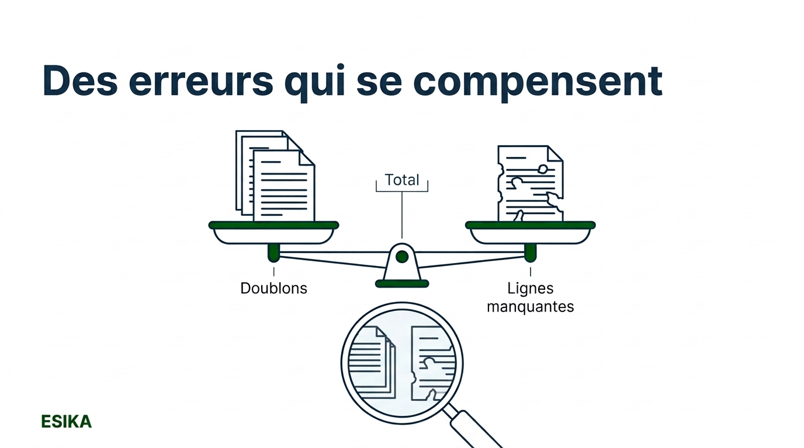
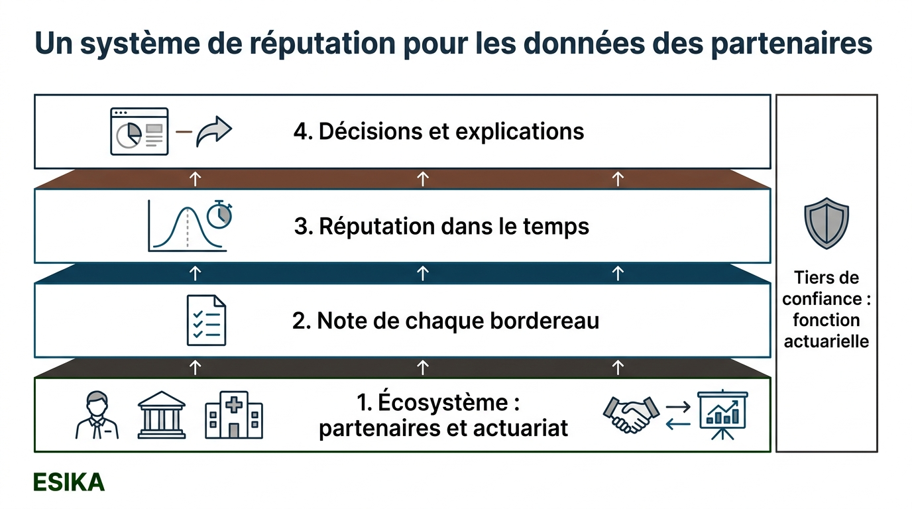
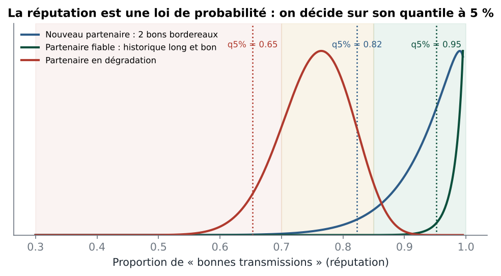
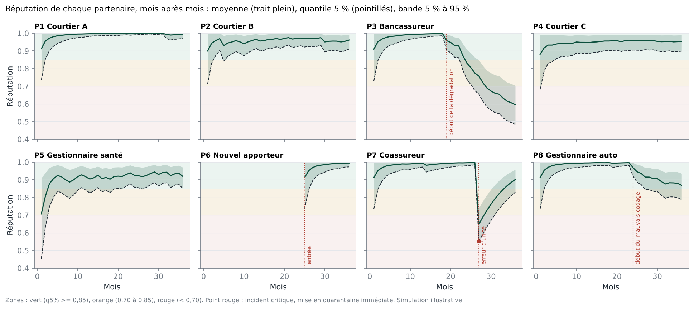
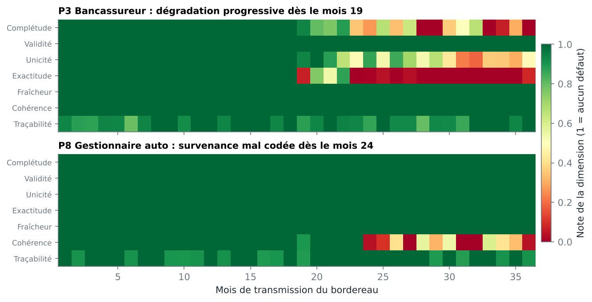
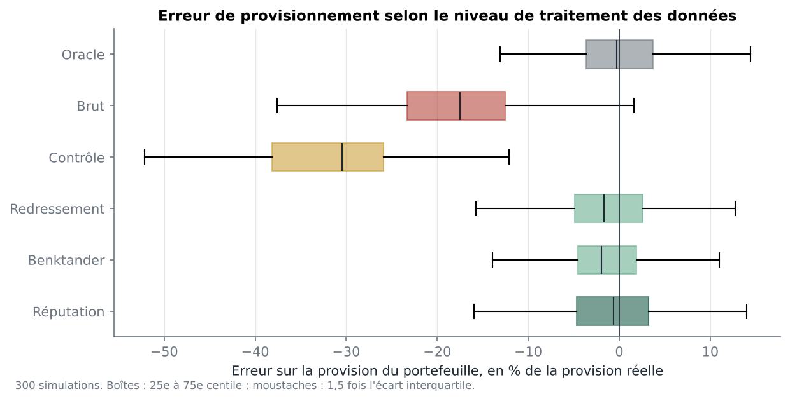
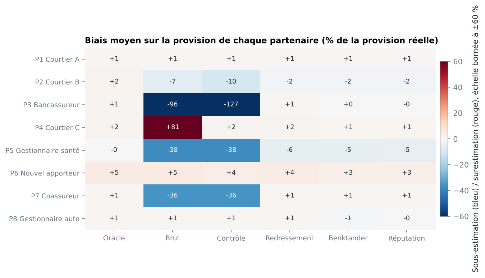
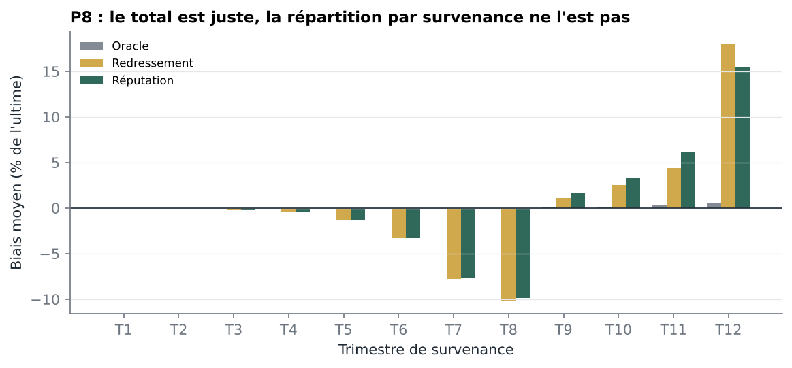

# Faire confiance aux données de ses partenaires : ce qu'un système de réputation change, et ne change pas, pour les provisions

*Transposer un travail de recherche récent sur la confiance dans le partage de données à un problème très concret de l'assurance : les bordereaux de courtiers, de bancassureurs et de gestionnaires délégués qui alimentent les provisions techniques. Avec une implémentation complète, des résultats chiffrés et quelques surprises.*



---

## 1. Le problème : des provisions calculées sur des données que l'on ne produit pas

Une part importante des sinistres d'un assureur n'est pas gérée par l'assureur lui-même. Les courtiers, les bancassureurs, les gestionnaires délégués en santé et les coassureurs apériteurs transmettent chaque mois un **bordereau** : la liste des sinistres payés, avec leur date de survenance, leur montant et leur identifiant.

L'actuaire construit ensuite ses triangles de développement à partir de ces lignes, puis estime les provisions. La qualité de la provision dépend donc directement de la qualité de données produites par des tiers.

Le cadre prudentiel est clair sur ce point. La directive Solvabilité II (article 82) demande aux assureurs de disposer de processus garantissant le caractère approprié, l'exhaustivité et l'exactitude des données utilisées pour calculer les provisions techniques.

En pratique, le dispositif le plus répandu reste le **contrôle ponctuel à réception** : on vérifie le bordereau du mois, on supprime les doublons évidents, on rejette les lignes incohérentes. Puis on oublie. Chaque bordereau est jugé seul, sans mémoire de ce que le partenaire a transmis les mois précédents.

Ce type de contrôle a deux angles morts :
- **les dérives lentes**, où chaque bordereau reste « acceptable » pris isolément ;
- **les défauts invisibles ligne à ligne**, comme une date de survenance systématiquement mal codée.

Cet article explore une piste issue de la recherche en informatique : traiter la confiance dans un partenaire comme une **réputation**, construite dans le temps à partir de preuves mesurables. Puis il teste, chiffres à l'appui, ce que cette approche apporte vraiment.

## 2. Ce que propose la recherche

Le point de départ est une revue de littérature publiée en août 2025 par Wenbo Wu et George Konstantinidis (Université de Southampton) : *Trust and Reputation in Data Sharing: A Survey* (arXiv 2508.14028).

Les auteurs étudient les **systèmes de gestion de la confiance et de la réputation** (en anglais *Trust and Reputation Management Systems*, TRMS). Ce sont les mécanismes qui permettent à des acteurs qui échangent des données de décider à qui se fier. On les connaît surtout par les notes des plateformes de commerce en ligne. Ils existent aussi dans les réseaux d'objets connectés, les véhicules communicants, les systèmes multi-agents, le *crowdsourcing* ou les réseaux sociaux.

> **Encadré : trois mots à ne pas confondre**
>
> Le survey distingue trois notions.
> - La **confiance** est la croyance subjective d'un acteur dans le fait qu'un autre se comportera comme prévu.
> - La **fiabilité** (*trustworthiness*) est la qualité objective qui rend un acteur digne de confiance. C'est ce que l'on cherche à mesurer.
> - La **réputation** est la perception collective de cette fiabilité, construite à partir de l'historique.
>
> Dans cet article, on mesure la fiabilité de chaque bordereau, puis on en déduit une réputation.

### Une architecture en quatre couches

Les auteurs proposent une architecture en quatre couches :
1. **l'écosystème** : fournisseurs de données, consommateurs, intermédiaires et tiers de confiance ;
2. **l'évaluation atomique** : chaque échange reçoit une note, à partir de signaux explicites (une plainte, une note) ou implicites (des contrôles automatiques de qualité, de conformité, de délai) ;
3. **l'inférence de réputation** : les notes successives sont agrégées dans le temps, avec un oubli progressif, des déclenchements sur événement et un modèle de calcul. Le survey distingue les modèles statistiques, à base de règles et de logique, à base de graphes, et d'apprentissage automatique ;
4. **les services** : des décisions, des tableaux de bord et des explications lisibles des scores.

### Le constat central

Sur plusieurs dizaines de systèmes analysés, l'évaluation porte presque toujours sur le **comportement des acteurs**, et presque jamais sur la **qualité de la donnée elle-même**. Pour les auteurs, c'est la thèse centrale de leur revue : la qualité de la donnée partagée n'est pas traitée comme un critère d'évaluation à part entière. Ils appellent donc à un score composite de confiance dans la donnée, construit sur des dimensions mesurables (exactitude, complétude, cohérence, fraîcheur, traçabilité, unicité) et pondéré selon l'usage qui sera fait de la donnée.

C'est une proposition, pas un résultat : le survey ne l'implémente pas et ne la chiffre pas, et l'assurance ne fait pas partie des domaines qu'il examine. C'est précisément ce que nous avons voulu tester.

## 3. La transposition à l'assurance



La correspondance des rôles est directe :
- **fournisseurs de données** : les partenaires (courtiers, bancassureurs, gestionnaires délégués, coassureurs) ;
- **consommateur** : l'actuariat, qui transforme les bordereaux en triangles puis en provisions ;
- **intermédiaire** : le système d'information qui reçoit, stocke et transforme les fichiers ;
- **tiers de confiance** : la fonction actuarielle et le contrôle interne, garants de la qualité des données utilisées.

Le survey définit l'exactitude comme la proximité entre une donnée et sa contrepartie « vraie ». La plupart des écosystèmes qu'il étudie n'ont pas accès à cette contrepartie. L'assurance, si : c'est le **flux comptable**. Les montants payés par un gestionnaire délégué ou réglés avec un courtier passent par les comptes. Le total d'un bordereau peut donc être rapproché d'un montant indépendant. Nous verrons que ce détail pèse lourd.

## 4. Couche 2 : noter chaque bordereau

Chaque bordereau mensuel reçoit une note entre 0 et 1 sur sept dimensions, reprises de la grille du survey et limitées à celles que l'on peut mesurer automatiquement :

| Dimension | Ce que l'on mesure | Tolérance (note nulle) |
|---|---|---|
| Complétude | part de lignes sans date de survenance | 10 % |
| Validité | part de lignes invalides (montant négatif, survenance postérieure au paiement) | 5 % |
| Unicité | part de lignes en double | 10 % |
| Exactitude | écart entre le total du bordereau (sans doublons) et le flux comptable du mois | 10 % |
| Fraîcheur | retard au-delà du délai contractuel de 10 jours | 20 jours de retard |
| Cohérence | dérive de la structure du bordereau par rapport à l'historique validé du partenaire | voir ci-dessous |
| Traçabilité | part de lignes sans identifiant de sinistre | 10 % |

Chaque note suit la même règle simple : `note = max(0, 1 - taux de défaut / tolérance)`. Les tolérances jouent le rôle d'un contrat de données entre l'assureur et son partenaire.

La **cohérence** mérite une explication. On compare chaque bordereau à l'historique du partenaire sur deux indicateurs :
- le niveau des montants, pour repérer par exemple un fichier transmis en milliers au lieu d'unités ;
- la part des paiements dont la survenance tombe le mois même du paiement. Quand un système remplace la date de survenance par la date de paiement, cette part grimpe brutalement.

Point important : **seuls les bordereaux jugés sains alimentent la référence**. Sans cette précaution, une dérive deviendrait en quelques mois « la nouvelle norme » et cesserait d'être détectée. Notons que cette dimension a déjà une mémoire : la note d'un bordereau n'est pas tout à fait « ponctuelle ».

Les sept notes sont combinées avec des poids qui dépendent de l'usage, comme le recommande le survey. Pour le provisionnement, les défauts qu'un nettoyage automatique corrige pèsent peu : les doublons (7 %) et les identifiants manquants (5 %). Les défauts qui faussent le triangle sans être visibles ligne à ligne pèsent lourd : l'exactitude (25 %), la complétude (20 %) et la cohérence (20 %). La fraîcheur compte pour 15 % et la validité pour 8 %.

```python
WEIGHTS_RESERVING = {"exactitude": 0.25, "completude": 0.20, "coherence": 0.20,
                     "fraicheur": 0.15, "validite": 0.08, "unicite": 0.07, "tracabilite": 0.05}
score = sum(WEIGHTS_RESERVING[d] * note[d] for d in WEIGHTS_RESERVING)
```

Chaque note est **explicable**. Le code produit automatiquement une phrase du type :

> Note 0,58. Principales causes : Exactitude (écart de 10,8 % avec le flux comptable, -25,0 pts) ; Complétude (6,5 % de lignes sans date de survenance, -13,0 pts).

C'est la couche « explicabilité » du survey, ramenée à sa forme la plus utile : dire au gestionnaire du partenariat **quoi** corriger.

Un incident grave, comme un écart comptable de plus de 30 % ou un montant total cinq fois supérieur ou inférieur à l'habitude, déclenche une **alerte immédiate** et la mise en quarantaine du bordereau.

## 5. Couche 3 : de la note à la réputation

Une note isolée oscille. Un bon partenaire peut avoir un mauvais mois, et un partenaire en dérive peut transmettre un bordereau correct entre deux mauvais. La réputation ajoute une mémoire.

> **Encadré : le modèle Beta, sans formule superflue**
>
> On cherche à estimer une proportion inconnue : la part des transmissions « bonnes » d'un partenaire. La loi Beta, définie par deux paramètres α et β, décrit ce que l'on sait de cette proportion.
> - α accumule les preuves favorables, β les preuves défavorables.
> - Un bordereau noté 0,9 ajoute 0,9 × poids à α et 0,1 × poids à β.
> - Un nouveau partenaire démarre avec α = β = 1 : on ne sait rien, toutes les valeurs sont également possibles.
>
> Avant chaque mise à jour, α et β sont multipliés par un **facteur d'oubli** (0,85 par mois, soit une mémoire effective d'environ sept mois). Les vieux bordereaux comptent moins, ce qui permet de suivre une dégradation récente et de laisser un partenaire se racheter. Ce mécanisme s'inspire du *Beta Reputation System* de Jøsang et Ismail (2002), qui relève des modèles à base de règles et de logique recensés par le survey.

```python
class BetaReputation:
    def update(self, score, critical=False):
        self.alpha *= self.lam            # oubli
        self.beta *= self.lam
        if critical:                      # incident grave : forte preuve défavorable
            self.beta += self.crit_weight
        else:
            self.alpha += self.weight * score
            self.beta += self.weight * (1 - score)
```

Le choix décisif est de **décider sur le quantile à 5 %**, et non sur la moyenne. Un nouveau partenaire avec deux bons bordereaux a une moyenne excellente, mais une loi encore très étalée : on ne le connaît pas, et son quantile à 5 % reste bas. Le **démarrage à froid**, identifié par le survey comme un problème classique, est ainsi traité sans règle ad hoc.



Trois zones en découlent :
- **vert** si le quantile à 5 % dépasse 0,85 ;
- **orange** entre 0,70 et 0,85 ;
- **rouge** en dessous de 0,70.

Pour le provisionnement, le quantile est converti en un **facteur de confiance Z**, qui passe linéairement de 0 (quantile de 0,70 ou moins) à 1 (quantile de 0,90 ou plus).

## 6. Couche 4 : décider

Une note ou une réputation n'a de valeur que si elle change une décision. Nous en testons trois.

1. **Alerter et prioriser.** Un partenaire en alerte déclenche une relance ciblée, avec l'explication des notes. Un incident critique met le bordereau en quarantaine.
2. **Redresser les montants.** Quand l'exactitude signale un écart avec le flux comptable, le bordereau est remis à l'échelle du montant comptable. Quand un bordereau manque à la clôture, il est estimé à partir du mois précédent, mis à l'échelle du flux comptable du mois.
3. **Pondérer les méthodes de provisionnement** par la confiance Z, détaillé dans l'encadré.

> **Encadré : Chain-Ladder, Bornhuetter-Ferguson, Benktander**
>
> **Chain-Ladder (CL)** projette les paiements déjà observés avec des coefficients de développement estimés sur le passé. La méthode suit fidèlement les données, défauts compris : un trou dans le dernier mois est multiplié par le coefficient de développement.
>
> **Bornhuetter-Ferguson (BF)** ajoute au déjà payé une part « restant à payer » calculée à partir d'une sinistralité a priori (sinistres attendus / primes). Elle est moins sensible aux données récentes, mais dépend de la qualité de l'a priori.
>
> **Benktander** combine les deux : ultime = Z × CL + (1 - Z) × BF, avec une crédibilité Z égale à la part déjà payée. Une survenance ancienne et presque entièrement payée suit ses données ; une survenance récente s'appuie davantage sur l'a priori.
>
> Dans notre implémentation, la partie CL utilise les coefficients propres à chaque partenaire, tandis que la part payée et la partie BF utilisent le profil de développement de l'ensemble du portefeuille. La variante « réputation » multiplie la crédibilité par le facteur de confiance du partenaire : Z = confiance × part payée. Avec une confiance de 1, on retrouve exactement le calcul témoin.

```python
def benktander_trust(tri, f_own, f_pattern, premium, elr, trust=1.0):
    cl = latest(tri) * cdf(f_own)[ages]
    bf = latest(tri) + (1 - 1 / cdf(f_pattern)[ages]) * elr * premium
    z = trust / cdf(f_pattern)[ages]        # confiance x part déjà payée
    return z * cl + (1 - z) * bf
```

## 7. Le protocole de simulation

Toutes les données sont **synthétiques**. Huit partenaires transmettent des bordereaux mensuels pendant 36 mois. Le portefeuille est à maturité au départ, avec quatre années de sinistres antérieurs simulées. Les sinistres sont réglés en un à six paiements, majoritairement dans les deux ans.

Chaque partenaire a un profil de qualité :

| Partenaire | Profil |
|---|---|
| P1 Courtier A | fiable |
| P2 Courtier B | fiable, petits défauts (doublons, identifiants manquants, quelques retards) |
| P3 Bancassureur | dégradation progressive dès le mois 19 : jusqu'à 15 % de lignes manquantes, 6 % de doublons, 8 % de survenances absentes |
| P4 Courtier C | doublons chroniques (6 %) |
| P5 Gestionnaire santé | retards fréquents (35 % des mois, jusqu'à 50 jours) |
| P6 Nouvel apporteur | entrée au mois 25, sans historique |
| P7 Coassureur | un bordereau transmis en milliers au mois 27 |
| P8 Gestionnaire auto | dès le mois 24, 25 % des lignes ont leur survenance remplacée par la date de paiement |

À la clôture (mois 36, plus 15 jours), on estime la charge ultime par trimestre de survenance avec six traitements, ajoutés couche par couche :

1. **Oracle** : données parfaites, Chain-Ladder. C'est l'erreur propre à la méthode.
2. **Brut** : bordereaux tels que reçus.
3. **Contrôle** : contrôle ponctuel sans mémoire. On supprime les doublons et les lignes invalides ou sans survenance, et on rejette un bordereau dont le total s'écarte de plus de 30 % du flux comptable.
4. **Redressement** : contrôle et remise à l'échelle par le flux comptable (couche 2).
5. **Benktander** : redressement et méthode de Benktander. C'est le **témoin** : la bonne pratique actuarielle, sans notion de confiance.
6. **Réputation** : même calcul, avec une crédibilité pondérée par la confiance du partenaire (couche 3).

Trois tests de sensibilité complètent le dispositif :
- un flux comptable bruité de 5 % par mois ;
- un a priori de sinistralité sous-estimé de 15 % ;
- l'absence de flux comptable détaillé, donc sans redressement.

L'expérience est répétée **300 fois**. On mesure l'erreur sur la provision, rapportée à la provision réelle, connue puisque les données sont simulées. Les écarts entre traitements sont testés sur les mêmes simulations (tests appariés).

Un repère d'ordre de grandeur : dans ce portefeuille à développement court, la provision représente environ 8 % de la charge ultime des trois exercices. Une erreur de 5 % sur les montants payés devient donc une erreur de plusieurs dizaines de pourcents sur la provision.

## 8. Résultats

### Détecter : la note suffit, la réputation stabilise



La figure montre l'évolution de la réputation sur une simulation type :
- les partenaires fiables restent au vert ;
- le nouvel apporteur démarre à l'orange faute d'historique (au rouge dans 8 % des simulations), et rejoint le vert dès le mois suivant son entrée dans la plupart des cas ;
- le coassureur chute au rouge le mois de son erreur d'unité, puis se rachète progressivement ;
- le bancassureur (P3) glisse vers l'orange puis le rouge ; le gestionnaire auto (P8) glisse vers l'orange et y reste.

Nous avons comparé trois façons de déclencher une alerte : le contrôle ponctuel, un simple seuil sur la note du bordereau (alerte dès qu'une note passe sous 0,85), et la réputation (alerte dès que le statut quitte le vert). Sur 300 simulations :

| | Début du défaut | Contrôle ponctuel | Seuil sur la note (médiane) | Réputation (médiane) |
|---|---|---|---|---|
| P3, dégradation progressive | mois 19 | au moins un rejet dans 12 % des simulations | mois 21 | mois 23 |
| P8, survenance mal codée | mois 24 | jamais | mois 24 | mois 27 |

Premier enseignement, qui nuance notre intuition de départ : **c'est la note du bordereau (couche 2) qui détecte**, et elle détecte plus tôt que la réputation. Le lissage du modèle Beta retarde l'alerte de deux à trois mois. Le contrôle ponctuel, lui, ne voit presque rien, car aucun bordereau pris seul ne franchit le seuil de rejet.

Les fausses alertes sur les partenaires sans défaut structurel sont comparables : 0 % des mois pour P1 et P6, moins de 1 % pour P4, environ 3 à 4 % pour P2, avec les deux méthodes.

Ce que la réputation apporte, c'est la **stabilité du signal**. Après le début de la dérive de P8, le seuil sur la note bascule en moyenne près de cinq fois entre alerte et absence d'alerte, et laisse plus de trois mois et demi sans alerte après la première. La réputation, une fois à l'orange, y reste. Pour un gestionnaire de partenariat, un statut qui ne clignote pas est plus facile à suivre et à justifier. Elle traite aussi naturellement le nouvel entrant et le retour en grâce après un incident.

La carte des notes montre pourquoi la couche 2 est si efficace : pour P3, l'exactitude et la complétude se dégradent ; pour P8, seule la cohérence s'allume.



### Provisionner : le rapprochement comptable fait l'essentiel



| Traitement | Biais moyen | Écart-type | Erreur quadratique moyenne |
|---|---|---|---|
| Oracle | +0,3 % | 6,0 % | 6,0 % |
| Brut | -17,8 % | 7,9 % | 19,5 % |
| Contrôle | -31,5 % | 7,7 % | 32,4 % |
| Redressement | -1,0 % | 5,9 % | 6,0 % |
| Benktander | -1,5 % | 5,2 % | 5,4 % |
| Réputation | -1,5 % | 5,6 % | 5,8 % |

*Erreur sur la provision du portefeuille, en % de la provision réelle, 300 simulations.*

**1. Le contrôle ponctuel aggrave l'erreur.** Les bordereaux bruts sous-estiment la provision de 18 % ; après contrôle, de 32 %. La carte des biais par partenaire éclaire ce paradoxe. Les doublons du courtier C gonflent sa provision de 81 %, les lignes manquantes du bancassureur réduisent la sienne de 96 % : au niveau du portefeuille, les deux erreurs se compensent en partie. Supprimer les doublons, ce qui est une bonne pratique, fait disparaître cette compensation (environ 8 points sur les 14 de dégradation). Le reste vient du bancassureur lui-même, dont on écarte les lignes sans survenance sans les remplacer. **Un total qui paraît juste peut cacher deux erreurs de sens opposé.**



**2. Le rapprochement avec le flux comptable fait l'essentiel du travail.** Le biais passe de -32 % à -1 %. Ce résultat doit être lu avec prudence, car notre flux comptable simulé est parfait : exact, ventilé par partenaire et par mois. Avec un flux bruité de 5 % par mois, le gain reste net (biais +1,2 %, erreur quadratique 7,2 %), mais il dépend entièrement de la disponibilité et de la qualité de ce flux.

**3. Benktander améliore légèrement la précision** par rapport au Chain-Ladder sur données redressées (erreur quadratique 5,4 % contre 6,0 %, écart significatif). C'est un résultat classique.

**4. Pondérer Benktander par la réputation n'aide pas, et peut nuire.** Sur données redressées, le biais est identique, mais l'erreur quadratique est un peu plus élevée (5,8 % contre 5,4 %, écart significatif). L'effet se concentre sur les partenaires signalés : pour le bancassureur, 15,1 % contre 12,7 %. La raison est simple. Une fois les montants redressés, les données d'un partenaire « peu fiable » sont déjà corrigées ; leur retirer du poids au profit de l'a priori ajoute du bruit sans retirer de biais.

Le test avec un **a priori sous-estimé de 15 %** est plus sévère encore. La pondération par la réputation porte alors le biais de -7,0 % à -10,0 %, et l'erreur quadratique de 8,5 % à 11,3 %. Déplacer le poids vers l'a priori n'a de sens que si l'a priori est bon.

À l'inverse, **sans flux comptable détaillé**, la pondération réduit un peu le biais (de -29,7 % à -26,8 %), mais les deux traitements restent très loin du compte. Bornhuetter-Ferguson s'appuie moins sur le développement des données récentes, mais il part toujours du montant déjà payé. Si ce montant est faux, aucune pondération ne le corrige.

### Le défaut le plus subtil : un total juste, une répartition fausse



Pour le gestionnaire auto (P8), la provision totale est presque exacte, quel que soit le traitement. Le détail par trimestre de survenance est pourtant faux. En pourcentage de la charge ultime de chaque trimestre :
- environ -8 à -10 % sur les trimestres 7 et 8 ;
- entre +14 et +17 % sur le dernier trimestre, selon le traitement.

Des paiements de sinistres anciens ont été rattachés à des survenances récentes. Les coefficients de développement s'ajustent et le total se compense.

Pour tout ce qui se pilote par exercice de survenance, c'est un vrai problème : tarification, suivi de la sinistralité par exercice, états réglementaires par exercice. Aucune méthode de provisionnement ne le corrige. Seule une **correction à la source**, déclenchée par l'alerte de cohérence, le peut.

## 9. Ce que cela signifie en pratique

Ces résultats contredisent en partie notre hypothèse de départ, et c'est tant mieux : ils indiquent où investir.
- **La couche 2, la note de chaque bordereau, porte l'essentiel de la valeur**, à la fois pour détecter et pour corriger. C'est la thèse centrale du survey (la qualité de la donnée doit devenir un critère à part entière), et elle se vérifie ici. Sa condition est de disposer d'une référence indépendante, ici le flux comptable, et d'un historique validé du partenaire.
- **La couche 3, la réputation, est un outil de gouvernance, pas d'estimation.** Elle donne un statut stable, explicable, qui gère le nouvel entrant et le retour après incident. Elle ne détecte pas plus vite que la note, et elle ne doit pas servir à pondérer les méthodes de provisionnement.
- **La couche 4 doit inclure une action humaine.** Le défaut le plus pernicieux de notre simulation ne se corrige qu'en retournant vers le partenaire.

Une mise en œuvre réaliste peut se faire en quatre étapes :
1. **Formaliser un contrat de données** avec chaque partenaire : champs obligatoires, délais, tolérances.
2. **Automatiser le rapprochement** bordereau par bordereau avec la comptabilité. C'est le gain le plus immédiat.
3. **Noter chaque bordereau** et alerter dès qu'une note passe sous le seuil, avec l'explication des causes.
4. **Suivre la réputation** de chaque partenaire dans un tableau de bord vert, orange, rouge, pour piloter les relances, la quarantaine et l'escalade vers la fonction actuarielle.

## 10. Limites

- **Les données sont simulées.** Les profils de défauts, les tolérances, les poids, le facteur d'oubli et les seuils sont illustratifs et devraient être calibrés sur l'historique réel de chaque portefeuille. D'autres réglages (oubli plus rapide, seuils différents) changeraient le délai de détection de la réputation.
- **Le flux comptable simulé est idéal.** En pratique, les règlements avec les intermédiaires passent souvent par des comptes courants agrégés, avec des décalages. Notre test bruité ne couvre ni les décalages temporels ni l'absence de ventilation par partenaire.
- **L'a priori de sinistralité est, dans le cas de base, centré sur la vraie sinistralité** (erreur aléatoire de 10 %). Cela favorise les méthodes qui s'appuient sur lui ; le test à -15 % montre la sensibilité.
- **Le redressement suppose que les lignes manquantes ressemblent aux lignes reçues.** Si un partenaire omet systématiquement les gros sinistres, la remise à l'échelle masque une partie du problème.
- **Les doublons sont détectés grâce à un identifiant technique de ligne.** Dans la réalité, il faut les rapprocher sur plusieurs champs, avec des erreurs possibles.
- **Le modèle ne couvre pas les comportements stratégiques** décrits par le survey : partenaire qui alterne bonnes et mauvaises périodes pour rester sous les seuils, ou qui change d'identité. Dans un contexte de bordereaux contractuels, ces risques sont faibles, mais pas nuls.
- **Ce dispositif ne remplace ni un audit des données ni le jugement de l'actuaire.** Il les oriente.

## Conclusion

Le survey de Wu et Konstantinidis conclut que les systèmes de confiance regardent trop les acteurs et pas assez la donnée. Transposé aux bordereaux d'assurance, ce constat se vérifie, et même plus nettement que nous ne l'attendions.

C'est la note de chaque bordereau, confrontée au flux comptable et à l'historique du partenaire, qui fait le travail : elle détecte les dérives dès leurs premiers mois et ramène l'erreur sur la provision de -32 % à -1 %. La réputation construite par-dessus n'améliore ni la vitesse de détection ni la provision. Elle apporte autre chose : un statut stable et explicable pour gouverner la relation avec chaque partenaire.

Autrement dit : faites confiance à la donnée pour le chiffre, et à la réputation pour la gouvernance.

---

*Le code complet (simulation, notation, réputation, provisionnement, tests et figures) est disponible dans le dépôt associé. Toutes les données sont synthétiques.*

**Références**
- Wu, W. et Konstantinidis, G. (2025). *Trust and Reputation in Data Sharing: A Survey*. arXiv:2508.14028.
- Jøsang, A. et Ismail, R. (2002). *The Beta Reputation System*. 15th Bled Electronic Commerce Conference.
- Directive 2009/138/CE (Solvabilité II), article 82 : qualité des données utilisées pour le calcul des provisions techniques.
- Mack, T. (2000). *Credible claims reserves: the Benktander method*. ASTIN Bulletin, 30(2).

*Esika : Financial Engineering & Process Optimization*
